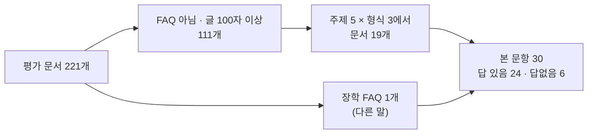

# 평가셋 첫 30문항 (M1 10번 실행 3단계)

> 상태: 문서 고르기 결정(2026-10-10, 사용자 결정) → 문항 계획 끝(질문·답 유형·태그·근거 위치, §4). 정답·인용은 색인 글을 받은 뒤 쓴다. 초안·자동 검증·이중 라벨링·휴먼 리뷰 결과와 실측값은 이 문서에 이어서 적는다.
> 기준: develop `462d790`, 대장 `Assets/corpus/ledger.sqlite`. 관련: 이슈 #129, `평가셋-설계-20261004.md` 결정 ①~⑦, ADR-0017~0020.

## 1. 첫 30문항으로 재는 것

설계에서 "첫 30문항에서 잰다"고 미뤄 둔 값이다. 첫 30문항은 이 값을 재는 시험 묶음이라, 나머지 220문항의 축소판이어야 한다.

| 잴 것 | 미뤄 둔 결정 | 쓰는 곳 |
|---|---|---|
| 문항당 휴먼 리뷰 시간, 고친 비율 | ④·⑥ | 2배 이상 걸리면 총 문항 수를 다시 정한다(⑥-9) |
| 이중 라벨링 불일치·헛걸음 비율(형식별) | ⑦·⑦-1·⑦-2 | 사람이 볼 문항 수 추정(약 100) 검증 |
| 긴 문서에서 근거를 못 찾는 비율 | ⑦-3 | '못 찾으면 위치 알려 주기'를 더할지 |
| 답 없는 문항 후보가 부재 확인으로 빠지는 비율 | ③ | 답 없는 문항 만드는 법 손질 |
| 답 유형이 애매한 문항 비율 | ① | 50문항쯤에서 10%를 넘으면 정의 손질 |

## 2. 결정 — 축소판: 문서 19개 + FAQ 1개에 주제·형식·답 유형을 고루 ✅ (2026-10-10 사용자 결정)

| 주제 | 문서(대장 ID · 형식 · 문항 수) |
|---|---|
| 입시 7 | 2027 신입생 모집요강 `ipsi/viewer/13` PDF 5(답 있음 3 · 답없음 2, 연도 시험 포함) · 농어촌 지원자격 확인서 `ipsi/viewer/14/f2` HWP 1 · 면접안내 `ipsi/page/420` HTML 1 |
| 학사 6 | 휴학ㆍ복학 `www/page/232` HTML 2 · 졸업학점 `www/page/236` HTML 1 · 증명서발급 `www/page/238` HTML 1 · 학생상벌에관한규정 `www/bbs/32/3000/a159854` PDF 1 · 답없음 1 |
| 장학·등록금 6 | 봄내장학생 선발 공고 `www/bbs/17/110559/a162863` HWP 2 · 국가장학금 가구원 동의 공지 `www/bbs/17/110438` HTML 1 · 학자금대출 `www/page/240` HTML 1 · FAQ 등록금·학생자치비 환불 `www/faq/579/qb75a1c6c59` 1(다른 말) · 답없음 1 |
| 학과·캠퍼스 생활 7 | 자격증(재료공학과) `mse/page/2741` · 주요 취업현황(항공경영학과) `asm/page/2141` · 교과목개요(전자공학과) `er/page/2957` · 학과소개(반도체기계정비학과) `maintenance/page/3385` · 도서관 `www/page/255` HTML 각 1 · 학생예비군 이동버스 탑승 계획 `www/bbs/33/110661/a162969` HWP 1 · 답없음 1 |
| 기타 4 | 실습실 정밀안전진단 결과보고서 `www/bbs/33/110446/a162771` PDF 1(369쪽) · 개인정보처리방침 `www/page/152` HTML 1 · 입찰공고 `www/page/541` HTML 1 · 답없음 1 |

| 나눔 | 값 |
|---|---|
| 답 유형 | 값 9 · 목록 5 · 절차 4 · 예아니오 3 · 설명 3 · 답없음 6 (250문항 목표 75·38·37·25·25·50을 30으로 줄임) |
| 근거 형식(답 있는 24) | HTML 15 · PDF 5 · HWP 4 |
| 긴 문서 | 모집요강 22쪽(32,876자) · 안전진단 369쪽(175,947자) |
| 제외 | 쉬운 문항(FAQ 제목 낱말 그대로)은 나중에 한 번에 만든다(시간 실측을 흐리지 않게) · 글 100자 미만 14개 · `[평가질문제외]` |

답없음 6개의 '가까운 문서'는 위 문서 안에서 고른다(입시 2는 모집요강). 문항별 답 유형은 초안을 쓸 때 문서 내용에 맞춰 위 비율 안에서 정한다.

**버린 대안**
- 모집요강 한 문서로 30문항: 초안은 가장 빠르지만 HTML·HWP 헛걸음과 주제별 리뷰 시간을 잴 수 없다.
- 221개에서 무작위: FAQ가 아닌 111개 중 64개가 학과·캠퍼스 HTML이라 PDF·HWP가 1~2개만 들어가 형식별 비율을 잴 수 없다.

**근거**
- [실측] 대장 조회(2026-10-10): FAQ가 아니고 글 100자 이상인 평가 문서 111개 — 학과·캠퍼스 69(HTML 64) · 기타 15 · 학사 13(PDF 7) · 장학·등록금 8(HWP 2) · 입시 6(PDF 2). FAQ 96.
- [실측] 2027 모집요강 묶음(`모집요강:신입생:2027`)의 지난해 판 `모집요강:신입생:2026`에 원본 파일이 있어, 자동 검증이 '지난해 값' 금지 값을 2026판 원문과 대조할 수 있다.
- [판단] 잴 값(§1)마다 표본이 최소 하나 이상 들어가도록 주제·형식·긴 문서·답없음을 채웠다. 형식별 표본(PDF 5, HWP 4)은 작아서 비율은 방향만 본다.

**네 관점**
- 서비스: 첫 실측값이 나머지 220문항 계획(문항 수, 사람이 볼 문항 수)에 바로 쓰인다.
- 비즈니스: 사용자 리뷰 시간 추정(약 3시간대)을 첫 묶음에서 검증한다.
- 유지보수: 학기 갱신 때도 "주제·형식·답 유형을 고루 담은 작은 묶음으로 먼저 잰다"는 같은 절차를 쓴다.
- 확장: 문서 묶음이 나중에 개발셋·테스트셋을 나누는 단위라, 첫 30문항이 한 묶음에 몰리지 않게 문서 20개로 흩었다.

**확신도**: 중간~높음. **확인 시점**: 30문항 초안을 쓴 뒤 실제 분포(주제·형식·답 유형)를 자동 검증의 분포 보고로 대조한다.

## 3. 진행 중 발견한 것

| 발견 | 영향 | 처리 |
|---|---|---|
| 자동 검증은 색인 글(`Assets/eval/index_text/`)이 없으면 원본 파일에서 뽑은 글로 인용을 대조한다 | 원본 글 추출기가 PDF는 pypdfium2, HWP는 수집기 `hwp.py`라 이중 라벨링이 읽는 글과 같다. 원본 글로 초안을 쓰면 PDF·HWP 문항(답 있는 24개 중 9개)에서 '다른 읽기'가 깨지고, 색인 글을 받은 뒤 인용이 안 맞아 다시 쓸 수 있다 | 초안 전에 색인 글을 받을지 다음 결정으로 묻는다 |
| 분할 명령(`evalset split`)은 실행할 때마다 모든 문항을 처음부터 다시 나눈다 | 30문항씩 쌓으며 나누면 앞서 나눈 결과(테스트셋 표본 등)가 바뀔 수 있다 | 첫 30문항 휴먼 리뷰 전에 정한다 |
| 용어 통일(PR #143·#144) 때 설계·파일 형식 문서에 오기가 생겼다(이름 바꿈 설명 문장, 예시의 옛 칸 이름 `refusal`·`machine`, 답 유형 '거절') | 문서를 읽는 사람이 칸 이름을 헷갈린다 | 이 작업의 문서 PR에서 고친다 |

## 4. 문항 계획 (2026-10-10, 데스크탑 꺼짐)

데스크탑을 켤 수 없는 동안 원본 글(수집기 추출)로 30문항의 질문·답 유형·태그·근거 위치만 정했다. 정답·인용·금지 값은 쓰지 않았다. 원본 글로 정답을 쓰면 PDF·HWP 문항이 이중 라벨링과 같은 글을 보게 되기 때문이다(§3). 계획 파일은 학교 글이 들어 있어 `Assets/eval/work/`에 두고 커밋하지 않는다.

| 나눔 | 계획 |
|---|---|
| 답 유형 | 값 9 · 목록 5 · 절차 4 · 예아니오 3 · 설명 3 · 답없음 6(가까운 빈칸 4 · 잘못된 전제 2) |
| 주제 | 입시 7 · 학사 6 · 장학·등록금 6 · 학과·캠퍼스 7 · 기타 4 |
| 근거(답 있는 24) | HTML 15 · PDF 5 · HWP 4 / 표 근거 11 · 글 근거 13 |
| 태그 | 연도 시험 2 · 다른 말 7 · 조건 9 · 비교·계산 1 · FAQ 근거 본 문항 1 |

**계획 중 바꾼 문서**: §2 표의 처음 고른 문서 중 둘을 바꿨다. 교과과정표(`cs/page/1768`)는 학년도·학년 탭 중 어느 표인지 글에 나오지 않아 답이 하나로 정해지지 않는다. 주요취업처(`gisup/page/3189`)는 회사 56곳의 행마다 대표자 이름(개인정보)이 있다. 같은 주제·형식·표 근거인 재료공학과 자격증 표(`mse/page/2741`)와 항공경영학과 취업현황 표(`asm/page/2141`)로 바꿨다.

**원본 글에서 본 것**
- 2027 모집요강의 PDFium 글에는 낱말 사이마다 `U+FFFE` 글자가 끼어 있다(2026판에는 없음). 색인 글(OpenDataLoader)과 다를 것이므로 인용은 색인 글에서 뽑는다. 이중 라벨링이 받는 PDF 글(쪽 그림 + PDFium 글)에도 같은 글자가 들어가는지 첫 실행에서 본다.
- 2027 모집요강 모집인원 표와 2026판·학과 사이트의 학과 이름이 한 곳 다르다(이름이 바뀐 것으로 보임). 답이 하나로 정해지지 않을 수 있어 이번에는 묻지 않았다.

**다음**: 데스크탑을 켜고 `evalset export-index`로 색인 글을 받는다 → 그 글로 정답·필수 사실·허용 표기·금지 값·인용을 채운다 → `validate` → 답 없는 문항 부재 확인 → `double-annotate`.
