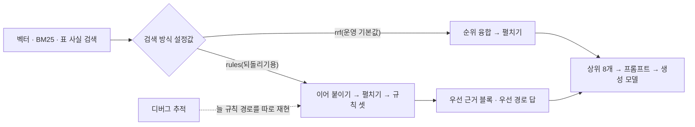
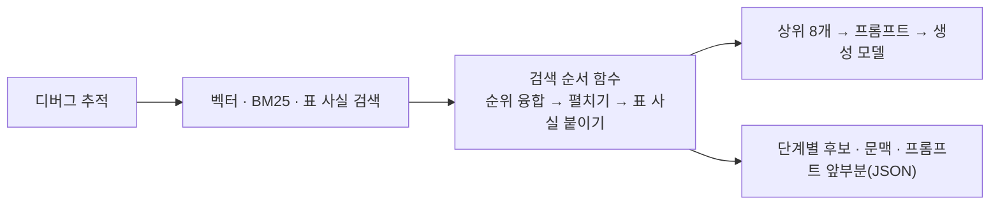

# M2 1단계 마무리 — 사람이 만든 규칙 경로 코드 삭제와 디버그 추적 맞추기 (#169, 2026-10-16)

> 운영 기본값이 순위 융합으로 바뀐 뒤(#170)에도 되돌리기용으로 남겨 둔 규칙 경로를 지워, AI 서버의 검색 순서를 한 경로로 만들었다. 운영 답이 바뀌면 안 되는 정리라서, 프롬프트 글자 비교와 데스크탑 개발셋 재실행으로 확인했다.
> 관련: 이슈 #169, ADR-0032(결과의 2026-10-16 줄), `검색개선-설계-20261014.md` §3 1단계, `1단계-순위융합-운영전환-20261015.md`, `2단계-상위k-20261015.md`

## 1. 결론

- 되돌리기용 규칙 경로(규칙 셋·우선 경로 답·검색 방식 설정값)와 관련 점검 스크립트·테스트를 지웠다. `main.py` 7,243 → 6,348줄. 디버그 추적(`/debug/rag-trace`)도 운영 질의와 같은 검색 순서 함수를 쓴다. [코드]
- 지운 코드는 운영 답에 영향을 주지 않았다. 프롬프트 조립 함수가 옛 코드와 입력 45조합에서 글자까지 같고, 데스크탑에서 같은 설정으로 다시 돌린 개발셋 205문항의 지표가 2단계 상위 8개 실행과 모두 같다(정답률 83.5%, 오답률 1.3%, 과잉 거절 10.7%, 한쪽만 맞은 문항 0). [실측]
- 다시 돌려 생긴 차이(프롬프트 9문항, 답 4문항)는 모두 지운 코드 바깥에서 나왔다. 근거 꼬리표를 고르는 함수가 길이가 같은 단어의 순서를 정하지 않아 서버를 띄울 때마다 바뀌는 것(6문항)과, 벡터 검색 원래 결과의 차이(3문항)다. 프롬프트가 같은 196문항은 답도 모두 같았다. [실측·코드]
- 이 재실행은 2단계 보고서가 권한 '같은 설정 한 번 더'를 겸한다. 한 번 실행끼리 판정이 갈린 문항은 0개였다(이전 재실행 비교에서는 3개). 2단계의 상위 5 → 8 정답률 차이(갈린 문항 2 / 10)는 이 흔들림 폭보다 크다. [실측·판단]

## 2. 용어

| 용어 | 뜻 | 지금 코드에서 |
|---|---|---|
| 순위 융합(reciprocal rank fusion, RRF) | 검색기 여러 개의 결과를 순위만 보고 1/(60+순위)를 더해 한 줄로 세우는 방법 | `_fuse_reciprocal_rank` |
| 규칙 경로(rules) | 사람이 만든 규칙 셋(표 값 질문 우선 거르기·규칙 재순위·질문 맞춤 근거 좁히기)으로 순서를 정하고, 확실하다고 보면 모델 없이 근거를 그대로 답으로 붙이던 옛 경로 | 이번에 지움 |
| 우선 경로 답(priority answer) | 생성 모델을 거치지 않고 표 사실·질문 맞춤 근거를 답 문장으로 바로 만든 답. 평가 기록의 `answer_path`가 `priority_*` | 이번에 지움(옛 실행 기록에는 남아 있고 채점기는 그대로 읽는다) |
| 검색 순서 함수 | 검색기 셋의 결과를 순위 융합 → 표 사실을 부모 청크로 펼치기 → 질문에 맞는 표 사실 붙이기 순으로 세우는 함수. 운영 질의와 디버그 추적이 함께 쓴다 | `_order_retrieval_results`(새로 만듦) |
| 디버그 추적(`/debug/rag-trace`) | 답을 만들지 않고 검색 단계별 후보·문맥·프롬프트 앞부분을 JSON으로 돌려주는 개발용 API | `_trace_query_retrieval` |
| 평가 기록(`eval_trace`) | 평가 요청(`include_eval_trace`)에만 붙는, 그 답을 만든 실행의 단계별 후보·문맥·프롬프트 | `_record_eval_stage` |

## 3. 바꾸기 전과 후

바꾸기 전: 운영 질의는 설정값(`AI_RETRIEVAL_MODE`)에 따라 두 갈래였고(운영 기본값은 이미 순위 융합), 디버그 추적은 설정값과 상관없이 늘 규칙 경로를 따로 재현했다.

바꾼 뒤: 갈래가 없고, 디버그 추적도 운영 질의와 같은 검색 순서 함수를 부른다.

### 바꾸기 전 위험 — 디버그 추적이 운영과 다른 후보를 보여 줌 [코드]

1단계(#170) 뒤 운영은 순위 융합으로 답하는데, 디버그 추적은 규칙 함수를 직접 불러 규칙 경로의 후보를 보여 줬다. 가나대학 예시로, 「컴퓨터공학과 1학기 등록금은?」을 물으면 운영은 순위 융합 상위 8개로 답하지만 디버그 추적은 '표 값 우선 거르기 → 규칙 재순위 → 근거 좁히기'를 거친 후보와 '우선 표 근거' 블록을 보여 준다. 운영 답이 왜 그렇게 나왔는지를 이 도구로는 추적할 수 없었다.

## 4. 바꾼 것 [코드]

| 곳 | 바꾼 것 | 이유 |
|---|---|---|
| `ai-server/main.py` | 규칙 함수 셋(`_prioritize_query_results`·`_rerank_by_query_analysis`·`_focus_candidates_with_query_evidence`), 우선 경로 답과 우선 근거 블록 함수, 그것만 쓰던 점수·도움 함수·상수 — 정의 30개(586줄)와 상수 4개를 지움. 7,243줄 → 6,348줄 | ADR-0032 결정 2: M2 2단계 뒤 지운다. 호출 관계로 찾아 운영 경로에서 닿지 않는 것만 지웠다 |
| `ai-server/main.py` | 검색 방식 설정값(`AI_RETRIEVAL_MODE`)·요청 칸(`retrieval_mode`)·설정값 읽기 함수(`_env_choice`)를 지움 | 고를 경로가 하나뿐이다. 옛 클라이언트가 칸을 보내도 무시하고 순위 융합으로 답한다 |
| `ai-server/main.py` | 검색 순서 함수 `_order_retrieval_results`를 새로 만들어 `_prepare_query`(운영 질의)와 `_trace_query_retrieval`(디버그 추적)이 함께 쓰게 함 | 같은 개념(검색 순서)이 두 곳에 있으면 다시 어긋난다. 이번 위험이 바로 그 경우였다 |
| `ai-server/main.py` | 평가 기록에서 규칙 단계 셋(`prioritized`·`reranked`·`focused`)을 뺌. 디버그 추적에서 규칙 단계 둘·우선 근거 블록·규칙 점수(`scores`)를 뺌 | 순위 융합 경로에서는 '펼친 뒤'와 같은 내용이라 기록만 커졌다. 채점기는 이 단계를 쓰지 않는다(`metrics.py`의 `RETRIEVAL_STAGES`) |
| `ai-server/main.py` `_build_rag_prompt` | 우선 근거 인자 두 개를 지움. 출력 글자는 그대로 둠 | 아래 '남긴 흔적' |
| `.env.example`·`docker-compose.yml` | `AI_RETRIEVAL_MODE` 줄을 지움 | 쓰지 않는 설정 |
| 점검 스크립트·테스트 | `check_query_evidence_priority.py`와 우선 근거 골든 3건·테스트를 지움. 표 사실 점검 두 개는 지운 함수 대신 답 경로가 쓰는 '표 검색 정보' 재료(`matched_table_facts`)에 행 이름이 남는지 보게 바꿈 | 규칙 경로 전용 검사는 대상이 없다. 표 사실 행 이름 검사는 답 경로에도 필요한 검사라 대상을 바꿔 남겼다 |
| `tools/corpus` 평가 실행기 | `--retrieval-mode`를 지우고 요청에 검색 방식을 넣지 않음. 실행 기록에는 `retrieval_mode: rrf`를 계속 남김 | 규칙 경로로 돈 옛 실행 폴더(값이 `rules`이거나 칸이 없는 #168 전 기록)에 지금 답을 이어 붙이지 않게 한다 |

### 안전 경계 — 바꾼 것과 안 바꾼 것

| 바꾼 것 | 안 바꾼 것 |
|---|---|
| 운영에서 이미 쓰지 않던 규칙 분기 | 운영 프롬프트 글자, 순위 융합 순서, 상위 8개·문맥 12,288 |
| 디버그 추적의 순서(운영과 같게)와 응답 칸 | 색인·업로드·청크·출처 응답 |
| 평가 기록의 규칙 단계 셋(같은 내용) | 채점기 — 옛 실행 기록의 우선 경로 답은 지금처럼 '모델 생성 아님'으로 센다 |

### 남긴 흔적 — 프롬프트 안의 옛 문구

프롬프트의 [답변 직전 확인]에는 '우선 표 근거가 있으면…'·'우선 질의 근거가 있으면…' 두 줄과 우선 근거 블록 자리의 빈 줄이 남아 있다. 이제는 그 블록이 나오지 않으므로 뜻 없는 문구지만, 지우면 프롬프트 글자가 바뀌어 답이 달라질 수 있다. 이번 작업은 '답이 바뀌지 않는 정리'로 한정하고, 이 문구는 프롬프트를 바꾸는 작업(모델 선정 계획 ①·M2 5단계)에서 측정과 함께 정리한다(`_build_rag_prompt` 주석에 적음).

## 5. 확인

### 테스트 [실측]

- ai-server 84 passed(1 skipped), tools/corpus 193 passed(가나대학 합성 데이터). ai-server는 규칙 경로 테스트·골든을 지우고 아래 새 테스트를 더해 100 → 84개가 됐다.
- 새로 붙인 테스트: 운영 질의가 순위 융합 순서를 따름, 디버그 추적과 운영 질의의 후보·순서·문맥·프롬프트가 같음, 요청에 검색 방식 칸이 없음, 실행기가 검색 방식을 보내지 않고 규칙 경로 옛 실행 폴더에 이어 붙이지 않음.
- 변이 확인 5/5: 디버그 추적을 옛 방식(이어 붙이기)으로, 운영 질의 순서를 뒤집음, 요청 칸 되살림, 실행기가 검색 방식을 다시 보냄, 칸 없는 옛 기록을 순위 융합으로 봄 — 하나씩 망가뜨리자 모두 테스트가 실패했고, 망가뜨린 파일만 되돌렸다.
- 정적 검사(pyflakes): 바꾼 파일에 쓰지 않는 이름·import 0.

### 프롬프트 글자 비교 [실측]

- 옛 코드(develop `e55e6a0`)의 `_build_rag_prompt`를 그대로 떼어 와 새 함수와 같은 입력 45조합(관리자 프롬프트 5 × 근거 글 3 × 질문 3)에 넣었더니 출력이 모두 글자까지 같았다. 기본·관리자 프롬프트 골든 파일 2건(`c_no_priority`·`e_custom_system`)도 바뀌지 않았다.

### 데스크탑 [실측]

- 2026-10-16, 이 브랜치(`bb9c364`), 기본 compose + GPU + 평가용 덮어쓰기. 데스크탑 `.env`에서 `AI_RETRIEVAL_MODE` 줄을 지움(원본 `.env.bak-20261016-before-169-cleanup`). 생성 모델 Gemma 4 12B·상위 8개·문맥 12,288, GPU 11,794 / 12,282MiB(96%, 두 모델 모두 100% GPU).
- **디버그 추적 = 운영 질의**: 개발셋 질문 6개에서 디버그 추적과 `/query`의 최종 후보·문맥·프롬프트 앞부분이 모두 같았다(6 / 6).
- **찾은 것 — 같은 질문의 첫 임베딩만 미세하게 다름**: 처음에는 3문항 중 2문항에서 두 경로의 후보가 달랐다. 단계별로 보니 BM25·표 사실 결과는 같고 벡터 검색 결과만 달랐는데, 같은 디버그 추적을 세 번 부르자 첫 호출만 질문 벡터와 거리가 달랐다(가장 가까운 청크 거리 0.826 대 0.836, 두 번째·세 번째 호출은 같음). 거리가 거의 같은 두 후보(0.8981 대 0.8984)의 순서가 바뀌어 상위 후보가 갈린 것이다. 같은 질문을 한 번 먼저 불러 두고 비교하면 두 경로가 같았다(위 6 / 6). 코드 경로 차이가 아니라, 임베딩 서버(Ollama)가 같은 입력을 다시 계산할 때 앞 계산을 재사용해 계산 경로가 바뀌는 것으로 본다[판단]. `docs/development/알려진-문제.md`에 적었다.
- **개발셋 205문항 재실행**(실행 폴더 `Assets/eval/runs/20261016-m2-169-cleanup-gemma4-12b`, 실패 0, 프롬프트 잘림 0, 애매 0 — 사람·Claude 판정 없이 채점): 2단계 상위 8개 실행(`20261015-exp-s2-k8-gemma4-12b-16384`, 생성 문맥 16,384)과 문항별로 비교했다.

| 비교 | 같은 문항 |
|---|---|
| 프롬프트 | 196 / 205 |
| 최종 후보(상위 8개) | 202 / 205 |
| 답 | 201 / 205 |
| 지표(본·쉬운 문항의 정답률·오답률·과잉 거절·출처 정확도·답없음 거절·안내 충실도) | 모두 같음, 한쪽만 맞은 문항 0 |

| 프롬프트가 다른 원인 | 문항 | 그중 답이 바뀐 문항 | 이번 변경과 관계 |
|---|---|---|---|
| 근거 꼬리표 단어가 바뀜(최종 후보는 같음) | 6 | 2 | 없음 — 꼬리표를 고르는 `_extract_item_label`은 고치지 않았다. 질문 단어를 길이로만 정렬해 길이가 같은 단어끼리는 파이썬 집합 순서를 따르는데, 이 순서는 해시 씨앗(PYTHONHASHSEED)마다 다르다(씨앗 1~4는 「국가」, 5~6은 「장학」이 먼저 — 재현). AI 서버 컨테이너에는 씨앗 설정이 없다 |
| 벡터 검색 원래 결과가 달라짐 | 3 | 2 | 없음 — 이번에 바꾸지 않은 벡터 검색 단계의 출력부터 달랐다. 임베딩 수치 차이로 본다[판단] |

- 프롬프트가 같은 196문항은 답도 모두 같았다. 생성 문맥이 16,384에서 12,288로 달라도 답이 바뀌지 않았다는 뜻이다(2단계 보고서의 '문맥 차이는 답을 바꾸지 않음'을 직접 확인).
- 답이 바뀐 4문항은 두 실행 모두 '맞음'이다(새 실행은 4문항 모두 규칙 채점으로 정해짐). 한 단어 꼬리표 차이만으로 답 문장이 바뀐 문항이 2개 있었다 — 생성 모델이 프롬프트의 작은 차이에도 문장을 바꾼다.
- 응답 시간(첫 문항 제외): 중앙 4.45초, 상위 5% 8.22초, 최대 13.28초(2단계 상위 8개는 4.58·9.16·13.46초).

## 6. 한계

- 개발셋 한 번 재실행이다. 테스트셋은 묻지 않았다(ADR-0018).
- 디버그 추적과 운영 질의가 같다는 실데이터 확인은 6문항(같은 질문을 한 번 먼저 부른 조건)이다. 나머지는 단위 테스트(가짜 검색 결과로 두 경로를 비교)로 잠갔다.
- 프롬프트에 남은 옛 문구 두 줄은 지우지 않았다(§4 '남긴 흔적').
- 찾은 흔들림 두 가지는 고치지 않았다. 꼬리표 순서는 고치면 일부 문항의 프롬프트가 바뀌므로 '답이 바뀌지 않는 정리'인 이 작업과 나눠 별도 작업으로 넘겼다. 첫 임베딩 차이와 재실행의 벡터 결과 차이는 임베딩 서버 쪽이라, 비교하는 방법만 `docs/development/알려진-문제.md`에 적었다.

## 7. 다음

- 이슈 #169는 이 PR로 끝난다(작업 범위 네 항목 모두).
- M2 3단계(재순위): 평가 기록에 검색기별 점수·표 사실의 부모 청크 id를 더하는 일부터. 이번에 검색 순서가 `_order_retrieval_results` 한 곳으로 모였으므로 재순위도 이 함수 뒤에 붙인다.
- 프롬프트 안의 옛 문구(§4 '남긴 흔적')는 모델 선정 계획 ①의 프롬프트 변경 때 함께 정리하고 잰다.
- 근거 꼬리표 순서 고치기(별도 작업으로 제안함): 길이가 같은 단어의 순서를 정해 서버를 다시 띄워도 프롬프트가 같게 한다.

## 8. 학습 포인트

- **되돌리기 장치의 수명**: 새 경로로 바꿀 때 옛 경로를 설정값으로 남기면 운영 중 문제가 생겼을 때 바로 되돌릴 수 있다(기능 플래그). 대신 두 경로를 함께 유지하는 비용이 생기고, 이번처럼 한쪽 도구(디버그 추적)만 옛 경로를 따라가는 어긋남이 생긴다. 그래서 되돌릴 일이 없어졌다는 근거(새 경로의 측정 결과, 옛 경로 기준 기록 보존)가 생기면 지운다.
- **'답이 바뀌지 않는 리팩토링'을 증명하는 법**: 단위 테스트만으로는 부족하다. ① 출력 글자를 옛 코드와 직접 비교(프롬프트 45조합), ② 골든 파일이 바뀌지 않음, ③ 실제 데이터로 같은 설정 재실행해 프롬프트가 같은지 비교, ④ 남은 차이가 코드 때문인지 실행 환경 때문인지 단계별로 가른다(이번에는 바꾸지 않은 단계에서 시작한 차이 — 첫 임베딩 수치, 집합 순서에 따라 바뀌는 꼬리표).
- **같은 개념은 한 곳에**: 운영 질의와 디버그 추적이 순서 정하기를 각자 갖고 있어서 어긋났다. 공용 함수 하나로 모으고 '두 경로의 결과가 같다'를 테스트로 잠갔다.
- 면접 문장 예: "검색 순서를 사람이 만든 규칙에서 순위 융합으로 바꾼 뒤, 되돌리기용으로 남겨 둔 규칙 경로 약 900줄을 지웠습니다. 운영 답이 바뀌면 안 되는 작업이라 프롬프트를 옛 코드와 글자 단위로 비교하고, 같은 평가셋 205문항을 다시 돌려 지표가 같고 프롬프트가 다른 9문항은 모두 지운 코드 밖에서 생긴 차이임을 단계별로 갈랐습니다. 그 과정에서 서버를 띄울 때마다 프롬프트 한 줄이 바뀌는 숨은 비결정성(파이썬 집합 순서)과 첫 임베딩 차이를 찾아 문서와 후속 작업으로 남겼습니다."
