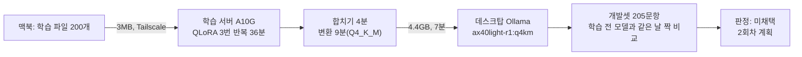

# M2 학습 1회차 결과 — A.X 4.0 Light QLoRA, 개발셋 전후 비교

> 상태: 끝(2026-11-03). 이슈 #223. 계획 `1회차-학습-계획-20261103.md`, 실행 절차 `tools/train/README.md`.

## 1. 결론

- 1회차 학습 모델(`ax40light-r1:q4km`)은 **틀린 답을 크게 줄였지만, 맞던 답까지 거절해 정답률이 떨어졌다.** ADR-0035 채택 규칙으로 **미채택**이다. 운영 모델은 `ax40light:q4km` 그대로 둔다.
- 주 지표: 오답률 8.1% → 2.0%(짝 비교 10 대 1, p=0.012, 의미 있게 나음). 답없음 거절 82.1% → 100%(5 대 0, p=0.063, 같은 수준).
- 나빠진 것: 정답률 80.2% → 70.2%(16 대 4, p=0.012), 과잉 거절 5.8% → 18.2%(0 대 15, p=0.0001). 채택 규칙의 '정답률이 의미 있게 나빠지지 않는다'를 어긴다.
- ADR-0033 운영 선(오답률 5% 이하, 답없음 거절 90% 이상)은 넘는다. 그래서 2회차는 '틀린 답을 줄인 효과는 지키고 과잉 거절을 되돌리는 것'을 목표로 한다(7절).
- 학습, 합치기, 변환, 데스크탑 등록, 평가까지 한 바퀴가 스크립트로 돌아간다. 도중에 도구 문제 셋을 찾아 고쳤다(3절).

## 2. 무엇을 했나

| 항목 | 값 |
|---|---|
| 데이터 | 1회차 학습 파일 200개(사실 40, 표 40, 절차 35, 거절 안내 30, 여러 문서 25, 일부만 있음 20, 범위 밖 거절 10). 검증 20개는 종류 비율대로 따로 뗌 |
| 길이 | 채팅 틀을 씌운 입력+답 최대 6,775토큰, 중앙 3,593토큰. 8,192토큰을 넘는 예시 0 |
| 학습 | QLoRA(4비트 NF4 원본 + LoRA r=16, alpha=32, 모든 선형 층), 답 부분만 학습, 학습률 1e-4 코사인, 3번 반복, 배치 1 × 누적 8 = 69걸음 |
| 검증 손실 | 0.321(1번째 반복) → 0.294(2번째) → 0.291(3번째). 가장 낮은 3번째 반복의 어댑터를 남김 |
| 자원 | 학습 2,136초(전체 38분), 최대 GPU 메모리 8.07GiB, CPU 메모리 최대 12.9GB(서버 15GiB) |
| 합치기·변환 | bf16 원본에 합치기 3분 55초, llama.cpp b11312로 Q4_K_M 변환 9분 18초(4,226MiB). 채팅 틀 확인 6토큰(운영 모델과 같음) |
| 학습 서버 | 학교가 준 AWS g5.xlarge(A10G 24GB), 미국 동부. 리전 결정은 ADR-0010 변경 메모 |

## 3. 한 바퀴 시험에서 고친 것

| 문제 | 증상 | 고친 것 |
|---|---|---|
| 토큰 수를 잘못 셈 | Transformers 5의 `apply_chat_template`이 dict가 아닌 `BatchEncoding`을 돌려줘, '안녕하세요'를 키 개수(2)로 세고 채팅 틀 확인에서 멈춤 | `Mapping`으로 가려 토큰 번호를 꺼냄. 테스트 추가, 일부러 되돌리면 테스트가 잡음 |
| 합친 폴더를 변환 도구가 못 읽음 | Transformers 5가 설정·토크나이저를 새 형식으로 다시 씀. 변환 이미지의 Transformers 4.57이 토크나이저를 못 읽고(`'list' object has no attribute 'keys'`), 설정의 `rope_theta`가 `rope_parameters` 안으로 옮겨져 RoPE 값을 놓칠 위험 | 합친 폴더에서 가중치 밖 파일은 원본 그대로 둠(가중치 이름 339개가 원본과 같은지 먼저 확인). 변환 결과 `rope.freq_base` 1,000,000 확인. 테스트 2개 |
| AMI의 GPU 라이브러리를 덮어씀 | Deep Learning AMI는 cuBLAS 13.8을 pip 기록 없이 둔다. 학습 라이브러리를 깔 때 pip가 PyTorch가 요구하는 cuBLAS 13.1을 같은 자리에 덮어써 TransformerEngine(peft가 불러옴)이 깨짐 | 판을 고정한 목록을 `--no-deps`로 깔게 바꿈(`tools/train/requirements.txt`). 서버는 같은 날 올라온 판(13.8.0.4)으로 되돌려 확인 |

## 4. 평가 방법

- 조건: 개발셋 205문항(평가셋 v3, 본 149 = 답 있음 121 + 답없음 28, 쉬운 56), 색인 `repro-20261010-develop15e776c`, 근거 8개, 순위 융합, 온도 0, 생성 문맥 12,288, 프롬프트 날짜 줄 켬(`--as-of 2026-10-31`). AI 서버 이미지는 학습 전 기준선 실행과 같은 판이고 생성 모델만 바꿨다.
- 같은 날 다시 잼: 프롬프트가 글자까지 같은 개발셋 10문항에서도 학습 전 모델의 답 글자가 7문항 달랐다(Ollama의 계산 재사용·연산 순서). 그래서 학습 전 모델도 같은 날 같은 서버 상태로 다시 재서 짝 비교했다. 어제 기준선과 오늘 학습 전 모델의 판정은 149문항 중 7문항이 갈렸다(측정 잡음). 학습 전후는 같은 149문항 중 31문항이 갈려 잡음보다 크다(쉬운 세트까지 205문항으로 세면 잡음 9, 학습 전후 35).
- 판정: 규칙 채점기 → '애매'와 의심 답은 판정 지침(`judge_instructions.md`)으로 판정. 답없음 문항은 바르게 거절하면 맞음, '찾지 못했습니다'를 먼저 말하고 정답을 붙인 답은 일부(결론을 흐림)로 매겼다.
- 처음 한 번은 날짜 줄을 끈 AI 서버로 재서 버렸다(학습 입력·기준선과 모양이 다름). 평가 절차에 날짜 줄 설정을 적었다.

## 5. 결과

### 5.1 개발셋(본 149문항, 짝 비교)

| 지표 | 학습 전 모델(같은 날) | 1회차 | 한쪽만 | p | 판정 |
|---|---:|---:|---:|---:|---|
| 오답률(주) | 8.1% (12/149) | **2.0%** (3/149) | 10 대 1 | 0.012 | 1회차 나음 |
| 답없음 거절(주) | 82.1% (23/28) | **100%** (28/28) | 0 대 5 | 0.063 | 같은 수준 |
| 정답률 | **80.2%** (97/121) | 70.2% (85/121) | 16 대 4 | 0.012 | 학습 전 나음 |
| 과잉 거절 | **5.8%** (7/121) | 18.2% (22/121) | 0 대 15 | 0.0001 | 학습 전 나음 |
| 출처 정확도 | 95.9% | 95.9% | 0 대 0 | 1.0 | 같음 |
| 안내 충실도 | 48.0% (12/25) | 40.0% (10/25) | 4 대 2 | 0.69 | 같은 수준 |

- 쉬운 문항 56개: 정답률 94.6%로 같고, 안내 충실도는 44.7% → 76.3%로 의미 있게 나아졌다(2 대 14, p=0.004).
- 학습 전 기준선(어제, 같은 기준으로 다시 판정): 틀린 답 13, 답없음 거절 23, 정답 97, 과잉 거절 7. 오늘 학습 전 모델(12, 23, 97, 7)과 거의 같다.

### 5.2 무엇이 어떻게 바뀌었나(답 있는 121문항)

| 학습 전 → 1회차 | 문항 |
|---|---:|
| 맞음 → 거절 | 9 |
| 맞음 → 일부 | 6 |
| 틀림 → 거절 | 4 |
| 일부 → 맞음 | 3 |
| 일부 → 거절 | 2 |
| 틀림 → 맞음 | 1 |
| 맞음 → 틀림 | 1 |

- 답없음 28문항에서는 학습 전 모델이 틀리던 5문항이 모두 바른 거절로 바뀌었다.
- 새로 거절한 15문항의 근거: 글 8, 표 7(문항마다 여럿). 모양: 값 8, 목록 3, 절차 2. 2027 모집요강 표·학과 페이지처럼 근거가 길거나 표인 질문에서 확신이 없으면 거절하는 쪽으로 기울었다.

### 5.3 답 모양(학습 위험, 개발셋 205답)

| 항목 | 학습 전 모델 | 1회차 | 해석 |
|---|---:|---:|---|
| 답 길이 중앙 | 252자 | 89자 | 목표 답 중앙(95자)을 따라감 |
| 끝 출처 번호 | 0 | 169 | 학습한 모양 |
| '검색 근거' 같은 시스템 말 | 104 | 0 | 군말이 사라짐 |
| 목록·굵은 글씨 | 134 | 0 | 문장으로 답함 |
| 거절 문장 | 14 | 50 | 거절만 42, 거절 뒤 내용 8(답없음 문항 5는 확인처 안내로 정상, 답 있는 문항 3은 정답 앞에 거절을 붙인 버릇) |
| 거절인데 출처 번호 | — | 6 | 내보낼 때 지웠는데도 남은 버릇 |
| 출처 번호 4개 이상 | — | 7 | 관계없는 출처를 다는 위험 |
| '~주세요' 끝 | 7 | 20 | 목표 답에는 0. 근거 문장을 그대로 옮기며 공지 말투를 따라감 |

### 5.4 페르소나 시험(54문항)

- 방법: 학습에 쓰지 않은 평가 몫 문서를 주제로 재학생, 신입생, 예비 입학생, 학부모, 채용 지원자, 외국인 유학생, 졸업생, 업체, 편입 희망자 등이 실제로 쓸 말투의 질문 48개와, 같은 내용을 다르게 묻는 6개를 만들었다. 거절해야 하는 질문(오늘 식단, 다른 대학, 날씨, 개인 연락처, 아직 없는 학년도)도 넣었다. 두 모델은 같은 근거를 받았다(날짜 줄 켬, 오늘 2026-11-03).
- 판정: 학습 예시 판정과 같은 격리 실행(`claude -p`, Opus 5.5, 읽기 도구만)으로 근거만 보고 판정했다. 서브에이전트 판정 한 벌은 정확과 안내를 섞어 매겨 버렸다.

| 판정 | 학습 전 모델 | 1회차 |
|---|---:|---:|
| 맞음 | 28 | 24 |
| 틀림 | 13 | 7 |
| 일부 | 6 | 6 |
| 바른 거절 | 6 | 12 |
| 과잉 거절 | 1 | 5 |

- 더 나은 답: 1회차 36, 학습 전 13, 같음 5. 결론 먼저, 짧은 답, 군말 없음이 크게 작용했다(학습 전 모델은 출처 번호 없음 47, 군말 20, 결론이 첫 문장이 아님 18).
- 1회차의 남은 잘못: 다른 학과 문서의 취업률을 붙임, 같은 뜻의 질문에 반대로 답함(수시1차 합격 뒤 2차 지원을 한 번은 된다, 한 번은 안 된다고 함), 근거에 열람실 시간이 있는데 답하지 않음.

## 6. 왜 이렇게 됐나 [판단]

1. 거절 쪽으로 기운 사전 분포: 목표 답 200개 중 60개(30%)에 거절 문장이 들고(일부만 있음 20개 포함, 2·3회차와 같은 기준), 40개(20%)가 거절 문장으로 시작하고 32개(16%)는 거절 문장뿐이다. 답 있는 예시는 160개뿐이라, 확신이 없을 때 거절하는 쪽이 손실을 덜 낸다.
2. 쉬운 근거 위주의 답 있는 예시: 학습 데이터는 모호한 표 근거에 기대는 예시를 자동 검사로 걸렀다. 그래서 '어렵지만 답이 있는' 표·긴 근거를 학습에서 거의 보지 못했다. 새로 거절한 문항의 절반이 표 근거다.
3. 거절 머리말: 거절 안내 예시 8개는 '찾지 못했습니다.' 뒤에 문의처를 붙인다. 이것이 '거절 문장 + 내용' 모양으로 번져, 답 있는 문항 3개에서 정답 앞에 거절 문장을 붙였다(답없음 문항 5개의 '거절 + 확인처'는 원하는 모양).

## 7. 2회차 계획

| 항목 | 1회차 | 2회차 | 이유 |
|---|---|---|---|
| 목표 | 틀린 답 줄이기 | 틀린 답 효과 지키고 과잉 거절 되돌리기 | 1회차 미채택 이유 |
| 데이터 양 | 200 | 약 600~750(지금 만드는 중) | 사용자 결정: 대량 데이터 |
| 구성 | 거절 20% | 거절 비중을 줄이고 답 있는 어려운 예시(표·여러 문서)를 늘림 | 6절 1·2 |
| 새 묶음 | — | r2-a 500(1회차와 같은 비율), r2-b 138·r2-c 210(답 있는 종류만) | 데스크탑은 근거 붙이기, Gemma 초안은 학습 서버(같은 모델 파일) |
| 거르기 | 판정 통과 | 판정 통과 + 출처 번호 4개 이상 목표 답 빼기 + 거절 문장 뒤 출처 번호 지우기 | 5.3 |
| 사람 확인 | 30개 | 하지 않음(2026-11-03 사용자 결정) | 1회차에서 Claude 판정과 30/30 일치 |
| 학습 설정 | QLoRA r16, 1e-4, 3번 반복 | 같음 | 바꾼 것을 데이터 하나로 둬 효과를 가린다 |
| 평가 | 개발셋 짝 비교 + 페르소나 54 | 같음 + 학습 전 모델·1회차와 세 갈래 비교 | 같은 기준 |
| 채택 | ADR-0035 | 같음 | 정답률·과잉 거절이 학습 전 모델보다 의미 있게 나빠지지 않고 오답률 5% 이하 |

위험: 답 있는 예시를 늘리면 틀린 답이 다시 늘 수 있다(오답률 5% 선을 함께 본다). 새 문서 묶음이 거의 바닥나 r2-c는 1회차에 쓴 문서에서 새 질문을 만든다. 같은 질문이 겹치면 내보낼 때 앞 묶음 것만 남는다.

## 8. 한계

- 개발셋 답없음 문항이 28개뿐이라 답없음 거절은 모두 고쳐져도 p=0.0625에 머문다(계획 §1의 계산과 같음).
- 측정 잡음이 있어 1~2문항 차이는 해석하지 않는다. 짝 비교 p값과 잡음(7/149)을 함께 본다.
- 페르소나 판정은 같은 근거 안에서의 판정이다. 검색이 놓친 문서는 두 모델 모두 같은 근거를 받아 가려지지 않는다.

## 9. 학습 포인트

- 미세 조정은 '말하는 방식'을 빨리 바꾼다. 10걸음만 학습한 시험 모델도 목표 답 모양을 따랐다. 대신 거절 비율 같은 데이터의 분포가 그대로 행동의 기울기가 된다.
- 지표 하나(오답률)만 보면 성공으로 보인다. 정답률과 과잉 거절을 함께 미리 정해 둔 채택 규칙이 있어서, 틀린 답을 거절로 바꿔 줄인 것인지 실제로 맞힌 것인지를 가렸다.
- 같은 입력에 온도 0이어도 LLM 서빙은 실행마다 답이 달라질 수 있다. 같은 날 학습 전 모델을 다시 재고 그 차이를 잡음으로 적어야 전후 비교를 믿을 수 있다.
