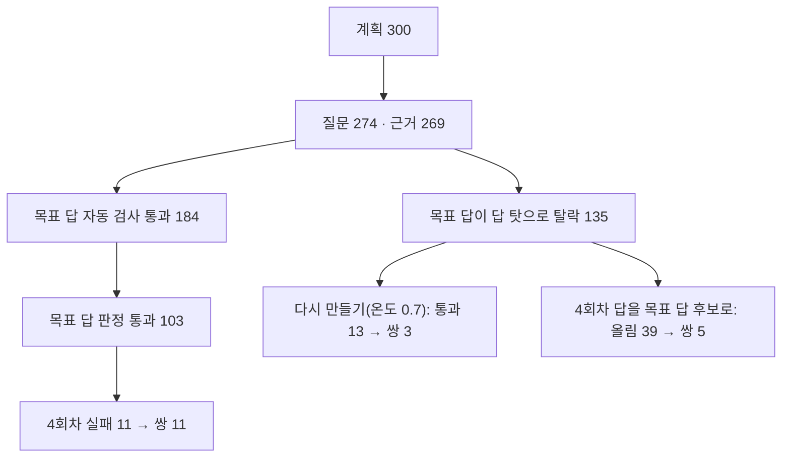

# M2 학습 5회차 시험 묶음 결과 — 목표 답이 쉬운 질문만 통과해 쌍이 적었다

> 상태: 끝(2026-11-09). 이슈 #247, 결정 ADR-0055(결정 3의 200문항 시험), ADR-0056(이 결과로 정함), 설계 `5회차-학습-설계-20261109.md`.

## 1. 결론

- **계획 질문 300개에서 선호 쌍 19개가 나왔다(6.3%).** 처음 흐름(Gemma 목표 답)으로는 11개였다. 탈락한 목표 답을 다시 만들어 3개를 더했고, 4회차가 낸 답을 목표 답 후보로 판정해(ADR-0056) 5개를 더했다.
- 쌍이 적은 까닭은 4회차가 잘 맞혀서가 아니라 목표 답이 쉬운 질문에서만 통과하기 때문이다. 목표 답이 판정을 통과한 103문항에서 4회차 실패는 11문항(10.7%)으로, 개발셋의 4회차 × 재순위 실패율(6.7%)과 비슷하다.
- 본 묶음은 4회차가 학습한 문서 묶음까지 써서 계획 941개로 만든다(2026-11-09 정함). 같은 비율이면 쌍이 약 59개 더 나온다. 4회차가 본 문서라 덜 틀려 더 적을 수 있다.

## 2. 무엇을 쟀나

- 질문: 4회차가 학습한 문서 묶음을 뺀 새 문서 묶음에서 300개(표 30%, 사실 25%, 답없음 20%, 절차 15%, 여러 근거 10%, 다른 말 25%), 씨앗 20261109.
- 근거: 데이터셋 스택(c62cb10)에서 재순위(TEI + bge-reranker-v2-m3, 후보 20)를 켜고 날짜 줄을 켠 근거 8개. 근거 붙이기는 재순위가 실제로 쓰인 근거만 받았다(269/269).
- 목표 답: Gemma 4 12B, 자동 검사, Claude 판정(목표 답 판정 지침 2026-11-01).
- 4회차 답: `ax40light-r4:q4km`이 같은 입력에 낸 답 4개(온도 0.7). 규칙으로 못 가른 답만 Claude 답 판정(지침 2026-11-03).

## 3. 결과

| 단계 | 문항 | 쌍 |
|---|---|---|
| 처음 흐름(Gemma 목표 답) | 판정 통과 103 | 11 |
| 탈락한 목표 답 다시 만들기 | 135 중 판정 통과 13 | 3 |
| 4회차 답을 목표 답 후보로(ADR-0056) | 122 중 올림 39 | 5 |
| 합계 | 판정 통과 155 | 19 |

- 쌍 종류: 틀린 값 10, 지어내기 4, 과잉 거절 4, 거절 머리말 1. 선호 답은 Gemma 14, 4회차 5.
- 4회차 답 620개 중 실패 43개(6.9%).
- 쌍 19개는 모두 근거 원문과 대조해 방향이 맞았다. 틀린 값 쌍은 대부분 근거 안의 비슷한 대상(다른 교수·공고·표 칸·과목 코드)을 고른 답이다.

## 4. 원인: 목표 답도 어려운 질문에서 틀린다

- 목표 답 탈락 166개 중 135개는 답 탓이고 31개는 질문·근거 탓이다.
- 다시 만든 답의 판정 탈락 62개 중 50개는 처음과 같은 이유였다(안내 빠짐 20, 기타 17, 값 틀림 8, 근거 없음 4, 확인처 1). 질문에 해가 없는데 가장 오래된 해의 값을 고르거나 대상이 다른 공고를 섞는 실수가 되풀이됐다.
- 온도 0.2(목표 답 기본값)로 다시 만들면 8개 중 5개가 앞 답과 글자까지 같았다. 그래서 다시 만들 때만 0.7로 올렸다.
- 자동 검사에서 떨어진 답없음 예시는 Gemma가 거절하지 않고 근거에 남은 비슷한 사실로 답했다. 61개 중 5개만 다시 만들어 통과했다.
- [판단] 그래서 목표 답이 통과하는 질문은 Gemma가 쉽게 답하는 질문으로 쏠리고, 그런 질문은 4회차도 대부분 맞힌다. 다시 만들어 살아난 13문항에서 4회차 실패는 3(23%)이었다. 표본이 작아 추측이다.
- 판정 이유를 Gemma에 주고 고쳐 쓰게 하는 방법은 쓰지 않았다. 판정 이유에 고친 값이 들어 있어 Claude 출력을 학습하는 셈이다(ADR-0010·0040).

## 5. 4회차 답을 목표 답 후보로(ADR-0056)

- 대상 122문항에서 자동 검사를 통과한 4회차 답 245개를 목표 답 판정 지침 그대로 판정했다. 통과 72, 탈락 173(안내 빠짐 57, 기타 48, 값 틀림 32, 근거 없음 17, 거절 오류 9, 일부 구분 8, 질문 어색 1, 확인처 1).
- 39문항에 통과한 답이 있어 목표 답으로 올렸다. 그중 33문항은 4회차 답 4개가 모두 맞아 쌍이 없었다. 56문항은 통과한 답이 없었고, 27문항은 자동 검사를 통과한 답이 없었다.
- 학습 위험 표본: 4회차에서 온 선호 답 5개 중 1개는 같은 낱말이 괄호로 겹쳤고, 1개는 확인처 없는 거절만 있었다(근거에 질문과 관련된 연락처가 없다는 판정). 본 묶음의 학습 위험 확인 때 이런 말투가 반복되는지 센다.

## 6. 운영에서 겪은 것

- 데스크탑 WSL 메모리(15.8GB)가 모자라 Gemma 실행 프로세스(약 10.7GB)가 리눅스의 메모리 부족 처리(OOM)로 여러 번 강제 종료됐다. 오류 난 답은 다음 차례에 다시 만들었다. 목표 답을 만들 때는 Ollama 컨테이너만 켜 두면 덜하다.
- Claude 사용 한도에 한 번 걸려 판정이 멈췄다. 본 묶음 체인은 한도가 풀릴 때까지 기다렸다가 다시 판정하게 한다.

## 7. 한계와 다음

- 질문 계획은 문서 묶음 하나에 질문 하나라, 4회차가 학습한 문서를 빼면 새 묶음이 232개뿐이다. 본 묶음은 학습한 문서 묶음까지 써서 941개를 계획했다.
- 쌍이 몇 개면 충분한지는 근거가 없다. 4회차는 진짜 실패 쌍 7개로 학습해 검증 쌍 선호 정확도가 0.43이었다.
- 다음: 본 묶음 941개(질문 → 근거 → 목표 답 → 판정 → 4회차 답 → 4회차 답을 목표 답 후보로 → 4회차 답 판정 → 쌍), 학습 위험 확인, 학습 서버에서 #242 뒤 DPO, 같은 날 개발셋 평가.

## 8. 학습 포인트

- 걸러 내는 단계가 여럿인 데이터 파이프라인은 통과한 표본이 쉬운 쪽으로 쏠린다(선택 편향). 단계마다 남은 수만 보지 말고, 떨어진 표본이 무엇이었는지 봐야 원인을 찾는다.
- 같은 입력과 낮은 온도로 다시 만들면 같은 답이 나온다. 다시 뽑기(거절 표본 추출)는 답이 실제로 달라질 때만 효과가 있다.
- 판정자의 설명을 생성 모델에 되먹이면 판정자의 글이 학습 데이터로 새어 든다. 판정만 쓰고 글은 쓰지 않게 나눠야 라이선스와 평가의 독립을 지킨다.
