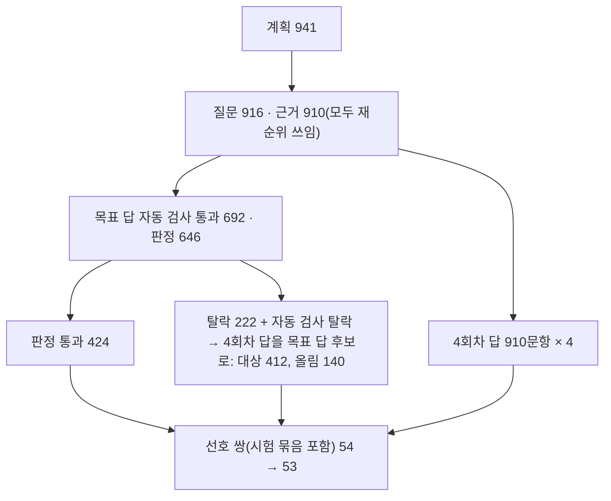

# M2 학습 5회차 결과 — 재순위 근거의 실제 실패로 선호 학습

> 상태: 끝(2026-11-10). 이슈 #247, 결정 ADR-0055(판정 규칙은 결정 4), ADR-0056(4회차 답을 목표 답 후보로), 설계 `5회차-학습-설계-20261109.md`, 앞 단계 `5회차-시험-묶음-결과-20261109.md`.

## 1. 결론

- **5회차 모델(`ax40light-r5:q4km`)도 미채택**이다. 재순위를 켠 5회차는 같은 날 다시 잰 학습 전 모델보다 개발셋 네 지표가 모두 좋은 방향이었지만(정답 98 → 100, 과잉 거절 7 → 4, 오답 11 → 9, 답없음 거절 24 → 26/28) 어느 것도 의미 있는 차이가 아니었다(p 0.38~0.82). 오답 9/149는 운영 선(7 이하)도 넘지 못했다. **운영은 학습 전 모델, 재순위 꺼짐 그대로 둔다.** 측정 전에 정한 규칙대로 새 평가 데이터는 재지 않았고 테스트셋은 열지 않는다.
- [실측] 1~4회차와 달리 정답과 과잉 거절이 나빠지지 않았다. 다만 이 개선은 대부분 재순위에서 왔다. 같은 재순위 조건의 4회차(11-09)와 비교하면 5회차에서 판정이 바뀐 문항은 3개(모두 좋아짐)이고, 겨냥한 오답(근거 속 비슷한 값으로 단정)은 10개 중 1개만 고쳤다.
- [판단] 원인은 데이터 양으로 본다. 선호 쌍이 53개(학습 48)뿐이었고, 검증 쌍에서 선호 답과 비선호 답의 보상 차가 0.06으로 4회차(0.073)와 비슷하게 작았다. 확신도 중간.

## 2. 4회차와 바꾼 것

| 항목 | 4회차 | 5회차 |
|---|---|---|
| 학습 출발점 | 3회차 어댑터 | 4회차 어댑터(기준 모델 4회차) |
| 근거 | 지금 검색(재순위 꺼짐) | 재순위 켬(TEI + bge-reranker-v2-m3, 후보 20), 원문 넣기 끔 |
| 비선호 답 | 3회차 답과 답없음 사본에서 지은 답 | 4회차가 같은 입력에서 실제로 낸 실패 답만 |
| 선호 답 | Gemma 목표 답 | Gemma 목표 답 46, 판정을 통과한 4회차 자기 답 7(ADR-0056) |
| 학습 설정 | DPO + sft, β 0.1, 학습률 1e-5, 반복 2번 | 같음 |

## 3. 본 데이터

[실측] 시험 묶음(계획 300) 뒤 본 묶음은 4회차가 학습한 문서 묶음까지 써서 941개를 계획했다(씨앗 20261110, 시험 묶음과 같은 종류 비율).

- 4회차 답 2,876개(목표 답이 있는 문항): 맞음 2,635, 일부 92, 틀린 값 84, 과잉 거절 35, 지어내기 19, 거절 머리말 11. 실패(일부 제외) 149개, 5.2%.
- 실패 답이 있는 문항 67개에서 쌍을 지었다. 지어내기 쌍(6)보다 과잉 거절 쌍이 많으면 거절 기준이 거절 쪽으로 기울어서, 쌍 도구 규칙대로 과잉 거절 쌍 13개를 뺐다(ADR-0055 결정 3).
- 쌍 53개: 틀린 값 39, 지어내기 6, 과잉 거절 6, 거절 머리말 2. 시험 묶음에서 14, 본 묶음에서 39. 질문 1,241개(계획 기준)당 4.3%로 시험 묶음(6.3%)보다 낮다. 4회차가 학습한 문서라 덜 틀린 것으로 본다(추측).

## 4. 학습 위험 확인(ADR-0055 결정 4, 학습 전)

| 위험 | 결과 |
|---|---|
| 선호 답 결론 문구가 한 틀로 반복 | 없음. 거절이 아닌 선호 답의 첫 문장 앞 12자 중 가장 흔한 것이 1/47 |
| 거절 쪽 쌍이 실제 실패보다 많음 | 아님. 지어내기 쌍 11.3% 대 실제 실패 중 지어내기 12.8% |
| 선호·비선호 답 판정 | 비선호 답 44개 Claude 판정, 9개 규칙. 선호 답은 모두 목표 답 판정 통과 |
| 학습 입력이 운영과 같음 | 53/53 날짜 줄, 재순위 쓰임, 원문 넣기 끔. 지난 입력 규칙과 거절 문장 0 |
| 반출 범위 | 근거 문서 231개 모두 학습 몫, 주민등록번호 형태 0 |

- [실측] 선호 답에만 같은 낱말이 괄호로 겹친 쌍 1개(원문과 비선호 답에는 없음)는 버릇을 배울 수 있어 학습 전에 뺐다(54 → 53).
- 거절 선호 답 6개 중 4개는 확인처 없이 거절 문장만 있다. 답변 형식(ADR-0050)이 허용하는 모양이지만, 근거에 쓸 만한 확인처가 있었는지는 보지 않았다.

## 5. 학습 실행

[실측] 학습 서버(A10G 24GB), 시범 학습(쌍 20개, 10걸음) 뒤 본 학습.

| 항목 | 값 |
|---|---:|
| 학습 · 검증 쌍 | 48 · 5 |
| 걸음 수 | 12(반복마다 6) |
| 학습 시간 | 1,667초 |
| 쌍 길이 최대 · 가운데(A.X 토크나이저) | 6,514 · 4,044토큰 |
| 반복별 검증 손실 | 1.143 → 1.137(2번째 반복을 고름) |
| 검증 쌍 선호 정확도 · 보상 차 | 0.8(4/5) · 0.062 |
| 학습 쌍 선호 정확도 · 보상 차(마지막 기록) | 0.95 · 0.172 |

- 10:22 시범 학습 시작, 11:12 본 학습 끝, 11:26 합치기·변환 끝. 데스크탑이 받은 GGUF의 SHA256이 학습 서버와 같음을 확인하고 채팅 틀(입력 6토큰) 확인 뒤 등록했다.
- 검증 쌍이 5개라 정확도 0.8은 한 쌍 차이로 크게 움직인다. 4회차(0.43, 14쌍)와 견주기 어렵다.

## 6. 결과: 개발셋(본 149문항, 같은 날 짝 비교)

[실측] 평가 조건은 1~4회차와 같다(날짜 줄 켬, 기준 날짜 2026-10-31, 근거 8개). 학습 전 모델은 같은 날 다시 쟀고 11-09 측정과 답 글 203/205가 같고 판정은 모두 같았다. 규칙 채점이 정하지 못한 5회차 답 5개는 같은 답 유형의 지난 판정과 같은 기준으로 판정했다(맞음 2, 틀림 3).

| 지표 | 학습 전 × 지금 | 4회차 × 재순위(11-09, 참고) | 5회차 × 재순위 | 학습 전 대비 5회차 |
|---|---:|---:|---:|---|
| 정답(121) | 98 | 98 | 100 | 같은 수준 p=0.82 (좋아짐 11 · 나빠짐 9) |
| 과잉 거절(121) | 7 | 5 | 4 | 같은 수준 p=0.38 (4 · 1) |
| 오답(149) | 11 | 10 | 9 | 같은 수준 p=0.81 (10 · 8) |
| 답없음 거절(28) | 24 | 25 | 26 | 같은 수준 p=0.69 (4 · 2) |
| 일부(121) | 9 | 11 | 10 | |

- 판정: **미채택**(ADR-0055 결정 4). 오답이나 답없음 거절이 의미 있게 좋아져야 하는 조건을 못 지켰고, 운영 선(오답 7 이하, 답없음 거절 26 이상) 중 오답이 넘었다. 정답과 과잉 거절은 나빠지지 않았다.
- [실측] 학습 전과 짝 비교하면 오답 칸에서 18문항이 갈렸다(10문항은 고치고 8문항은 새로 틀림). 새로 틀린 8문항은 4회차 × 재순위에서도 모두 틀렸고, 4회차 × 지금 검색(11-09)에서는 1개만 틀렸다. [판단] 재순위가 바꾼 근거에서 생긴 오답으로 본다(학습 전 × 재순위는 이번에 재지 않았다).

## 7. 원인 분석: 학습이 바꾼 것이 적다

- [실측] 4회차 × 재순위와 5회차 × 재순위는 같은 검색이고 모델만 다르다. 판정이 바뀐 문항은 3개로 모두 좋은 쪽이다(답없음 문항의 오답 → 거절, 일부 → 맞음, 과잉 거절 → 맞음). 나빠진 문항은 0이다. 답 글은 205개 중 143개가 같다.
- [실측] 5회차가 겨냥한 4회차 × 재순위 오답 10개 중 고친 것은 1개(답없음 문항을 거절로)다. 남은 오답 9개는 근거 속 비슷한 값·다른 문서 사실 6, 관계없는 근거로 답함 3이다.
- [판단] 쌍 53개(학습 48, 12걸음)로는 모델을 크게 옮기지 못했다. 방향은 맞았지만(나빠진 문항 0) 양이 모자랐다고 본다. 확신도 중간. 쌍 수 말고 다른 원인(검증 쌍 5개라 체크포인트 고르기가 흔들림, 선호 답 출처가 Gemma 위주)도 배제하지 못했다.
- [실측] 쌍이 적었던 까닭은 4회차가 학습 질문에서 잘 틀리지 않기 때문이다. 목표 답이 있는 문항에서 4회차 답 실패율은 5.2%로, 개발셋의 4회차 × 재순위 실패율(6.7%)보다 낮다. 학습 질문은 문서 묶음마다 하나씩 Gemma가 만든 질문이고, 목표 답이 통과한 문항만 남아 쉬운 쪽으로 쏠린다(시험 묶음 결과 4절). 개발셋과 실패율이 다른 까닭은 따로 확인하지 않았다.

## 8. 운영에서 겪은 것

- 데스크탑 WSL의 바깥 연결이 새벽 3시쯤 끊겼다(WSL의 Tailscale 노드 offline, Windows 쪽은 정상). 학습 전 측정이 저장소 받기에서 멈췄고 `wsl --shutdown` 뒤 다시 켜 되살렸다. 원인은 확인하지 못했다.
- Claude 사용 한도에 06:18부터 걸려 4회차 답 판정이 09:50 한도가 풀릴 때까지 멈췄다. 체인은 20분마다 다시 시도했지만 맥북이 잠든 동안은 그 대기도 멈췄다. 학습 시작이 약 2시간 반 늦었다.
- 학습 서버에서 `ssh 서버 'pkill -f "http.server 8765"; rm ...'`가 자기 셸을 죽여 뒤 명령이 돌지 않았다. `pkill -f`는 명령줄 전체를 찾으므로 원격 셸 명령줄의 같은 글자에 걸린다. `"[h]ttp.server"`로 고쳤다. 올리기 도구가 학교 데이터가 남은 것을 보고 멈춰, 지우지 않은 채 학습이 시작되지는 않았다.
- Windows SSH의 기본 셸(cmd)은 작은따옴표를 인용으로 보지 않아 `wsl -- bash -c '...'`가 깨졌다. 데스크탑에 스크립트를 보낼 때는 `bash -s` 표준 입력(필요하면 base64)으로 보낸다.

## 9. 정리와 다음

- 운영은 그대로 둔다. `ax40light-r5:q4km`는 데스크탑에 등록된 채 비교용으로 남긴다. 5회차 어댑터는 맥북 `Assets/train/round5/aws/`에 보관했고, 학습 서버의 4·5회차 학교 데이터(선호 쌍, 학습 결과, 합친 모델, 변환 파일)는 모두 지웠다(#242 포함). 지운 뒤 서버 디스크 사용량은 5회차 전과 같은 48GB다.
- [판단] 다음 후보(이슈를 닫은 뒤 따로 정한다): ① 학습 질문을 실패가 잦은 쪽(개발셋처럼 비슷한 값이 많은 표·공고)으로 모아 쌍을 늘린 6회차, ② 설계 문서의 다음 후보였던 근거 풀이·인용형 목표 답, ③ 재순위를 켠 학습 전 모델과 5회차의 차이가 작으니 재순위만 켜는 운영 변경의 비용(오답 9 대 운영 선 7)을 다시 따지기. 확신도 낮음, 숫자로 고르기 전에 사용자와 정한다.

## 10. 학습 포인트

- 같은 검색 조건의 이전 모델과 비교해야 학습이 바꾼 몫이 보인다. 학습 전 대비 네 지표가 모두 좋아 보였지만, 같은 재순위의 4회차와 비교하면 학습이 바꾼 판정은 세 문항이었다.
- 선호 학습(DPO)은 쌍이 모델이 실제로 낸 실패일 때 방향이 맞는다. 5회차는 학습 전보다 정답과 과잉 거절이 나빠지지 않아 1~4회차의 맞바꿈(오답 대신 과잉 거절)이 없었고, 같은 재순위의 4회차보다 나빠진 문항이 0이었다. 대신 실제 실패만 쓰면 쌍 수가 모델 실패율에 묶인다.
- 밤새 도는 체인은 바깥 요인(사용 한도, 네트워크, 노트북 잠자기)에 멈춘다. 멈춘 단계를 다시 시도하는 것만으로는 부족하고, 기다리는 쪽이 잠들지 않는 곳(학습 서버, 데스크탑)으로 옮겨야 한다.
