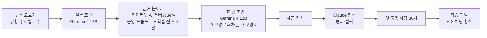

# M2 6단계 — 학습 예시 만들기 설계 (2026-10-21)

> 계획: `A.X-기준-계획-20261017.md` §4 6단계·§5. 결정: ADR-0037(검토), ADR-0038(데이터셋용 색인 범위), ADR-0039(목표 답 모양), ADR-0040(초안 모델). 조사: `../research/학습셋-제작-실무조사-20261021.md`, `../research/학습데이터-사람검토-실무조사-20261021.md`.
> 상태: 설계 합의(2026-10-21 사용자). 이 문서는 1회차(200개)와 그 첫 묶음(40개)을 만드는 방법을 정한다. 본 학습(2회차) 규모는 1회차 결과로 정한다.

## 1. 흐름

- 근거는 서비스와 같은 코드가 붙인다: 데이터셋 AI 서버의 `/query`에 평가용 옵션(`include_eval_trace`)을 켜면 운영과 같은 함수(`_prepare_query`)가 만든 프롬프트 전체, 근거 8개의 청크 번호, 학습 전 A.X의 답이 함께 온다(ADR-0010 '같은 로더·청킹·프롬프트').
- 초안 모델(Gemma)·학생 모델(A.X)·임베딩을 12GB GPU에 한꺼번에 올릴 수 없어, 단계마다 전체를 한 번에 돌린다(질문 전부 → 근거 전부 → 목표 답 전부). Ollama가 모델을 바꿔 올리는 횟수를 줄인다.

## 2. 예시 종류와 개수 (1회차 200)

| 종류 | 개수 | 목표 답 | 만드는 법 |
|---|---|---|---|
| 답 — 사실 하나(날짜·금액·연락처·장소) | 35 | 결론 → 안내 → `[출처 N]` | 청크 하나에서 질문 |
| 답 — 절차·방법 | 30 | 같음 | 절차가 있는 청크에서 질문 |
| 답 — 표 값(행·열) | 35 | 같음 | 표가 있는 청크에서, 행과 열을 함께 가리키는 질문 |
| 답 — 여러 근거 합치기 | 20 | 같음 | 같은 묶음의 청크 둘에서 질문 |
| 일부만 있음 | 20 | 있는 것은 답 → 없는 것은 확인처 | 청크에 있는 것 하나 + 없는 것 하나를 묻는 질문 |
| 거절 + 안내(근거에 답 없음) | 40 | 운영 거절 문장 + 근거에 있는 확인처 | 청크와 같은 주제지만 청크에 없는 것을 묻는 질문 |
| 거절(엉뚱한 근거만) | 20 | 운영 거절 문장 | 학교 문서가 다루지 않는 주제의 질문 |

- 계획 §5 비율(답 60 · 거절 + 안내 20 · 엉뚱한 근거 10 · 나머지 10)을 따른다. 나머지 10%는 '일부만 있음'으로 둔다 — 4단계에서 A.X가 답한 뒤 거절 문장을 기계적으로 덧붙인 답이 33건이었다(`4단계-2-프롬프트-문구-20261020.md`). 있는 것과 없는 것을 가려 말하는 행동을 직접 가르친다. [판단]
- 표 값은 답 120개 중 35개(29%)로 계획 §5의 '답 안에서 1/4 이상'을 지킨다. 합계 200 = 답 120 · 일부만 있음 20 · 거절 + 안내 40 · 엉뚱한 근거 20.
- 묶음은 주제(입시·학사·장학·등록금·학과·캠퍼스 생활·기타)와 형식(HTML·PDF·HWP)별로 고르게 뽑고, 1회차에서는 한 묶음에서 질문 하나만 만든다. 1회차 첫 묶음 40개는 위 종류를 같은 비율로 담는다.

## 3. 질문 초안 (Gemma 4 12B)

- 입력: 청크 글(데이터셋 AI 서버 `/documents/{id}/chunks`) · 문서 제목 · 예시 종류 · 사용자 범주 · 말투.
- 사용자 범주는 재학생 · 예비 입학생·지원자 · 교직원 · 외국인 · 업체 중 그 문서를 물을 만한 사람을 고르게 돌린다(문서 주제와 맞지 않으면 건너뜀). 말투는 짧은 구어체 · 정중체 · 상황 설명형 · 쉬운 한국어(외국인)를 돌린다. 세부 페르소나는 쓰지 않는다(조사: 세부 설정의 다양성 이득이 작음).
- 출력(JSON): 질문, 답이 되는 청크 속 글(답 근거), 예시 종류. 답 근거는 목표 답 초안과 자동 검사에만 쓰고 학습 입력에는 넣지 않는다.

## 4. 근거 붙이기

- 데이터셋 AI 서버 `/query`(근거 8개, 평가용 옵션)로 질문마다 프롬프트·근거 청크 번호·학습 전 A.X 답을 받는다.
- 학습 전 A.X 답은 학습하지 않는다. 학습 전후 비교와 'A.X가 이미 맞히는 쉬운 예시' 비율을 보는 데만 쓴다.

## 5. 목표 답 초안 (Gemma 4 12B)

- 입력: 학생이 받을 프롬프트 그대로 + 답 근거 + 모양 지시(ADR-0039: 결론 → 근거에 있는 방법·기한·문의처·사이트 → 쓴 근거 번호, 답 없으면 운영 거절 문장 + 근거에 있는 확인처). 근거에 없는 사실·일반 조언은 쓰지 않는다.
- 1회차는 같은 예시에 '근거 줄 인용 → 결론' 모양(나)도 만든다(ADR-0039 비교용).

## 6. 자동 검사 (사람 시간 0)

| 검사 | 거르는 것 |
|---|---|
| 모양 | 끝에 `[출처 N]`(N은 1~8)가 없거나 거절 문장이 운영 문장과 다름 |
| 근거 대조 | 목표 답의 날짜·숫자·금액·전화번호가 프롬프트 근거 글에 없음(채점기 정규화 재사용) |
| 출처 번호 대조 | `[출처 N]` 블록에 답의 핵심 값이 없음 |
| 지워진 정답 | 답 근거가 프롬프트 글에 없음 — 발췌 규칙이 정답을 지운 예시(4단계 보고서 §4) |
| 왕복 검색 | 답 종류인데 질문을 만든 청크가 근거 8개 안에 없음 |
| 모호한 표 근거 | 답이 기대는 표 사실이 같은 표 이름·행 이름·열에 값이 여럿인 문장(5단계 보고서 §8) |
| 중복 | 질문끼리 글자·임베딩 유사도가 높음 |
| 개인정보 | 주민등록번호·개인 휴대전화·개인 이메일 형태(부서 대표 번호는 허용) |
| 거절 유형 확인 | 거절 예시인데 학습 전 A.X 답과 근거에 답의 값이 그대로 있음 → Claude 판정으로 보냄 |

## 7. Claude 판정과 사람 표본 (ADR-0037)

- 판정 지침(별도 문서)에 볼 것: 값이 맞는 행·열·해인가, 근거에 답이 있는데 거절했나, 확인처가 근거에 있나, 질문이 그 사용자가 물을 만한가, 목표 답이 질문에 답하나. 예시마다 통과·탈락과 이유 한 줄. Claude는 글을 고치지 않는다.
- 실행은 평가셋 이중 라벨링처럼 사용자 터미널에서 `claude -p`(저장소 밖 격리 폴더, 읽기 도구만)로 한다.
- 첫 묶음 40개 판정 → 사람이 그중 30개를 판정과 나란히(종류를 고르게, 통과·탈락 모두) → 어긋남 1개 이하면 나머지 160개를 Claude 판정만으로. 2개 이상이면 지침을 고치고 새 30개.

## 8. 기록 (ADR-0010 원본·파생)

- 원본 레코드(JSONL, `Assets/train/` — 학교 글이라 커밋하지 않음): 예시 번호, 묶음·대장 ID, 종류, 사용자 범주, 말투, 질문, 답 근거, 프롬프트, 근거 청크 번호, 학습 전 A.X 답, 목표 답(가·나), 만든 모델 이름과 판, 자동 검사 결과, Claude 판정, 사람 판정.
- 파생: A.X 채팅 형식 학습 파일(사용자 = 프롬프트, 답 = 목표 답). AWS에는 파생 파일만 올린다(ADR-0010).

## 9. 코드

- `tools/corpus`에 학습 예시 명령을 둔다: 묶음 고르기 → 질문 초안 → 근거 붙이기 → 목표 답 초안 → 자동 검사 → 판정 꾸러미 → 학습 파일 내보내기. 단계마다 파일로 남겨 이어서 돌린다. 모델 이름·AI 서버 주소는 설정으로 받는다(ADR-0040).
- 테스트는 가나대학 합성 데이터로, 자동 검사 규칙마다 통과·탈락 예를 둔다. 커밋 뒤 검사 규칙을 망가뜨려 테스트가 잡는지 본다.

## 10. 어림

- 초안은 탈락을 생각해 1.5배(300개)를 만든다. 질문 약 2초 + 근거 붙이기 약 4초(A.X 생성 포함) + 목표 답 약 5초(가·나 두 모양이면 약 10초) → 300개 약 1~1.5시간(데스크탑). [계산, 1회차에서 잼]
- 사람 시간: 첫 묶음 표본 30개 약 30분(ADR-0037).
