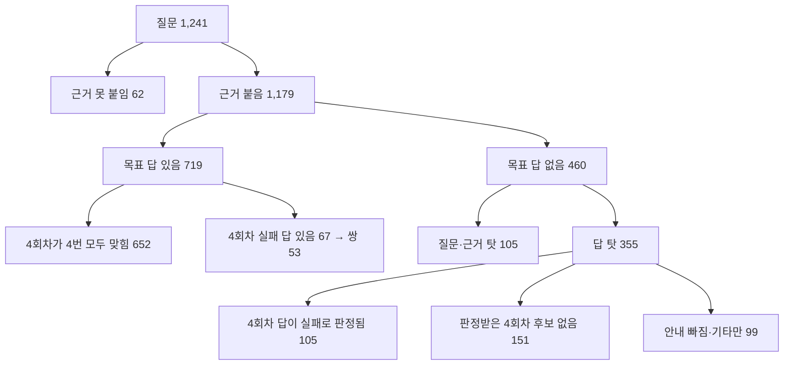

# M2 학습 6회차 설계 — 4회차 모델에서 다시 시작해 선호 쌍을 늘린다

> 상태: 설계 끝(2026-11-10), 결정 ADR-0057. 이슈 #253. 앞 단계: `5회차-학습-결과-20261110.md`, `5회차-시험-묶음-결과-20261109.md`, ADR-0055·0056.

## 1. 왜 6회차인가

- [실측] 5회차는 4회차 모델에서 이어 학습했다. 고칠 대상이 4회차이므로 선호 쌍의 비선호 답은 4회차가 실제로 낸 틀린 답만 썼다. 4회차는 학습용 질문을 대부분 맞혀서 질문 1,241개에서 쌍이 53개만 나왔다.
- [실측] 5회차 × 재순위는 1~4회차와 달리 정답과 과잉 거절이 나빠지지 않았다. 같은 재순위의 4회차와 견주면 판정이 바뀐 문항은 3개(모두 좋아짐)이고, 재순위 근거에서 새로 생긴 오답 8개는 그대로였다.
- [판단] 방향은 맞고 양이 모자랐다고 본다(확신도 중간). 6회차는 설정을 그대로 두고 쌍만 늘려 이 판단을 가른다.

## 2. 쌍이 줄어든 곳

5회차 묶음 기록(시험 묶음, 다시 만든 두 묶음, 본 묶음)을 쌍 도구의 함수(`pairs.candidates`, `pairs.assess`, `model_targets.answer_side_failure`)로 질문 단위로 다시 셌다. 세는 스크립트는 로컬 `Assets/train/analysis/r6-design/`에 있다(커밋 안 함).

### 2-1. 실패는 일부 문항에 몰려 있다

[실측] 목표 답이 있는 719문항에 4회차 답을 4개씩(온도 0.7) 받았다.

| 답 4개 중 실패 수 | 0 | 1 | 2 | 3 | 4 |
|---|---:|---:|---:|---:|---:|
| 문항 | 652 | 28 | 13 | 9 | 17 |

- 실패 답이 있는 67문항에서 과잉 거절 쌍 13개(쌍 도구의 균형 규칙)와 겹친 낱말 1개를 빼 53쌍이 됐다.
- [계산] 이 분포를 베타-이항 분포로 맞추면(a=0.032, b=0.593) 답을 8개로 늘려도 실패 답이 나오는 문항은 약 79개(+18%), 16개여도 약 93개다. 대부분의 문항은 늘 맞히거나 늘 틀린다.

### 2-2. 선호 답이 없어 버린 문항

[실측] 목표 답이 답 탓으로 떨어지고 4회차 자기 답(ADR-0056)으로도 선호 답을 얻지 못한 문항은 355개다.

- Gemma 4 12B 목표 답이 떨어진 곳: 자동 검사 212(답이 없게 만든 근거인데 거절하지 않음 124, 확인처를 허용 밖 근거에서 붙임 109, 출처 번호가 값과 맞지 않음 93, 모양 30, 모호한 표 근거 14, 겹쳐 셈), Claude 판정 143(기타 55, 값 틀림 34, 안내 빠짐 34, 근거 없음 15, 그 밖 5).
- 계획한 종류: 답 있는 질문 198(표 95, 사실 39, 절차 34, 여러 근거 30), 답없음 질문 157.
- 355문항 중 105문항은 4회차 답이 목표 답 판정에서 값 틀림, 근거 없음, 거절 오류로 판정됐다(답 기준 값 틀림 136, 근거 없음 49, 거절 오류 32). 4회차가 틀린 것은 확인됐는데 선호 답이 없어 쌍이 되지 못했다. 답 있는 질문으로 계획한 것이 79(표 43, 사실 14, 절차 13, 여러 근거 8, 받은 근거로 답없음이 된 것 1), 답없음으로 계획한 것이 26이다.
- [실측] 그 79문항에서 14개를 뽑아 판정 이유를 읽었다. 값이 여러 개인데 일부만 답함, 근거에 대상이 둘인데 어느 쪽인지 밝히지 않음, 표의 행이나 단위를 잘못 읽음이 많았고, Gemma 4 12B와 4회차가 같은 곳에서 틀렸다.
- [실측] 목표 답 프롬프트에는 질문을 만든 글의 답 부분과 그 근거 번호가 이미 들어간다(`prompts.target_prompt`). 정답 위치를 더 알려 줄 여지는 없다.

### 2-3. 종류별 수

[실측] 종류는 받은 근거로 정한 종류다(근거를 못 붙인 문항은 계획한 종류).

| 종류 | 질문 | 목표 답 있음 | 4회차 실패 답 있음 | 질문당 | 목표 답 없음 | 그중 4회차 실패 확인 |
|---|---:|---:|---:|---:|---:|---:|
| 표 값 | 358 | 218 | 26 | 7.3% | 130 | 43 |
| 절차 | 181 | 110 | 12 | 6.6% | 45 | 13 |
| 여러 근거 | 138 | 64 | 9 | 6.5% | 68 | 12 |
| 답없음 | 147 | 92 | 6 | 4.1% | 39 | 4 |
| 사실 하나 | 369 | 235 | 14 | 3.8% | 130 | 32 |
| 일부만 있음 | 48 | 0 | 0 | 0% | 48 | 1 |
| 합계 | 1,241 | 719 | 67 | 5.4% | 460 | 105 |

## 3. 정한 것

1. **방향**: 5회차의 방식(재순위 근거, 모델이 실제로 낸 실패 답만 비선호 답으로 쓰는 선호 학습)을 이어 쌍 수를 늘린다.
   - [원문] 같은 방식의 Trust-Align(ICLR 2025)은 지도 학습한 모델의 지어내기를 비선호 답으로 써서 19,000쌍으로 학습했다. 지어내기 유형이 고루 나오게 질문과 근거 약 7만 건을 구성해 지어내기가 든 답 약 4만 건을 얻고, 그중 심한 쪽 절반을 골랐다(조사 문서 자료 8).
   - 버린 대안은 ADR-0057에 적었다(근거 풀이·인용형 목표 답, 재순위 켠 5회차로 운영 전환, 학습을 5회차로 마침).
2. **시작 모델과 설정**: 4회차 어댑터에서 다시 시작한다. 손실(DPO + sft), β 0.1, 학습률 1e-5, 반복 2번, 검증 쌍 비율(약 10%)은 5회차와 같다. 학습 쌍은 5회차의 53쌍에 새 쌍을 더한다.
   - [판단] 5회차와 다른 것이 쌍 수와 걸음 수뿐이라, 결과가 달라지면 쌍 수의 효과로 읽을 수 있다. 이미 받아 판정한 4회차 답도 그대로 쓴다.
   - 버린 대안: 5회차 어댑터에서 이어 학습(틀린 답을 5회차 모델로 다시 받아 판정해야 하고, 쌍 수와 시작 모델이 함께 바뀐다).
3. **선호 답**: 2-2의 355문항처럼 선호 답을 얻지 못한 질문은 Gemma 4 26B A4B(`gemma4:26b-a4b-it-qat`, Apache 2.0)가 목표 답을 다시 쓴다. 프롬프트, 자동 검사, Claude 판정은 12B 목표 답과 같다. 쓰는 순서는 12B → 4회차 자기 답 → 26B다.
   - [실측] 2026-11-01 표본 60문항에서 12B가 떨어진 23개 중 26B가 7개(30%)를 통과시켰다. 두 모델의 통과 수는 비슷하지만(12B 37, 26B 34) 떨어지는 문항이 다르다(ADR-0048 결과).
   - [실측] 26B는 데스크탑에서 GPU와 CPU에 나눠 올라가고 목표 답 하나에 약 17초가 걸렸다. 355문항이면 약 1시간 40분이다[계산].
   - 버린 대안: 문항당 답을 더 받음(2-1의 계산), Claude가 씀(ADR-0010·0040), 사람이 고침(105문항에 약 5시간), 12B 생각 모드(생각 글이 답에 섞일 위험, 26B가 살린 비율이 낮으면 다음에 봄).
4. **질문 재료**: 질문 계획의 '문서 묶음 하나에 질문 하나' 제한을 묶음당 최대 3개(서로 다른 청크)로 푼다. 종류는 2-3에서 질문당 쌍이 많은 표, 절차, 여러 근거 위주로 하고 비율은 시험 묶음 300개 결과로 정한다.
   - [실측] 질문 재료가 있는 문서 묶음 1,241개를 5회차가 한 번씩 모두 썼다. 문서 대장 기준 학습 몫 묶음 1,475개 중 표가 있는 묶음은 614개(표 2개 이상 348, 4개 이상 208)이고 표 질문을 낸 묶음은 372개다. 글이 3,000자 이상인 묶음은 329개다.
   - [계산, 가정] 새 질문은 약 1,500개로 어림한다(표 질문 약 800, 긴 글 묶음에서 약 650). 실제 수는 계획 도구로 센다.
5. **학습을 시작하지 않는 기준**: 3과 4의 시험 뒤 예상 쌍 수가 200개에 못 미치면 6회차 학습을 하지 않는다. 예상 쌍 수 = 53 + 355문항에서 살린 쌍 + 시험 묶음의 질문당 쌍 수 × 만들 수 있는 새 질문 수.
   - [판단] 200은 5회차의 약 4배다. 4절의 어림으로 닿을 수 있는 수가 약 210이라, 그보다 적으면 쌍 수의 효과를 가르기 어렵다고 봤다.
6. **판정**: ADR-0055 결정 4와 같다(기준은 같은 날 다시 잰 학습 전 모델 × 지금 검색, 운영 선, 채택 규칙, 개발셋을 통과해야 새 평가 데이터). 같은 재순위의 4회차, 5회차와의 비교는 참고로 적는다.
   - [계산] 통과하려면 재순위 근거에서 새로 생긴 오답 8개 중 6개 이상을 없애야 한다(고침 10 대 새 오답 2는 p=0.039, 10 대 3은 0.092). 5회차는 0개였다.
7. **학습 위험 확인(학습 전)**: ADR-0055 결정 5, ADR-0056 결정 5에 아래를 더한다.

| 위험 | 확인 |
|---|---|
| 26B가 쓴 선호 답이 길어 A.X 답이 길어짐(표본 가운데값 115자 대 94자) | 선호 답을 쓴 모델별 비율과 길이, 학습 뒤 개발셋 답 길이 |
| 한 문서에서 질문을 여러 개 만들어 그 문서의 답을 외움 | 묶음당 쌍 수(상한 3), 같은 청크를 두 번 쓰지 않음, 학습 몫과 검증 몫을 묶음 단위로 나눔 |
| 표 질문이 늘어 쌍 종류 비율이 실제 실패 비율(틀린 값 56%, 과잉 거절 24%, 지어내기 13%, 거절 머리말 7%)에서 벗어남 | 쌍 종류 비율, 학습 뒤 과잉 거절과 답없음 거절 |
| 살린 질문이 대상이 모호한 질문임 | Claude 판정의 '질문 어색' 탈락을 그대로 적용, 살린 쌍 표본을 근거와 대조 |

## 4. 쌍 수 어림

[계산, 가정] 가정은 새 질문 수(약 1,500)와 26B가 살리는 비율(30%) 둘이다.

| 단계 | 쌍 |
|---|---:|
| 5회차 | 53 |
| 새 질문 약 1,500개(질문당 쌍 약 6%) | 약 150 |
| 선호 답이 없어 버린 질문의 30%를 살림(지금 105문항과 새 질문 몫) | 약 210 |
| 통과에 필요하다고 어림한 수(5회차의 쌍당 효과가 비례한다고 놓음) | 약 300 |

지금 수단으로는 300에 못 미친다. 채택 규칙을 통과할 가능성은 낮게 본다(확신도 낮음).

## 5. 다음(실행 순서)

설계는 여기서 끝나고, 실행은 새 이슈로 한다.

1. 떨어진 목표 답을 26B로 다시 쓰는 단계를 도구에 더하고, 5회차 묶음의 355문항으로 살린 문항 수와 새 쌍 수를 잰다(결정 3). 살린 쌍 표본을 근거와 대조한다.
2. 질문 계획에 묶음당 상한을 넣고 만들 수 있는 새 질문 수를 센 뒤, 시험 묶음 300개로 질문당 쌍 수를 잰다(결정 4).
3. 예상 쌍 수를 계산해 기준(200)과 견준다(결정 5).
4. 기준을 넘으면 본 묶음, 학습 위험 확인, 학습 서버에서 4회차 어댑터에 이어 DPO, 같은 날 개발셋 평가를 한다(결정 2·6·7).

## 6. 한계

- 26B의 30%는 답 있는 종류 60문항 표본의 값이다. 2-2의 문항은 그보다 어렵고, 답없음으로 계획한 157문항에서 26B가 거절을 더 잘하는지는 잰 적이 없다.
- 새 질문 수는 문서 대장의 표 수와 글 길이로 낸 어림이다. 표가 있어도 질문 재료가 되는 청크(3행 이상, 200자 이상)가 아닐 수 있다.
- 쌍이 몇 개면 충분한지는 근거가 없다. Trust-Align의 19,000쌍은 영어 질의응답 데이터와 전체 파라미터 학습의 값이다.
- 한 문항에서 쌍을 하나만 만든다. 실패 답이 여럿인 문항에서 쌍을 더 만드는 방법은 같은 선호 답을 되풀이해 외울 위험이 있어 다루지 않았다.
