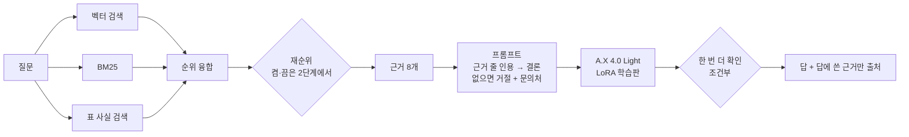
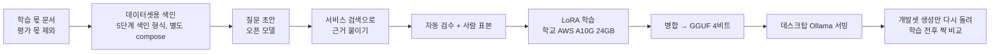
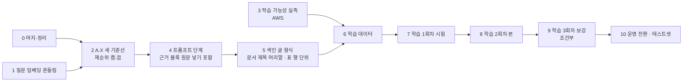

# M2 총설계와 계획 — A.X 4.0 Light 기준 (2026-10-17)

> **역할**: M2(맞는 답, 모르면 모른다)에서 남은 일의 단일 계획이다. §1은 끝난 일의 사실, §2는 유효한 결정, §3은 목표 상태(설계), §4부터가 앞으로의 순서다. 진행 상태는 §1과 §4의 '상태' 칸에만 적는다.
> **대체**: `모델선정-비교계획-20261015.md`(기반 모델을 A.X로 정해 끝남). **이어받음**: `검색개선-설계-20261014.md`(1~3단계 결과·측정 방법 §2·그 문서 4단계의 표 행 단위 색인 설계 = 이 문서 5단계), `3단계-재순위-점수결합-20261016.md`(결과 기록).
> **변경(2026-10-20, 사용자 결정)**: 학습 데이터를 만들기 전에 프롬프트에 들어가는 근거의 모양을 굳히도록 순서를 바꿨다 — 근거 블록에 원문 넣기(발췌만 넣는 규칙 끄기)를 4단계에, 문서 제목 머리말과 표 행 단위 색인을 새 5단계(옛 8단계)에 둔다. 학습 데이터·학습 회차는 번호가 하나씩 밀렸다(옛 5·6·7 → 6·7·8). 근거: `청크-임베딩-평가-20261020.md`, ADR-0010(학습 데이터는 서비스와 같은 로더·청킹·프롬프트로).
> **관련 결정**: ADR-0033(LLM 학습은 반드시), ADR-0034(기반 모델 A.X 4.0 Light), ADR-0026(성공 기준), ADR-0025(짝 비교), ADR-0018(테스트셋 봉인), ADR-0010(학습 데이터·AWS 반출 범위), ADR-0030(운영 서빙은 클라우드 예정).

## 1. 지금까지 끝난 일 (사실)

개발셋 본 답 있는 121문항 기준, 바로 앞 단계와 같은 문항 짝 비교.

| 순서 | 한 일 | 정답률 | 그 밖에 | 기록 |
|---|---|---|---|---|
| M1 베이스라인 | EXAONE · 사람이 만든 규칙 검색 | 43.8% | 과잉 거절 38.0% | `../m1/베이스라인-측정-20261012.md` |
| 모델 교체 | Gemma 4 12B(EXAONE은 라이선스로 제외) | 53.7% (p=0.002) | | `../m1/모델비교-20261014.md` |
| 검색만 바꿈(실험) | EXAONE 그대로, 규칙 → 순위 융합 | 43.8% → 62.0% (p=0.0005) | 검색 효과가 모델 효과보다 큼 | `실패원인-분석-20261014.md` §6 |
| 1단계 | 순위 융합을 운영 기본값으로, 규칙 코드 삭제 | 76.9% (p<0.0001) | | `1단계-*.md` |
| 2단계 | 근거 5개 → 8개, 생성 문맥 12,288 | 83.5% (p=0.039) | 과잉 거절 18.2% → 10.7% (p=0.012) | `2단계-상위k-20261015.md` |
| 3단계 | 재순위(bge-reranker-v2-m3, 별도 서버 TEI) — **측정만, 기능은 기본 꺼짐** | 87.6% (p=0.23, 같은 수준) | 정답 근거 프롬프트 포함 112 → 119 (p=0.016), 응답 +0.5초, 데스크탑 GPU 부족 | `3단계-재순위-점수결합-20261016.md` |

- **지금 운영값**: 순위 융합 · A.X 4.0 Light(`ax40light:q4km`, 2026-10-20부터 — 그 전 Gemma 4 12B) · 근거 8개 · 생성 문맥 12,288 · 재순위 꺼짐 · 임베딩 Qwen3-Embedding-4B.
- **개발셋 목표 대비**(ADR-0026): 정답률·오답률(1.3%)·과잉 거절(10.7%)·출처 정확도(95.9%)·쉬운 문항(98.2%)·답없음 거절(96.4%) 모두 통과. **안내 충실도 32.0%만 미달**(목표 50%).
- **남은 실패 20문항**: 정답 근거가 프롬프트에 없음 9(표 3·글 6) · 근거는 있는데 못 맞힘 11(표 7·글 4).
- **임베딩·청크 평가(2026-10-20, `청크-임베딩-평가-20261020.md`)**: 임베딩은 문제가 아니다(벡터만으로 정답 청크 8위 안 114 / 121, 질문 지시문을 붙여도 117로 같은 수준). 위 '프롬프트에 없음 9' 중 검색이 놓친 문항은 0이다 — 근거 8개 안에 들었는데 원문 대신 발췌만 넣는 규칙이 답을 지움 5 · 청크 글에 문서 제목이 없어 벡터 순위가 낮음 2 · 벡터 1·3위였는데 순위 융합에서 밀림 2. 프롬프트 근거 블록의 59%가 발췌만 들어간다. 칸 단위 표 사실의 58%는 행을 가릴 수 없다(색인 전체).
- **A.X 4.0 Light 측정값**(2026-10-14, 순위 융합·근거 5개 프롬프트, Gemma와 같은 입력): 정답률 71.1%(Gemma 74.4%, 같은 수준), 틀린 답 10 / 149(Gemma 1), 답없음 거절 82.1%(Gemma 100%), 과잉 거절 11.6%(Gemma 19.0%), 안내 충실도 48.0%(Gemma 32.0%), 생성 86.3토큰/초(Gemma 46.8). 지금 운영 설정(근거 8개)으로는 아직 재지 않았다.
- 2026-10-17에 머지 대기였던 세 브랜치(재순위 기능, 이 문서·ADR-0033·0034, 근거 꼬리표 흔들림 수정)는 0단계에서 머지했다(PR #176~#178). 데스크탑의 지금 상태는 `docs/project/현재-상태.md`에 적는다.

## 2. 유효한 결정

| 결정 | 한 줄 | 이 계획에 미치는 것 |
|---|---|---|
| ADR-0034 | 학습·운영할 기반 모델은 A.X 4.0 Light(Apache 2.0, 바탕 Qwen2.5-7B) | 모든 실험의 생성 모델이 A.X로 바뀐다. Gemma는 비교 기준으로만 |
| ADR-0033 | LLM 학습(LoRA)은 M2에서 반드시, 운영에 쓸지만 전후 비교로 | 학습 트랙이 계획의 축이다 |
| ADR-0026 | M2 끝 본 테스트셋 한 번: 정답률 65%↑ · 오답률 5%↓ · 과잉 거절 20%↓ · 출처 80%↑ · 쉬운 90%↑ · 답없음 거절 90%↑ | 오답률이 가장 엄하다 |
| ADR-0025 · 0018 | 같은 문항 짝 비교 p<0.05 · 테스트셋은 M2 끝 한 번 | 단계마다 개발셋 205문항만 |
| ADR-0032 | 검색 순서는 순위 융합 | 검색 뼈대는 바꾸지 않는다 |
| ADR-0010 · 0008 | 학습 데이터는 서비스 프롬프트 형식 그대로, 학습 몫 문서만, AWS에는 학습 몫만 | 학습 데이터는 프롬프트가 굳은 뒤 만든다 |
| 순서 결정(2026-10-20 사용자) | 학습 데이터 전에 근거 모양(근거 블록 원문·문서 제목 머리말·표 행 문장)을 굳힌다 — ADR-0010의 결과 | 4·5단계를 6단계(학습 데이터) 앞에 둔다 |
| ADR-0030 | 운영 서빙은 클라우드 예정(M6 전 결정), 개발·평가는 데스크탑 | 데스크탑 GPU 12GB는 개발 제약 |
| 사용권 조사 | A.X는 상업·학교 챗봇·학습·인계 가능. 인계 때 LICENSE·NOTICE·수정 표시, SKT 상표 미사용 | `../research/A.X-4.0-Light-사용권-조사-20261017.md` |

## 3. 총설계 — 목표 상태

### 3.1 답이 만들어지는 흐름

| 자리 | 지금 | 목표 | 바꾸는 단계 |
|---|---|---|---|
| 검색 셋 → 순위 융합 | 운영 중 | 그대로 | — |
| 표 사실 색인 글 | PDF는 칸 단위 — 행을 가릴 수 없는 문장 58%(색인 전체), 개발셋 프롬프트에서 51% | 행 머리 경로 + 행 문장(구조 계약, 학과·표 이름 조건문 없음) | 5 |
| 검색용 청크 머리말 | 제목 경로만(30%는 없음, HWP 141 / 142), 문서 제목은 없음 | 문서 제목 + 제목 경로 | 5 |
| 재순위 | 기능 있음, 꺼짐 | A.X로 GPU에 함께 올라가고 답이 나빠지지 않으면 켬 | 2 |
| 근거 개수·문맥 | 8개 · 12,288 | 그대로(A.X 최대 문맥 16,384 안) | — |
| 프롬프트 근거 블록 | 질문 의도 추출 정보·표 검색 정보가 있으면 원문을 빼고 발췌만(블록의 59%) | 원문 전체를 넣음 | 4 |
| 프롬프트 | 필수 답변 규칙 11개 | + 근거 줄 인용 → 결론, 없으면 거절 + 문서의 문의처·방법, 답에 쓴 근거 번호 | 4 |
| 생성 모델 | A.X 4.0 Light(2단계에서 바꿈, ADR-0036) | A.X 4.0 Light → LoRA 학습판 | 2 → 8 |
| 한 번 더 확인(검증 호출) | 없음 | 학습 뒤에도 틀린 답이 남을 때만 | 조건부 |
| 화면 출처 | 근거 8개 전부 | 답이 인용한 근거만 | 4 뒤 |

### 3.2 학습이 만들어지는 흐름

### 3.3 환경

| 환경 | 하는 일 | 데이터 범위 |
|---|---|---|
| 맥북 | 코드, 평가 명령, 판정, 문서, PR | 전부 |
| 데스크탑(RTX 4070 Super 12GB) | 서빙·색인·평가 실행, 학습한 모델 서빙 | 전부 |
| 학교 AWS g5.xlarge(A10G 24GB, RAM 16GB, EBS 200GiB, 서울) | **학습만**: 데이터 초안 생성·LoRA·병합·변환 | 학습 몫 청크 글·학습 데이터·공개 모델·결과물만(ADR-0010). 평가셋·개인정보·원본 전체 금지, 끝나면 삭제 |
| 클라우드(운영, M6) | 학교 서비스 서빙 | M6 전 ADR로(ADR-0030) |

- 데스크탑 GPU 예산: A.X 4비트 약 4.4GB + 임베딩 4.1GB + 재순위 서버 약 1.3~2GB ≈ 10GB — Gemma(8.0GB)로는 못 올리던 조합. 2단계에서 실측.

### 3.4 재는 법

| 항목 | 정한 것 |
|---|---|
| 반복 측정 | 개발셋 205문항(본 149 + 쉬운 56), 바꾸기 전·후 실행을 같은 문항 짝 비교, p<0.05 |
| 학습 효과만 가르기 | 학습 전 실행의 프롬프트를 학습한 모델에 그대로 넣어 생성만 다시 돌린다(`evalset regenerate --from-run`) |
| 채택 규칙(ADR-0035, 2026-10-20) | 실행 전에 정한 주 지표가 의미 있게 좋아지고 정답률·오답률이 의미 있게 나빠지지 않으면 채택. 주 지표: 2 재순위 — 정답 청크가 근거 8개 안(최종 후보) · 4 원문 넣기 — 정답 사실이 프롬프트 글에 남음(문맥) · 4 문구 — 틀린 답·답없음 거절 · 5 색인 글 형식 — 정답 청크가 근거 8개 안 · 7~9 학습 — 틀린 답·답없음 거절(운영 채택은 ADR-0033 결정 2의 선도) |
| 지킬 선 | 어느 단계든 정답률·오답률이 의미 있게 나빠지면 채택하지 않음. 오답률 5%·답없음 거절 90%는 운영 채택의 선 |
| 안내 충실도 | 본 25문항만으로는 방향만 보이므로 쉬운 문항까지 63문항으로 잰다(제안) |
| 판정 | 애매는 본 세션이 판정 지침(`Assets/eval/work/judge_instructions.md`)으로 |
| 테스트셋 | 10단계에서 정한 설정 하나로 한 번 |

## 4. 계획 — 순서

| # | 단계 | 어디서 | 할 일 | 끝난 기준 | 사용자가 할 일 | 상태 |
|---|---|---|---|---|---|---|
| 0 | 머지·정리 | 맥북·데스크탑 | PR 셋 머지. 데스크탑 `.env` 되돌리고 재순위 프로필 없이 compose 올림 | develop에 셋 머지, 데스크탑 기본 상태 | PR 승인, 데스크탑 켜기 | 끝(2026-10-20, PR #176~#179 머지, 데스크탑 develop·재순위 꺼짐·평가 포트 닫음) |
| 1 | 질문 임베딩 흔들림 | 맥북·데스크탑 | 원인 실측: 바로 앞 요청과 같은 글이거나 앞부분이 겹치면 Ollama 입력 캐시를 다시 써서 벡터가 조금 달라짐. 질문 임베딩 직전에 조건부로 캐시를 비움 | 같은 설정 재실행끼리 벡터 검색 결과 205 / 205 같음 | — | 끝(2026-10-20, 순서대로·거꾸로·두 번씩 205 / 205 같음, `임베딩-흔들림-수정-20261020.md`) |
| 2 | A.X 새 기준선 | 데스크탑 | 지금 운영 설정에서 생성 모델만 A.X로 개발셋 실행 둘(재순위 끔·켬). Gemma 실행과 같은 문항 비교. GPU 메모리(A.X+임베딩+재순위 서버) 실측 | A.X 끔/켬 × 지표 표, 재순위 켬·끔 결정, 코드 기본 생성 모델을 A.X로 바꾸는 PR | 데스크탑 켜기, 재순위 결정 | 측정 끝(2026-10-20, `2단계-A.X-새기준선-20261020.md`): A.X 끔 정답률 76.9%·오답률 6.0%·답없음 거절 89.3%. 재순위는 주 지표 112 → 119지만 오답률 6.0 → 12.1%(p=0.049)로 ADR-0035 미채택 → 끄고 4단계 뒤 다시 잼(결정). 끝(2026-10-20): 기본 생성 모델을 A.X로 — 변환·등록 스크립트와 모델 대장(`deploy/models/`), 모델 준비 단계는 이미 등록된 모델을 내려받지 않음(ADR-0036) |
| 3 | 학습 가능성 실측 | AWS → 데스크탑 | 합성(가나대학) 예시 수십 개로 A.X LoRA → 병합(RAM 16GB, 스왑 또는 GPU에서 병합) → GGUF Q4_K_M → 데스크탑 Ollama(13번 때 만든 A.X 채팅 틀로 등록) → 답 확인. 단계별 시간·최대 메모리 기록 | 끝까지 통과, 또는 막힌 지점과 대안(LoRA 어댑터를 GGUF로) | AWS 켜기, 맥북 접속 설정 | 대기 |
| 4 | 프롬프트 단계 | 데스크탑 | ① 근거 블록에 원문 넣기: 질문 의도 추출 정보·표 검색 정보가 있으면 원문을 빼고 발췌만 넣는 규칙(`_format_context_block`, #110 실험 때 7.8B용)을 끈다 ② 문구 고정(§3.1 프롬프트 행) → 채점 표본 10개로 답 형식이 채점을 흔들지 않는지 → A.X 개발셋 실행 → 2단계 기준선과 짝 비교(①과 ②는 나눠 잰다). 프롬프트 토큰 최대·잘림 수 확인. 채택하면 화면 출처를 답이 인용한 근거로 줄이는 PR. 채택 뒤 재순위 끔·켬을 다시 잰다(2단계 결정) | 채택 여부, 운영 프롬프트·근거 블록 고정 | 문구 확인 | ① 측정 끝(2026-10-20, `4단계-1-근거블록-원문-20261020.md`): 문맥 기준 112 → 117(0 / 5, p=0.0625 — 최대 5문항이라 닿을 수 없는 설계), 정답률 76.9 → 81.8%·오답률 6.0 → 8.7%·답없음 거절 89.3 → 75.0%(모두 같은 수준) → 단독 미채택, 켠 채로 ②를 재고 ①+②를 ②의 주 지표로 판정(ADR-0035 보완). ② 끝(`4단계-2-프롬프트-문구-20261020.md`): ①+② 틀린 답 9 → 8·답없음 거절 89.3 → 85.7%(같은 수준), 정답률 76.9 → 83.5%(p=0.057) → **미채택, 운영은 기준선 그대로 두고 4단계 닫음(2026-10-20 사용자 결정)**. 코드는 브랜치 `exp/m2-s4-fulltext-context`에 보관 |
| 5 | 색인 글 형식 | 데스크탑 | 검색용 청크 머리말에 문서 제목(+ 제목 경로)을 붙이고 재순위 서버에 보내는 글에도 같은 머리말, 표 사실을 행 머리 경로 + 행 문장으로 → 재색인 한 번(약 1시간, 백업 뒤) → 4단계 결과와 짝 비교(정답 근거 프롬프트 포함·표 근거 문항) | 행 모호 문장 0%, 머리말 없는 검색용 청크 0%, 채택 여부 | 데스크탑 켜기 | 대기 |
| 6 | 학습 데이터 | 데스크탑 + AWS | 데이터셋용 색인(M1 9번, 5단계 형식) → 질문 초안(오픈 모델) → 서비스 검색으로 근거 붙이기(4·5단계 형식) → 자동 검수 → 사람 표본 | 1회차용 200개, 본 학습용 전체(규모는 여기서 확정) | 사람 검토 범위 결정, 표본 검토 | 대기 |
| 7 | 학습 1회차(시험) | AWS → 데스크탑 | 200개로 LoRA → 생성만 다시 돌려 전후 비교 | 지표 변화, 학습·병합·변환 시간 | — | 대기 |
| 8 | 학습 2회차(본) | AWS → 데스크탑 | 전체 데이터로 LoRA → 전후 비교 → 운영에 쓸지(ADR-0033 결정 2) | 결정 기록 | 운영 채택 결정 | 대기 |
| 9 | 학습 3회차(보강) | AWS → 데스크탑 | 8 뒤 남은 틀림 유형(표 등)만 데이터를 더해 학습 → 비교. 8에서 충분하면 생략 | 전후 비교 | — | 조건부 |
| 10 | 운영 전환·테스트셋 | 데스크탑 | 고른 설정으로 운영값 고정(모델·재순위·프롬프트·색인 형식·출처) → 본 테스트셋 한 번 → ADR-0026 판정 → M2 끝 | 판정 보고서, 총괄계획 갱신 | — | 대기 |

- 1·3은 다른 단계와 무관하게 먼저 할 수 있다. 3(학습 가능성)은 6 전까지 끝내면 된다.
- **4·5는 6(학습 데이터) 전에 끝낸다**(2026-10-20 사용자 결정): 학습 데이터는 서비스와 같은 로더·청킹·프롬프트로 만들므로(ADR-0010), 근거 블록·색인 글 형식이 학습 뒤에 바뀌면 학습한 입력과 운영 입력이 달라진다. 학습 뒤 형식을 바꿔야 하면 그 회차를 다시 학습한다.
- 조건부: 검증 호출(한 번 더 확인)은 8 뒤에도 틀린 답이 오답률 선 위일 때, 임베딩 비교(KURE-v1 등, 오프라인)는 5 뒤에도 검색 쪽 실패가 남을 때. 질문 지시문은 2026-10-20 비교에서 같은 수준이라 넣지 않는다.
- 단계마다 보고서를 이 폴더에 쓰고 `현재-상태.md`를 고친다. 다음 단계는 결과를 보고한 뒤 간다.

## 5. 학습 설계

| 항목 | 정한 것 | 근거 |
|---|---|---|
| 가르칠 것 | ① 근거로만 답하기(근거 줄 인용 → 결론) ② 근거가 없으면 거절 + 문서의 문의처·방법 안내 ③ 표의 행·열을 맞춰 값 읽기 | A.X 틀린 10건 = 근거 없이 답함 3 · 표 잘못 읽음 5 · 글 잘못 읽음 2 [실측] |
| 예시 종류 | 답(근거 있음) · 거절 + 안내(근거 없음) · 거절(엉뚱한 근거만) · 표 질문(답 안에서 1/4 이상) | ①~③ 대응 [판단] |
| 비율(출발값) | 답 60% · 거절 + 안내 20% · 엉뚱한 근거 10% · 나머지 10%는 1회차 결과로 | 틀린 답을 줄이면서 과잉 거절이 늘지 않게 [판단, 1회차에서 확인] |
| 규모 | 1회차 200개. 본 학습은 학습 묶음(1,515)당 1~2문항 → 약 1,500~3,000 후보에서 검수 통과분 | ADR-0008 용도 고정 수치 [계산] |
| 입력 형식 | 4·5단계에서 굳은 시스템 프롬프트 + `[검색 근거]` 블록(원문, 문서 제목 머리말, 표 행 문장) + 질문 → 답(인용 줄 → 결론 → 출처 번호, 없으면 확인처) | ADR-0010 "서비스 파이프라인을 거친 결과로", 순서 결정(2026-10-20) |
| 초안 모델 | Apache 2.0·MIT 오픈 모델(A.X 자신 포함). EXAONE·Claude 출력은 쓰지 않음 | ADR-0010, 사용권 조사 §3.4 |
| 검수 | 자동(인용 일치·답 가능·중복·개인정보·왕복 검사) 전부 + 사람 표본(범위는 6 전에 결정) | ADR-0010(무작위 200개, 오류 5% 이하)·0019 |
| 방법 | LoRA(16비트 기반), GPU가 모자라면 QLoRA. 설정(rank·학습률·epoch)은 3·7단계에서 실측으로 | [계산] 7B 16비트 LoRA 약 22GB, QLoRA 약 6GB(A10G 24GB) |
| 병합·변환 | 병합(RAM 16GB가 빠듯하면 스왑 또는 GPU에서) → llama.cpp GGUF → Q4_K_M → Ollama 등록(A.X 채팅 틀 지정) | 커뮤니티 GGUF 채팅 틀 문제(13번 경험) |
| 회차 | 1 시험(200) → 2 본(전체) → 3 보강(남은 유형만, 조건부). 회차마다 생성만 다시 돌려 전후 비교 | 회차마다 데이터를 고친다 |
| 채택 | 오답률이 의미 있게 늘지 않고, 오답률 5% 이하·답없음 거절 90% 이상을 넘을 때만 운영에 | ADR-0033 결정 2 |

## 6. 남은 결정 (정하는 순서)

| 순서 | 결정 | 언제 | 추천 |
|---|---|---|---|
| 1 | PR 셋을 올리고 머지할지 | 지금 | 머지(기능은 꺼짐, 문서는 결정 기록) |
| 2 | 단계 채택 규칙(§3.4 주 지표) | 2단계 전 | **정함(2026-10-20, ADR-0035)**: 주 지표가 의미 있게 좋아지고 정답률·오답률이 의미 있게 나빠지지 않을 때 채택 |
| 3 | 재순위 켬·끔 | 2단계 결과 뒤 | **정함(2026-10-20)**: 지금은 끔. 주 지표는 좋아졌지만(112 → 119) A.X 오답률이 6.0 → 12.1%로 늘어 ADR-0035 미채택. 검색에 필요하다고 보고, 4단계 뒤 다시 재 단점이 교정되면 켬. 4단계가 미채택이라 교정되지 않음 → 꺼 두고 학습 뒤 다시 잰다 |
| 4 | 프롬프트 문구·근거 블록 원문 넣기 | 4단계 전 | **결과(2026-10-20): ①+② 미채택, 운영은 기준선 그대로(4단계-2 보고서)**. 근거 블록: 정함(2026-10-20) — 질문 의도 추출 정보·표 검색 정보·질문 관련 발췌는 그대로 두고 원문 전체를 늘 붙인다(한 가지만 바꿔 문맥 기준 주 지표로 가른다. 원문만 남기는 안은 표 검색 정보까지 빠져 두 변화가 섞여 버림). 문구: **정함(2026-10-20)** — 질문과 같은 대상의 근거만 쓰기·결론 먼저·추측 금지·근거 없으면 거절 + 문서의 문의처·방법·끝에 출처 번호(후보 B). 근거 줄 인용 → 결론(후보 A)은 개발셋 51문항 시험에서 답 있는 질문을 5번 거절하고 맞던 답 2개를 잃어 버림(B는 맞던 답 15 / 15 유지, 틀린 답 13 → 5, 답없음 거절 21 → 24) |
| 5 | 안내 충실도 재는 범위(ADR-0026 재검토) | 5단계 전(4단계는 본 25·쉬운 38 둘 다 적음) | 본+쉬운 63문항, 목표 50%는 보조 그대로 |
| 6 | 색인 글 형식(문서 제목 머리말·표 행 문장) 채택 | 5단계 결과 뒤 | 정답 근거 프롬프트 포함·표 근거 문항이 좋아지고 정답률·오답률이 나빠지지 않으면 채택 |
| 7 | 학습 데이터 사람 검토 범위 | 6단계 전 | Claude가 먼저 판정하고 사람은 표본만 |
| 8 | 학습한 모델을 운영에 쓸지 | 8단계 뒤 | ADR-0033 결정 2의 선으로 |

## 7. 위험과 확인

| 위험 | 확인 | 시점 |
|---|---|---|
| 병합할 때 RAM 16GB 부족 | 스왑·GPU 병합 실측, 안 되면 LoRA 어댑터를 GGUF로 | 3 |
| A.X 틀린 답이 프롬프트·학습으로도 안 줄어듦 | 4·7 뒤 오답률 선과 비교. 안 되면 Gemma 학습 재검토(ADR-0034 결과) | 4, 7 |
| 학습 뒤 과잉 거절 증가(거절 예시 과다) | 비율을 1회차 결과로 조정 | 7 |
| 학습 데이터 오류가 학습됨 | 자동 검수 + 표본, 행마다 만든 도구 기록 | 6 |
| 개발셋에 맞춘 학습 | 학습 데이터는 학습 몫 문서로만, 개발셋 문항 미포함 | 6 |
| 근거 블록에 원문을 넣어 프롬프트가 길어짐 | 4단계 실행의 프롬프트 토큰 최대·잘림 수를 생성 문맥 12,288과 비교 | 4 |
| 학습 뒤 근거 블록·색인 형식이 바뀌어 학습한 입력과 운영 입력이 달라짐 | 4·5를 6 전에 끝냄(2026-10-20 결정). 바꿔야 하면 그 회차 재학습 | 6~8 |
| 데스크탑 GPU 부족 | 2단계 실측, 재순위는 자리가 있을 때만 | 2 |
| 재실행 흔들림이 짝 비교를 흐림 | 1단계에서 고침(205 / 205 같음). 남은 흔들림은 Ollama 판 변경 — 판을 올릴 때 다시 잰다 | 1 |

## 8. 문서 사이 관계

| 문서 | 상태 | 역할 |
|---|---|---|
| 이 문서 | 현재 | M2 남은 일의 계획·설계 원본 |
| `2단계-A.X-새기준선-20261020.md` | 결과 기록 | 2단계: A.X 기준선, Gemma와 비교, 재순위 켬·끔 판정, GPU |
| `임베딩-흔들림-수정-20261020.md` | 결과 기록 | 1단계: 질문 임베딩 흔들림의 원인(Ollama 입력 캐시)과 고친 방법 |
| `청크-임베딩-평가-20261020.md` | 결과 기록 | 임베딩·청킹·청크 평가, 남은 실패 9의 원인 재분류 — 4·5단계를 학습 데이터 앞으로 옮긴 근거 |
| `검색개선-설계-20261014.md` | 이어받음 | 1~3단계 결과, 재는 법 §2, 표 행 단위 색인 설계(그 문서의 4단계 → 이 문서의 5단계). 그 문서의 5·6단계는 이 문서의 4단계·조건부로 흡수 |
| `모델선정-비교계획-20261015.md` | 대체됨 | A.X 틀린 10건 분류는 §5가 인용 |
| `3단계-재순위-점수결합-20261016.md` | 결과 기록 | 재순위 측정값, 켬·끔은 2단계에서 다시 |
| `docs/project/인하공전-챗봇-총괄계획.md` M2 | 이 문서를 가리킴 | 마일스톤·완료 기준 |
| `docs/project/현재-상태.md` | 세션마다 갱신 | 지금 위치는 이 문서 §4의 번호로 적는다 |
