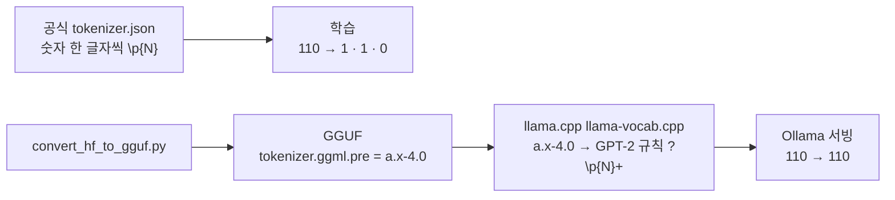
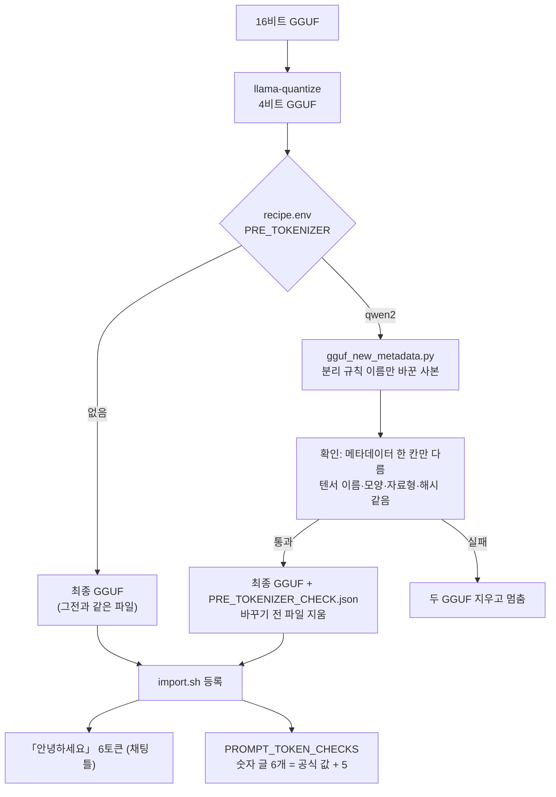

# A.X GGUF 숫자 토큰 분리 수정 (2026-11-28)

> 상태: 끝남(2026-11-28). 이슈 #279. 변환 스크립트를 고쳤고, 운영 모델(`ax40light:q4km`)은 바꾸지 않았다.
> 날짜와 상위 문서: 2026-11-28, 상위 [M2 README](README.md) 1절, 결정 [ADR-0036](../../adr/0036-공개-목록에-없는-모델은-변환-스크립트로-등록한다.md) 변경 메모

## 1. 결론

- 지금까지 Ollama에 올린 A.X GGUF는 숫자를 공식 토크나이저와 다르게 잘랐다. 학습은 「110」을 `1`, `1`, `0` 세 토큰으로 보고, 서빙은 `110` 한 토큰으로 봤다.
- GGUF 메타데이터 한 칸(`tokenizer.ggml.pre`)을 `a.x-4.0`에서 `qwen2`로 바꾸면 입력 토큰 수가 공식 토크나이저 값과 360개 중 348개 같아진다. 남은 12개는 숫자와 상관없는 호환 한자 정규화 차이다.
- 같은 프롬프트로 짝 비교하면 표 읽기 2차 학습 모델은 코드 채점의 「값 있음」이 늘었고(정답 표만 25 → 31, 실제 검색 14 → 19), 학습 전 모델은 같거나 줄었다(22 → 19, 18 → 18).
- 결정: 앞으로 만드는 A.X 모델은 고친 판으로 변환하고, 등록 뒤 숫자가 든 글의 토큰 수를 확인한다. `deploy/models/convert.sh`와 `import.sh`에 그 단계를 넣었다.
- 하지 않은 것: 운영 모델 교체(표 읽기 학습 단계 B 뒤에 따로 정함), 이미 만든 레시피(`ax40light`, `ax40light-r1`~`r5`) 변경, 데스크탑에서 변환 전체 다시 돌리기.

## 2. 문제

- llama.cpp는 GGUF의 분리 규칙 이름을 보고 사전 분리(pre-tokenization) 정규식을 고른다. 변환에 쓴 판(b11312)의 `src/llama-vocab.cpp`는 `tokenizer_pre == "a.x-4.0"`을 `gpt-2`, `phi-2`와 함께 `LLAMA_VOCAB_PRE_TYPE_GPT2`에 묶고, 이 규칙의 정규식은 숫자 줄을 한 덩어리로 잡는 ` ?\p{N}+`다. `qwen2`는 `LLAMA_VOCAB_PRE_TYPE_QWEN2`이고 숫자를 한 글자씩 잡는 `\p{N}`이다([llama-vocab.cpp, b11312](https://github.com/ggml-org/llama.cpp/blob/b11312/src/llama-vocab.cpp)).
- 변환 도구: `ghcr.io/ggml-org/llama.cpp:full-b11312@sha256:f9c7815efe7ac3fddfc4d162f8b353f01752dc61896681810f3a5c430b96c3de`(build 11312, 커밋 `0c1e57098`). 운영 모델과 학습 모델 모두 이 이미지로 만들었다.
- 앞선 대조(2026-11-27, 모델 호출 없음): 지난 측정의 프롬프트 133개 모두 공식 토크나이저 값이 Ollama 값보다 컸다(중앙 5.8%, 최대 15.4%). 분리 정규식만 GPT-2 규칙으로 바꾼 토크나이저로 세면 133개 모두 Ollama 값과 같았다.

## 3. 측정 조건 (2026-11-27, 데스크탑)

| 항목 | 값 |
|---|---|
| 고친 판 만들기 | 위 llama.cpp 이미지 안 `gguf_new_metadata.py --pre-tokenizer qwen2`(gguf-py 0.19.0). 등록된 GGUF를 읽어 새 파일로 씀 |
| 고친 판 확인 | 메타데이터 32키 중 `tokenizer.ggml.pre`만 다름, 텐서 339개의 이름·모양·자료형·데이터 SHA256 같음(두 모델 모두) |
| 모델 넷 | 학습 전 모델 `ax40light:q4km`과 고친 판 `ax40light-preq:q4km`, 표 읽기 2차 학습 모델 `ax40light-table-trial4-t4e2:q4km`과 고친 판 `…-preq:q4km`. 채팅 틀은 원본 등록 정보에서 GGUF 경로 줄만 바꿈 |
| 서빙 | Ollama 0.30.7, 11-24 측정과 같은 컨테이너와 이미지 |
| 프롬프트 | 11-24 표 읽기 측정과 같은 파일. 정답 표만 준 조건 43개, 실제 검색 조건 47개(답없음 4 포함) |
| 생성 옵션 | temperature 0, `num_ctx` 12,288, `num_predict` 512, 생각 끔. 두 번씩, 둘째는 순서를 거꾸로. 모두 720개 |
| 토큰 수 기준 | 학습에 쓴 A.X `tokenizer.json`(tokenizers 0.22.2, 특수 토큰 없이) 값 + 채팅 틀 5 |
| 답 채점 | 코드 규칙: 핵심 사실 값이 답에 글자로 모두 있으면 「값 있음」, 「찾지 못했습니다」가 들면 「거절」. 판정한 정답과 다르다 |

## 4. 결과

### 4.1 입력 토큰 수

| 대조 | 지금 판 | 고친 판 |
|---|---|---|
| 생성 중 고친 판 360개: 공식 값 + 5와 같음 | — | 348 / 360 |
| 짧은 글 11개와 숫자가 가장 많은 프롬프트 5개: 공식 값 + 5와 같음 | 1 / 16(「안녕하세요」만) | 16 / 16 |

- 예: 「110」 6 → 8, 「2026-10-31」 11 → 15, 숫자 4,099글자가 든 정답 표만 프롬프트(tq-0048) 9,250 → 10,930.
- 같은 프롬프트에서 두 판의 차이: 실제 검색 조건 중앙 227토큰(51~810), 정답 표만 조건 중앙 139토큰(12~1,680).
- 지금 판은 11-24 측정의 토큰 수를 그대로 재현했다(2절의 133개 대조와 같은 상태).
- 남은 12개: 실제 검색 프롬프트 셋(tq-0005, 0066, 0073)에 든 호환 한자 「樂」(U+F95C)이 원인이다(3개 × 2회 × 고친 판 2개). 공식 토크나이저는 NFC 정규화로 U+6A02 한 토큰으로 세고, llama.cpp는 정규화 없이 바이트 3토큰으로 센다. 지금 판도 같은 차이가 있다.

### 4.2 코드 채점 (답 있는 43문항)

「값 있음」과 「거절」은 두 번 모두 그 분류인 문항, 「그 밖」은 나머지다.

| 모델 | 조건 | 지금 판 값 있음 / 거절 / 그 밖 | 고친 판 |
|---|---|---|---|
| 표 읽기 2차 학습 | 정답 표만 | 25 / 9 / 9 | 31 / 4 / 8 |
| 표 읽기 2차 학습 | 실제 검색 | 14 / 18 / 11 | 19 / 13 / 11 |
| 학습 전 | 정답 표만 | 22 / 0 / 21 | 19 / 2 / 22 |
| 학습 전 | 실제 검색 | 18 / 3 / 22 | 18 / 3 / 22 |

- 답없음 4문항(실제 검색 조건)을 두 번 모두 거절: 2차 학습 4 → 4, 학습 전 1 → 0.
- 분류가 갈린 칸(문항 × 조건): 2차 학습 21, 학습 전 23. 같은 판을 두 번 돌린 차이는 조건마다 0~3칸이다.

### 4.3 갈린 답을 직접 읽은 결과 (1회차 답)

| 모델 | 나아짐 | 나빠짐 | 나머지 |
|---|---|---|---|
| 표 읽기 2차 학습 | 9칸: tq-0007, 0021, 0023, 0027(두 조건), 0049, 0051, 0054, 0066. 거절하거나 맞는 답 뒤에 거절 문장을 붙이던 답이 맞는 답으로 | 5칸: tq-0025(21.0 → 50), tq-0048(1.09, 1.07 → 63), tq-0039(두 조건), tq-0024. 맞던 값을 틀리게 읽음 | 두 판 모두 틀리거나 같은 답 |
| 학습 전 | 0칸 | 4칸: tq-0011, 0023, 0024, 0053 | 두 판 모두 틀림 |

이 읽기는 판정 절차(평가셋 판정 지침)가 아니라 코드 분류가 갈린 칸을 사람 기준으로 나눈 것이다.

## 5. 결정과 범위

- 학습 쪽 토크나이저는 SKT 공식 `tokenizer.json` 그대로 두고, 서빙 쪽 GGUF를 공식 규칙에 맞춘다(ADR-0036 변경 메모).
- 범위: 2026-11-28부터 새로 만드는 A.X 레시피(학습한 모델 포함)에 `PRE_TOKENIZER=qwen2`와 숫자 글 확인 목록을 넣는다. 운영 모델 교체는 표 읽기 학습 단계 B 뒤에 따로 정한다.

### 바꾼 스크립트

| 파일 | 바뀐 동작 |
|---|---|
| `deploy/models/convert.sh` | `PRE_TOKENIZER`가 있으면 양자화 뒤 분리 규칙 이름을 바꾸고 텐서가 그대로인지 확인한다. 16비트 GGUF를 먼저 지워 디스크를 더 쓰지 않는다 |
| `deploy/models/import.sh` | `PROMPT_TOKEN_CHECKS`가 있으면 숫자가 든 글마다 Ollama 입력 토큰 수를 기대값과 대조하고, 하나라도 다르면 멈춘다 |
| `deploy/models/README.md` | 새 A.X 레시피에 넣을 두 값과 확인 글 목록. 확인 글은 지어낸 글과 숫자만 쓰고, 기대값은 11-27 관문 측정의 공식 값 + 5다 |
| `deploy/models/ax40light/recipe.env` | 설명 줄만. 이 레시피는 지금 운영 파일을 그대로 다시 만든다 |

「안녕하세요」 확인은 숫자가 없어 두 판 모두 6토큰이다. 이 문제를 잡으려면 숫자가 든 글이 필요하다.

## 6. 검증

- [x] 두 스크립트 `bash -n` 통과.
- [x] 컨테이너 안 단계를 가짜 도구(작은 GGUF를 만드는 변환기, 파일을 복사하는 양자화기)와 실제 gguf-py 0.19.0으로 맥북에서 돌림: `PRE_TOKENIZER`가 없으면 develop 판 스크립트와 결과 파일 목록과 SHA256이 같다. `qwen2`면 최종 파일의 분리 규칙이 `qwen2`, 텐서 같음, 바꾸기 전 파일은 지워짐. 바꾸기가 텐서까지 바꾸면 확인이 실패하고 두 GGUF를 지운 채 멈춘다.
- [x] `import.sh`를 가짜 docker로 돌림: 고친 판 토큰 수(11-27 값)면 통과, 지금 판 토큰 수면 숫자 글 6개가 모두 걸려 멈춤, 확인 목록이 없는 레시피는 develop 판과 같은 출력.
- [ ] 데스크탑에서 변환과 등록 전체를 다시 돌리지 않았다. 고친 판을 만든 명령과 확인은 11-27에 손으로 한 기록(3절)이 근거다.

## 7. 한계

- 학습 전 모델은 고친 판에서 나아진 칸 없이 나빠진 칸이 4개다. 학습 전 모델은 GPT-2 규칙의 숫자 토큰으로 서빙 측정을 해 왔고, 그 상태에 맞춘 프롬프트와 비교 결과도 그 위에 있다. 운영 모델을 바꾸려면 따로 짝 비교를 한다.
- 2차 학습 모델에서 맞던 값을 틀리게 읽게 된 5칸의 원인은 모른다.
- 호환 한자 같은 NFC 정규화 차이는 이 수정으로 없어지지 않는다. 서버가 프롬프트를 NFC로 정규화하는 것은 #274에서 다룬다.
- 등록 확인의 기대값은 11-27에 `/api/generate`로 잰 값이다. `import.sh`는 `ollama run`(채팅 API)으로 센다. 채팅 틀의 두 갈래가 같은 글을 만들어 같은 수가 나와야 하지만, 이 숫자 글로 실제 데스크탑에서 돌려 본 적은 아직 없다.
- llama.cpp 판을 바꾸면 분리 규칙 이름과 정규식의 대응이 바뀔 수 있다. 판을 바꿀 때는 등록 확인의 숫자 글로 다시 본다.

## 8. 학습 포인트

- 같은 모델 가중치라도 토크나이저 설정 한 칸이 다르면 학습과 서빙이 다른 입력을 본다. 모델 파일 해시가 같다는 것만으로는 이 차이를 못 잡는다.
- 등록 확인은 그 문제를 실제로 드러내는 입력으로 해야 한다. 숫자가 없는 「안녕하세요」는 채팅 틀만 확인한다.
- 큰 파일을 고칠 때는 고친 범위를 기계로 확인한다(메타데이터 한 칸, 텐서 해시). 손으로 「한 칸만 바꿨다」고 믿지 않는다.
