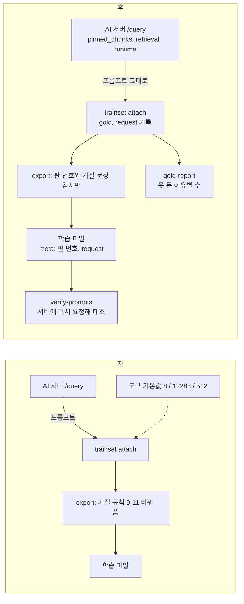

# 서버 프롬프트를 그대로 쓰는 학습 데이터와 평가 입력, 정답 청크 순위 기록 (2026-11-28)

> 상태: 끝남(2026-11-28). 이슈 #275. 학습 데이터 파일은 새로 만들지 않았다(도구와 테스트만). 실제 검색과 정답 청크 지정의 비율, 거절 예시 상한은 단계 C에서 정한다.
> 날짜와 상위 문서: 2026-11-28, 상위 [M2 README](README.md) 1절, 결정 [ADR-0048 변경 메모](../../adr/0048-답없음-예시는-근거-구성으로-정답-근거-블록은-코드가-짚는다.md), 앞 작업 [표 블록 조립](표-블록-조립-20261128.md)(#274)

## 결론

- 학습 데이터 도구(`trainset`)와 평가 실행기(`evalset`)는 AI 서버가 준 프롬프트를 고치지 않고 쓴다. 지난 거절 규칙을 바꿔 쓰던 코드와 지시문 사본(`REFUSAL_RULES`)을 없앴다.
- 근거 수, 문맥 길이, 답 상한은 서버 응답의 실행 설정(`runtime`)에서만 읽는다. 도구 쪽 기본값(8, 12,288, 512)을 지웠다.
- AI 서버 평가용 요청에 정답 청크 지정(`pinned_chunks`)을 더했다. 지정한 청크를 재순위 뒤 순서의 정한 자리(1~근거 수)에 넣고 나머지는 검색 순서대로 조립한다.
- 서버는 후보마다 검색기별 순위, 순위 융합 뒤 순위, 재순위 뒤 순위, 근거 블록 번호를 평가용 기록에 싣는다. 도구는 이것으로 정답 청크가 근거에 못 든 이유를 세고(`gold-report`), 실제 검색에서 못 든 예시는 목표 답을 거절로 둔다.
- 입력 틀 판 번호(`PROMPT_TEMPLATE_VERSION`, 지금 1)를 서버 응답과 학습 파일에 남긴다. 골든 프롬프트가 바뀌었는데 판 번호가 그대로면 테스트가 실패한다.
- 학습 파일의 프롬프트를 서버에 다시 받아 글자까지 대조하는 명령(`verify-prompts`)을 뒀다. 한 글자 바꾼 학습 파일을 잡는다.
- 하지 않은 것: 학습 데이터 만들기, 지정 비율과 거절 상한 정하기(단계 C), 지시문 규칙 번호 다시 매기기(아래 「지시문 규칙 번호」에 추천만).

## 용어

| 용어 | 뜻 | 쓰이는 곳 |
|---|---|---|
| `pinned_chunks`(지정 청크) | 평가와 학습 데이터 전용 요청 칸. 원문 청크 id와 자리(1부터) | `ai-server/main.py` `QueryRequest`, `_place_pinned_chunks` |
| `retrieval`(후보별 단계 순위) | 평가용 기록의 후보 목록. 청크마다 `vector_rank`, `bm25_rank`, `table_fact_rank`, `fused_rank`(순위 융합 뒤), `rerank_rank`(재순위 뒤, 재순위를 안 썼으면 없음), `final_rank`(지정 청크를 넣은 뒤), `block`(근거 블록 번호, 못 들었으면 없음) | `_retrieval_ranks`, `eval_trace.retrieval` |
| `gold`(정답 청크 기록) | 학습 예시마다 실제 검색(`검색`)인지 지정(`지정`)인지, 정답 청크마다 위 순위와 근거에 들었는지, 못 들었으면 이유 | `tools/corpus/corpus/trainset/gold.py` |
| 입력 틀 판 번호 | 프롬프트의 고정 글이나 조립 규칙을 바꾸면 올리는 정수 | `PROMPT_TEMPLATE_VERSION`, `runtime.prompt_template_version` |

## 배경

학습 데이터와 측정 입력을 스크립트가 서버 프롬프트를 다시 조립해 만들어 왔고, 운영 입력과 29항목 중 22항목이 달랐다([운영과 학습 파이프라인 차이 점검](운영-학습-파이프라인-차이-점검-20261126.md)). 저장소 도구에도 그런 곳이 셋 있었다.

- 내보낼 때 입력 프롬프트의 지난 거절 규칙 9·11을 지금 규칙으로 바꿔 썼다(`pipeline.current_rules`). 규칙을 번호(「9.」, 「11.」)째로 찾았다.
- 표본 답 받기가 서버 값이 없으면 12,288과 512를, 근거 붙이기가 근거 수 8을, 다시 생성하기가 512를 도구 쪽에 따로 적어 썼다.
- 1차 학습 데이터는 정답 청크가 늘 첫째여서 모델이 「둘째 이후면 거절」을 배웠다. 정답 청크의 자리를 정할 수단이 서버에 없었다.

정답 청크가 근거 8개에 못 든 질문이 왜 못 들었는지 기록도 없었다.

## 변경 전과 후



## 지정 청크 조립

서버는 검색, 순위 융합, 재순위를 운영과 똑같이 마친 뒤 지정 청크를 정한 자리에 넣고, 그 순서로 #274의 표 블록 조립(또는 기존 근거 조립)을 한다. 검색 후보에 있던 청크는 그 자리에서 옮기고, 없던 청크는 색인에서 꺼내 검색된 청크와 같은 런타임 처리(질문에 맞는 표 사실 붙이기)를 거친다.

가나대학 예시(근거 수 3): 순위 융합 순서가 `13_1`, `11_0`, `12_3`이고 `14_2`(검색 후보 아님)를 2번 자리에 지정하면 근거는 `13_1`, `14_2`, `11_0`이 되고 `12_3`은 4위로 밀려 빠진다.

```json
{"question": "가나대학 장학금", "top_k": 3, "include_eval_trace": true,
 "pinned_chunks": [{"chunk_id": "14_2", "rank": 2}]}
```

응답의 `eval_trace.pinned`는 `[{"chunk_id": "14_2", "rank": 2, "candidate_rank": null, "from": "index", "block": 2}]`이다. 표 블록이 켜져 같은 표의 앞 순위 블록에 합쳐지면 `block`은 그 블록 번호가 아니라 없음이 되고, 도구가 같은 표 블록 번호로 잇는다(아래 이유 분류의 「합쳐짐」). 지정 청크는 첫째에 두지 않고 정한 자리에 넣으므로, 표를 다 줄여도 프롬프트가 상한을 넘어 서버가 뒤 블록부터 빼면 지정 청크도 빠질 수 있다. 블록 하나만 남아 끝 줄을 자르는 경우는 지정 자리가 1일 때만 정답 블록에 닿는다.

거부하는 요청(400): 자리가 근거 수 밖, 평가용 기록(`include_eval_trace`) 없이 지정, 청크나 자리가 겹침, 색인에 없는 청크, 제외 목록에 걸린 청크.

## 정답 청크가 근거에 못 든 이유

도구는 서버의 후보별 단계 순위를 그대로 옮기고 아래 순서로 가른다.

| 정답 청크 상태 | 판정 |
|---|---|
| `block`이 있음 | 근거에 듦 |
| 프롬프트 길이 상한 때문에 서버가 뺀 블록의 청크(`limit_dropped_chunk_ids`)이거나 그 블록에 합쳐져 있던 청크(`limit_dropped_merged_chunk_ids`) | 길이 상한으로 빠짐 |
| 표 블록에서 같은 표의 앞 블록에 합쳐짐(`dropped_chunk_ids`) | 근거에 듦(합쳐짐), 같은 표 블록 번호를 씀 |
| 순위 융합 후보에 없음 | 검색 후보에 없음 |
| 재순위를 썼고 순위 융합 순위는 근거 안이었음 | 재순위에서 밀림 |
| 그 밖 | 순위 융합에서 밀림 |

길이 상한을 합쳐짐보다 먼저 보는 까닭: 합쳐진 블록이 상한 때문에 빠지면 그 청크도 근거에 없다. 서버는 뺀 블록 자기 청크(`limit_dropped_chunk_ids`)와 별도로 거기 합쳐져 있던 청크를 `limit_dropped_merged_chunk_ids`에 남긴다(기록만 더하고 프롬프트 글은 그대로). 블록 하나만 남아 끝 줄을 잘랐으면 자른 뒤 남긴 줄 수(`truncated_lines`)를 정답 청크 기록에 옮긴다. 잘린 줄에 답 값이 있으면 「근거 대조」 검사가 그 예시를 떨어뜨린다.

못 든 청크마다 같은 문서의 같은 표 번호를 가진 표 블록이 근거에 있는지(`same_table`)도 남긴다. 청크의 표 번호는 계획을 만들 때 서버 `/documents/{id}/chunks`의 메타데이터에서 받는다. 옛 계획처럼 표 번호가 없으면 「모름」이다.

실제 검색이고 정답 청크가 못 들었으며 답 근거(질문을 만든 글의 답 부분)도 프롬프트에 없으면 목표 답을 거절로 둔다(`gold.refusal_target`). 목표 답 지시문은 답 근거를 주지 않고 답없음 예시로 쓰게 하며, 확인처는 재료 문서, 같은 게시글, 같은 묶음 블록에서만 고른다(ADR-0048 결정 2와 같은 규칙). 자동 검사의 「거절함」, 「확인처 출처」도 같이 건다.

`trainset gold-report --batches g` 출력 예(가나대학 합성 묶음, 테스트 `test_count_reasons_counts_only_real_retrieval_answer_examples`와 같은 데이터):

```json
{
 "실제 검색 예시": 6,
 "정답 청크가 근거에 듦": 1,
 "정답 청크가 근거에 못 듦": 5,
 "못 든 청크의 이유": {"검색 후보에 없음": 2, "순위 융합에서 밀림": 1, "재순위에서 밀림": 1, "길이 상한으로 빠짐": 1},
 "못 든 청크 중 같은 표의 다른 조각이 근거에 듦": {"예": 1, "아니오": 0, "표 번호 모름": 4},
 "거절로 둔 예시": 1,
 "끝 줄을 자른 예시": 1,
 "지정 예시": 2,
 "지정 예시의 정답 블록": {"1": 1, "2": 1}
}
```

거절 + 확인처 예시(답이 든 청크를 일부러 뺌)와 엉뚱한 근거 예시(청크 없음)는 세지 않는다. 여러 근거 합치기는 정답 청크가 둘이라 못 든 청크마다 센다. 「끝 줄을 자른 예시」는 실제 검색과 지정을 모두 센다.

## 입력 틀 판 번호와 대조

- 서버: `PROMPT_TEMPLATE_VERSION`을 실행 설정에 싣는다(평가용 기록, 처리 기록, `/debug/rag-trace`).
- 테스트: `tests/test_prompt_golden.py`가 골든 파일 다섯 개 전부의 SHA-256을 판 번호별로 적어 둔다. 골든을 갱신했는데 판 번호를 올리지 않거나 새 판 줄을 더하지 않으면 실패한다. 지난 판 줄은 고치지 않는다.
- 학습 파일: 줄마다 `meta.prompt_template_version`, `meta.retrieval_mode`, `meta.gold_blocks`, `meta.request`(근거를 붙일 때 보낸 요청 그대로)를 남긴다. 판 번호가 없거나 둘 이상 섞였거나, 입력 규칙의 거절 문장이 지금 문장(「학교 홈페이지 안내에서 찾지 못했습니다.」)이 아닌 예시가 있으면 `export`, `export-round`, `pairs`가 학습 파일로 쓰지 않는다. 거절 규칙은 번호가 아니라 따옴표 안 문장으로 찾는다.
- 대조: `trainset verify-prompts round-ga.jsonl --ai-url URL`이 줄마다 `meta.request`로 서버 `/query`를 다시 불러 프롬프트를 글자까지 견준다. 다르면 처음 달라진 위치와 앞뒤 글, 판 번호가 같은지를 낸다. 근거 붙이기는 기준 날짜(`as_of`)를 늘 보내 같은 날짜로 다시 받게 했다.

## 쓰는 법

| 할 일 | 명령(맥북, `tools/corpus`) |
|---|---|
| 정답 청크 지정 몫을 주고 근거 붙이기 | `python -m corpus trainset attach --batch 묶음 --pinned-share 0.5`(몫은 단계 C에서 정함, 기본 0) |
| 못 든 이유별 수 | `python -m corpus trainset gold-report --batches 묶음1,묶음2` |
| 학습 파일 대조 | `python -m corpus trainset verify-prompts 학습파일.jsonl --ai-url http://localhost:18100` |
| 평가 실행(근거 수는 서버 기본값) | `python -m corpus evalset run 평가셋 --ai-url URL --out 실행폴더 --index 색인`(`--top-k` 생략) |

## 안전 경계

| 바꾼 것 | 바꾸지 않은 것 |
|---|---|
| `/query` 평가용 요청 칸 `pinned_chunks`, 평가용 기록의 `retrieval`, `pinned` | 운영 경로(`pinned_chunks`를 보내지 않으면 `_prepare_query` 호출 인자까지 같음) |
| 실행 설정에 `prompt_template_version`, `default_top_k` | 프롬프트 글(골든 다섯 개 그대로) |
| `/debug/rag-trace` 응답에 `runtime` | `/query/stream`, 백엔드, 화면 |
| 표 블록 처리 기록에 `limit_dropped_merged_chunk_ids` | 길이 상한 처리와 그 결과 프롬프트 |
| 학습 도구의 근거 블록 번호를 서버 기록으로 잇기 | 색인, 검색 순서, 표 블록 조립 규칙 |

근거 블록 번호를 고친 까닭: 표 블록이 켜지면 같은 표의 뒤 순위 청크가 앞 블록에 합쳐져 근거 목록의 N번째가 `[출처 N]`이 아니다. 답이 든 청크를 빼는 곳과 확인처 블록을 고르는 곳이 N번째로 이었으면 다른 청크를 빼거나 없는 블록을 확인처로 줄 수 있었다.

## 검증

- AI 서버 `OLLAMA_BASE_URL=http://127.0.0.1:9 venv/bin/python -m pytest`: 280 통과, 1 건너뜀(라이브 Chroma 진단). 새 테스트 `tests/test_pinned_chunks.py` 16개, 판 번호 테스트 1개, 상한으로 뺀 블록에 합쳐진 청크 기록 1개. 골든 프롬프트와 표 블록 테스트는 그대로 통과한다.
- `tools/corpus` `.venv/bin/python -m pytest`: 388 통과. 새 테스트 `tests/test_trainset_server_prompt.py` 24개(경우별 매개변수 포함). 입력을 바꿔 쓰던 동작을 가정한 기존 테스트는 새 계약(입력 그대로, 검사만)으로 고쳤다.
- 변이 확인: 새 동작 31개를 하나씩 망가뜨려 모두 테스트가 잡았다(되돌리기는 바꾼 파일에만). 처음에 놓친 하나(표본 단계가 서버 문맥 길이 없이 도구 기본값으로 부름)는 테스트를 보강한 뒤 잡았다.

| 망가뜨린 동작 | 결과 |
|---|---|
| 지정 자리를 무시하고 늘 첫째 | 잡음 |
| 재순위 뒤 순위를 남기지 않음 | 잡음 |
| 자리 범위 검사, 제외 목록 검사 뺌 | 잡음 |
| 판 번호만 올림, 골든 글만 바꿈 | 잡음 |
| 검색 추적의 실행 설정 뺌 | 잡음 |
| 재순위 이유 조건 뒤집음, 합쳐진 청크를 못 듦으로 | 잡음 |
| 지정 자리를 늘 1부터 | 잡음 |
| 거절로 두기에서 답 근거 검사를 뺌 | 잡음 |
| 거절 규칙을 규칙 안의 첫 「[검색 근거]」로 자름 | 잡음 |
| 학습 입력을 손봄(빈 줄 하나 줄임) | 잡음 |
| 대조를 길이로만 | 잡음 |
| 지난 규칙 입력을 세지 않음 | 잡음 |
| 표본 화면이 날짜 줄을 통째로 읽음 | 잡음 |
| 표본 단계 문맥 길이 기본값 | 놓침 → 테스트 보강 뒤 잡음 |
| 실행 폴더 판 번호 검사 뺌, 다시 생성하기 기본값 | 잡음 |
| 블록 번호를 근거 순서로 이음 | 잡음 |
| 서버가 상한으로 뺀 블록에 합쳐진 청크를 남기지 않음, 남은 블록 조건 뒤집음 | 잡음 |
| 근거 붙이기가 상한 기록 세 칸 중 하나씩 옮기지 않음 | 잡음 |
| 상한 이유를 보지 않음, 합쳐짐을 상한보다 먼저 봄, 합쳐진 상한 청크를 무시함 | 잡음 |
| 정답 기록에 자른 줄 수 없음, 자른 예시 수 0, 이유 목록에 상한 없음 | 잡음 |

데스크탑에 접속하지 않아 실제 색인과 실제 서버로는 돌리지 않았다.

## 학습 위험

- 실제 검색에서 정답이 못 든 예시를 모두 거절로 두면 「답이 있는데 거절」을 배울 수 있다. 그래서 답 근거가 다른 블록(거의 같은 문서)에 있으면 답 예시로 남긴다(ADR-0048 결정 3과 같은 판단). 같은 표의 다른 조각이 들어와 표 전체가 근거에 있으면 답 근거가 프롬프트에 있으므로 거절로 두지 않는다.
- 지정 예시만 많으면 「정답은 늘 근거 안에 있다」를 배울 수 있다. 실제 검색 몫과 거절 상한을 단계 C에서 함께 정한다.
- 지정 자리는 1~근거 수에서 고르게 뽑는다. 1차의 「정답은 늘 첫째」가 되풀이되지 않는지는 `gold-report`의 「지정 예시의 정답 블록」으로 본다.

## 한계와 다음 작업

- `verify-prompts`는 서버 `/query`로 다시 받아 예시마다 학습 전 모델 답 생성이 한 번 돈다. 수천 개를 대조하면 시간이 든다. 생성 없이 프롬프트만 주는 평가용 칸을 더하면 빨라진다(이번에는 문서에 없어 만들지 않음).
- 정답 청크의 표 번호는 이번 판부터 계획에 남는다. 지난 계획으로 붙인 예시는 같은 표 조각 여부가 「모름」이다.
- 근거 수를 모를 때 도구는 지정 청크가 있는 첫 예시 전에 `/debug/rag-trace`를 한 번 부른다(검색만 하고 답은 만들지 않음).

## 지시문 규칙 번호

#274가 표 사실 규칙(4번)을 빼고 번호를 다시 매기지 않아 지금 규칙은 3 다음이 5다. 학습 도구는 이제 번호에 기대지 않으므로 번호를 다시 매겨도 도구는 그대로 돈다(테스트로 확인). 추천: 단계 C에서 학습 데이터를 만들기 전에 다시 매긴다. 모델이 학습으로 볼 지시문이 빠진 번호를 갖지 않게 하려는 것이다. 다시 매기면 프롬프트 글이 바뀌므로 골든 갱신, 판 번호 2, 단계 B 기준선 다시 재기가 함께 따른다. 다시 매기지 않는다면 지금 모양(판 1)으로 학습해도 운영 입력과는 같다.

## 학습 포인트

- 학습 입력을 운영 서버가 만든 글 그대로 쓰면 「운영과 학습이 다르다」를 코드로 막을 수 있다. 도구는 고치지 않고 검사만 하고(판 번호, 거절 문장), 다른 판이 섞이면 멈춘다.
- 「정답 청크가 왜 못 들었나」는 검색기, 융합, 재순위, 조립 단계마다 순위를 남겨야 셀 수 있다. 서버가 이미 가진 후보별 처리 기록(ADR-0052)을 평가용 응답으로 넓혀 같은 기록을 썼다.
- 골든 파일 지문과 판 번호를 짝으로 묶으면 「틀을 바꾸고 판 번호를 잊음」을 CI가 잡는다.
