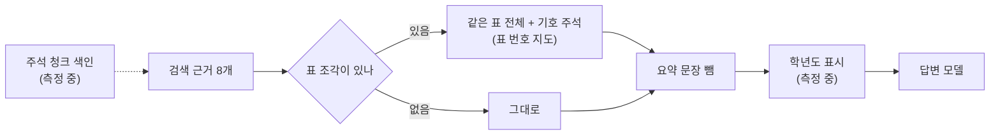

# 표 근거 개선 기록: 2026-11-16 하루의 측정과 결정

> 상태: 기록(2026-11-16 23:55). 서비스 코드는 바뀌지 않았다. 밤새 도는 측정과 학습 데이터 제작의 결과는 없고, 그 자리는 「측정 중」으로 둔다.
> 앞 기록: [표 범례 문제 기록](표-범례-문제-기록-20261116.md)(11-13 ~ 11-16 낮, 범례가 표와 다른 청크로 갈리는 문제와 범례 줄 찾기 방법). 이 문서는 그 뒤에 한 일만 쓰고, 겹치는 내용은 그 문서를 가리킨다.

## 1. 요약

- [실측] 표 조각 하나가 검색되면 같은 표 전체와 기호 주석을 함께 넣는 조립(R2)으로, 근거 8개를 고정한 채 표 질문 맞음이 47문항 중 21 → 26, 개발셋 본 틀림이 13 → 9가 됐다(`rp_summary.json`).
- [실측] 전공심화과정 문항이 표 전체를 받고도 15개 중 9개 학과만 답한 원인은 서버가 표 조각에서 만든 요약 문장이었다. 세 설정에서 요약 문장의 학과 수와 답한 학과 수가 9, 15, 9로 같았다(`tq0001-explain.html`).
- [판단] 요약 문장은 빼기로 정했다. 넣은 쪽과 뺀 쪽의 전체 점수 차는 변동 폭 안이라 우열을 못 가렸지만, 요약 문장이 252문항 중 130문항에 들어가고 틀린 문장이 섞여 있어 위험만 확인됐다.
- [실측] 학년도 줄을 질문 쪽에만 넣으면 모델은 해를 바르게 적고도 값은 다른 해 표에서 읽었고, 답없음 거절이 4개 줄어 기준에서 떨어졌다(`rp_summary.json`).
- [실측] 자유전공학부 농어촌 문항은 답이 든 주석 청크가 검색 13, 14위라 근거 8개에 들지 못했다. 이 문제는 프롬프트 조립으로 못 고치고 색인에서 풀어야 한다(`표-주석-색인-검색-20261116.md`).
- 남은 것: 지금까지 숫자는 모두 학습 전 모델, 재순위 끔 조건이다. 학습 쪽 조건(5회차 모델, 재순위 켬)으로 다시 잰 값은 아직 없다(데스크탑 메모리 부족으로 두 번 멈춤, 10절).

처음 나오는 용어:

- 근거 고정 재생(replay): 기준 실행이 검색한 근거 8개를 그대로 두고 프롬프트 조립만 바꿔 답 생성만 다시 하는 측정이다. 검색 차이를 빼고 조립의 효과만 본다.
- 표 번호 지도(table map): 문서마다 표에 번호를 붙이고, 어느 청크가 어느 표의 조각인지 적은 파일이다. 조립이 「같은 표의 나머지 조각」을 찾는 데 쓴다.
- 요약 문장(table bridge facts): 서버가 검색된 표 조각에서 질문과 맞는 행을 뽑아 「질문 의도 추출 정보」 머리말 아래에 한 줄로 만들어 넣는 문장이다. 예: 「- 4년제 학사학위(전공심화)과정 운영 학과 ※: 로봇자동화공학과, 자동차공학과, …」.
- 본 틀림: 개발셋 틀림 가운데 답이 있는 문항의 틀림이다. 답없음 거절: 답이 문서에 없는 문항을 바르게 거절한 수다.
- 학년도(academic year): 학교 문서가 쓰는 해 이름이다. 2025년 가을에 치른 입시가 문서에서는 「2026학년도」다.

## 2. 측정 조건

| 조건 | 값 |
|---|---|
| 답변 모델 | 학습 전 A.X 4.0 Light(`ax40light:q4km`), 온도 0, 문맥 12,288, 출력 512 |
| 검색 | 서비스 색인, 순위 융합, 근거 8개, 재순위 끔 |
| 기준 날짜 | 2026-10-31(날짜 줄 켬) |
| 문항 | 표 질문 고르는 몫 47문항, 개발셋 205문항. 확인 몫과 테스트셋은 열지 않았다 |
| 채점 | 규칙 채점 뒤 애매한 답은 Claude가 설정 이름을 가린 채 한 번 판정(사람 확인 없음) |
| 거르기 | 표 질문 맞음 ≥ 기준 + 3, 개발셋 본 틀림 ≤ 기준 + 2, 답없음 거절 ≥ 기준 − 1 (11-14 단계 1과 같음) |

[원문] 조건은 재생 기록 2절과 4절, 11-14 기록 3-1절에서 옮겼다. [판단] 이 조건은 학습 쪽 측정과 달랐다. 7절에 따로 쓴다.

## 3. 표 번호로 합치기 (근거 고정 재생)

### 증상

[실측] 범례 문제 기록 2절의 두 문항이 그대로 남아 있었다. 「기계공학과는 전문대졸 전형으로 몇 명 뽑아요?」(tq-0004)는 「모름」, 「전공심화과정이 있는 학과는 어디예요?」(tq-0001)는 15개 중 9개만 답한 「일부」였다. 표가 여러 청크로 나뉘어 일부 행이나 범례만 근거에 든 것이 원인으로 보였다(범례 문제 기록 3절).

### 재현과 측정

[실측] 색인을 다시 만들지 않고, 기준선 근거에 표가 든 문서 103개를 같은 코드로 다시 잘라 표 번호 지도를 만들었다. 다시 자른 청크와 표 원문 블록 580개가 기준선 근거와 글자까지 같았다(재생 기록 3-1절, `map_stats.json`).

[실측] 지도에는 표 413개가 있고, 근거에 나온 표 블록 429개 가운데 398개에 표 번호가 붙었다. 못 붙인 31개 중 25개는 한 행이나 한 열짜리였다(`map_stats.json`).

| 설정 | 근거 블록에서 바꾼 것 |
|---|---|
| R0 | 아무것도 안 바꿈. 재생 경로 확인용으로 두 번(R0a, R0b) |
| R1 | 표 조각 자리에 같은 표의 조각을 모두 이은 표 하나 |
| R2 | R1 + 표 칸의 기호와 같은 기호가 든 표 뒤 줄(기호 주석) |
| R3 | R1 + Opus가 고른 표에 딸린 줄 전부(사람 확인 없음) |

표가 4,000자를 넘으면 넓히지 않고 근거에 있던 표 줄을 그대로 뒀다.

**표 1. 설정별 결과(근거 고정 재생, 11-16 16:22~17:13 생성)** [실측, `rp_summary.json`, 판정 `judgments_pool_20261116.jsonl`]

| 설정 | 표 질문 맞음(47) | 개발셋 본 틀림 | 답없음 거절 | 거르기 |
|---|---:|---:|---:|---|
| R0a(= R0b) | 21 | 13 | 23 | 기준 |
| R1 표 전체 | 25 | 10 | 25 | 통과 |
| R2 표 전체 + 기호 주석 | 26 | 9 | 25 | 통과 |
| R3 표 전체 + 딸린 글 전부 | 24 | 10 | 25 | 통과 |

- [실측] tq-0004는 R2와 R3에서 범례 줄 「◈표시: 모집인원 제한 없음」이 들어가 「모름」에서 「맞음」이 됐다. 범례가 없는 R1은 「모름」 그대로였다(재생 기록 10-4절).
- [실측] 입력 토큰 최대는 표 질문 5,714 → 9,004, 개발셋 7,394 → 8,929였고 잘림은 0이었다(재생 기록 10-1절).
- [실측] 11-14 단계 1에서 표를 통째로 넓혔을 때(c13)는 답없음 거절이 24 → 18로 줄었다. 이번에는 세 설정 모두 23 → 25로 늘었다(재생 기록 1절).

### 원인

[판단] 표 조각만 받을 때 모델은 받은 행만 답한다. 같은 표의 나머지 행과 범례를 함께 주면 값을 읽는다. 다만 기호와 무관한 딸린 글까지 다 넣은 R3은 R2보다 낫지 않았다.

### 견준 후보와 버린 이유

| 후보 | 버린 이유 |
|---|---|
| 표를 한 청크로 색인(11-14, 최대 2,000자) | [실측] 표 질문 맞음 21 → 23이지만 개발셋 틀림 14 → 17로 탈락(범례 문제 기록 4절) |
| 표 전체로 넓히기 4,000자, 10,000자(11-14 c05, c06) | [실측] 프롬프트가 문맥 한도에 닿아 한두 글자에서 멈춘 답이 12개, 27개 나왔다(`표-근거-실험-단계1-20261114.md` 3-2절) |
| R3 딸린 글 전부 | [실측] 표 질문 맞음 24로 R2(26)보다 낮다. [판단] 1~2문항 차이는 순위로 읽지 않지만, 넣는 글이 많아도 나아지지 않았다 |

### 부작용과 한계

- [실측] R0를 두 번 돌린 답은 표 질문 46/47, 개발셋 205/205가 같았다. 그런데 R0a와 서버 경로 기준선의 답 글은 프롬프트가 252개 모두 글자까지 같은데도 표 질문 16/47, 개발셋 100/205만 같았다(재생 기록 10-3절).
- [실측] 원인으로 의심한 두 가지를 확인해 배제했다. 서버처럼 스트리밍으로 받아도, 질문마다 임베딩 모델을 먼저 불러 두 모델을 함께 올려도 기준선과 같은 답은 16/47이었다(`check_embed.py`, 실행 `20261116-rp-chk-stream-tq`, `20261116-rp-chk-embed-tq`). 원인은 확인하지 못했다.
- [실측] 반대로 요약 문장을 뺀 c01 실행의 프롬프트를 재생한 D0은 서버 경로 c01과 답 글이 표 질문 45/47, 개발셋 205/205 같았다(재생 기록 11-1절). 재생과 서버의 차이가 왜 실행마다 다른지도 모른다.
- [판단] 그래서 재생 숫자는 같은 경로 안의 짝 비교로만 읽는다. 서버에 구현한 뒤 서버 경로로 다시 재야 한다.
- [판단] 판정 84개는 Claude가 한 번 했고 사람 확인은 없다. R1, R2, R3 사이의 1~2문항 차이는 프롬프트가 조금만 달라져도 답이 바뀌는 폭 안이다.
- [실측] 4,000자를 넘는 표 22개는 넓히지 않았다. 표 질문에서 상한으로 그대로 둔 표 131개는 지원·성적현황 PDF 다섯 개와 실습실 안전진단 보고서의 표가 거의 전부다(재생 기록 5절).

### 정한 것과 남은 것

- 정함 [판단]: 표 조각이 검색되면 표 전체와 기호 주석을 넣는다(R2 모양). 딸린 글 전부(R3)는 넣지 않는다.
- 남은 것: 서버 구현과 서버 경로 측정, 색인 때 표 번호를 메타데이터로 남기기, 4,000자를 넘는 표를 어떻게 넣을지.

## 4. 전공심화과정 문항이 9개에서 멈춘 원인: 요약 문장

### 증상

[실측] R1~R3에서 근거의 ♣ 표시 줄은 7줄에서 21~22줄로 늘었고 15개 학과 행이 모두 들어갔다. 그런데 네 설정 모두 답은 9개 학과를 나열하고 멈췄다(출력 166~168토큰, 멈춤 이유 stop, 재생 기록 10-4절).

### 재현과 측정

[실측] 세 실행의 tq-0001 프롬프트와 답을 나란히 놓았다(`tq0001-explain.html`, 원자료 `20261114-t1-base1-tq`, `20261114-t2-t2one-tq`, `20261116-rp-R2-tq`의 `answers.jsonl`).

| 실행 | 요약 문장의 학과 | 프롬프트의 ♣ 표 행 | 답한 학과 |
|---|---:|---:|---:|
| 기준선(표 조각) | 9 | 일부 | 9 |
| 11-14 표를 한 청크로 색인 | 15 | 15 | 15 |
| 11-16 R2(표 행을 뒤에 붙임) | 9 | 15 | 9 |

[실측] 기준선과 「표를 한 청크로」의 프롬프트 차이는 요약 문장의 학과 6개, 위치 표기, 청크 번호 셋뿐이었다(`tq0001-explain.html`).

### 원인

- [원문] 요약 문장은 `ai-server/main.py`의 `_derive_table_legend_list_evidence_facts()`가 만든다. 질문 의도가 목록(list)이면, 검색된 표 조각의 행 가운데 범례 뜻이 질문과 맞는 행의 행 이름을 모아 한 줄로 만든다. 2026-05-15 PR #68(squash 커밋 `763b213`)에 들어갔고, PR 안의 커밋 이름은 「fix(rag): 전공심화 목록형 근거 보강 (#18)」이다.
- [원문] 같은 파일의 프롬프트 지시문에 「'질문 의도 추출 정보'가 있으면 답변에 우선 사용한다」가 있다(`ai-server/main.py` 4780행).
- [판단] R1~R3은 이미 만들어진 프롬프트에 표 행만 바꿔 넣었으므로, 요약 문장은 검색된 조각 기준의 9개 그대로 남았다. 모델은 지시대로 요약 문장을 옮겼다.

### 견준 해석과 버린 이유

| 해석 | 버린 이유 |
|---|---|
| 모델이 긴 목록을 끝까지 나열하지 못한다 | [실측] 같은 모델이 「표를 한 청크로」에서 15개를 모두 답했고, 요약 문장이 15개일 때 15개, 9개일 때 9개를 답했다 |
| 요약 문장도 표 전체로 다시 만든다 | [판단] 목록 질문 한 종류는 풀 수 있지만, 서버가 만든 문장이 틀리면 지시문 때문에 그대로 답이 된다는 위험이 남는다(5절) |

### 정한 것과 남은 것

5절의 결정으로 이어진다.

## 5. 요약 문장을 뺄지

### 문제

[실측] 요약 문장은 표 질문과 개발셋 252문항 가운데 130문항의 프롬프트에 들어 있었다. 틀린 문장도 섞여 있었다. 예: 「인문사회 학과: 스마트기계설계과」(공학 계열 학과), 「반도체기계공학과 인원: 화학생명공학과」(뜻이 통하지 않음).

### 재현과 측정

[실측] 11-14 단계 1에서 요약 문장을 지우는 서버 설정(`drop_table_bridge`, 후보 c01)을 이미 쟀다. 당시 채점기로 표 질문 맞음 21 → 23, 개발셋 본 틀림 11 → 8, 답없음 거절 24 → 22였고, 표 질문 맞음이 기준(+3)에 하나 모자라 탈락했다(`표-근거-실험-단계1-20261114.md` 3-2절). 고친 채점기(#261)로 다시 채점한 판정 수는 개발셋 틀림 12 → 9, 맞음 175 그대로다(재생 기록 10-1절의 base1, 11-1절의 c01).

[실측] 11-16에는 표 전체를 준 상태에서 요약 문장을 넣은 쪽과 뺀 쪽을 같은 재생 경로로 견줬다(`rp_summary.json`, 판정 `judgments_pool_20261116_d.jsonl`).

**표 2. 요약 문장 있음과 없음** [실측]

| 설정 | 요약 문장 | 표 | 표 질문 맞음 | 개발셋 본 틀림 | 답없음 거절 | tq-0001 |
|---|---|---|---:|---:|---:|---|
| R0a | 있음 | 조각 | 21 | 13 | 23 | 9개 답 |
| D0 | 없음 | 조각 | 23 | 8 | 22 | 13개 답, 정답 11 |
| R2 | 있음 | 전체 + 기호 주석 | 26 | 9 | 25 | 9개 답 |
| D2 | 없음 | 전체 + 기호 주석 | 24 | 8 | 24 | 15개 답, 정답 13 |

- [실측] D2 대 R2는 표 질문 맞음 −2, 개발셋 본 틀림 −1, 답없음 거절 −1이다. 재기 전에 적은 「지워도 된다」(표 질문 맞음 ≥ R2 − 1)에도, 「지우면 안 된다」(≤ R2 − 3 또는 본 틀림 ≥ R2 + 3)에도 들지 않았다(재생 기록 11-1절).
- [실측] 서버 설정을 켜면 요약 문장만 빠지는 것이 아니라, 27문항(표 질문 5, 개발셋 22)에서 같은 청크의 「질문 관련 발췌」도 달라진다(`drop_excerpt_diff.json`). 그래서 D2 대 R2는 「요약 문장만 뺀 효과」가 아니라 「서버 설정을 켠 효과 전체」다.
- [실측] tq-0001에서 D0과 D2가 답한 학과 가운데 정답에 없는 학과 2개는 검색 1위 FAQ 글의 목록에 적힌 이름이었다(재생 기록 11-1절).

### 원인

[판단] 요약 문장은 프롬프트 지시문 때문에 표 원문보다 앞서 쓰인다. 문장이 맞으면 도움이 되지만, 틀리거나 일부만 담으면 그 잘못이 그대로 답이 된다. 표 전체를 주는 지금은 모델이 표 행을 직접 읽을 수 있어, 요약 문장이 더해 주는 것이 줄었다.

### 견준 후보와 버린 이유

| 후보 | 더 주는 것 | 버린 이유 |
|---|---|---|
| 요약 문장 유지(R2) | 표 질문 맞음이 D2보다 2개 많다 | [판단] 2개 차이는 변동 폭 안이다. 틀린 문장이 섞인 130문항의 위험이 그대로 남는다 |
| 요약 문장을 표 전체 기준으로 다시 만듦 | 목록 질문에서 행이 모두 담긴다 | [판단] 서버가 문장을 만들고 모델이 우선 쓰는 구조, 곧 위험의 원인이 그대로다. 잰 적도 없다 |
| 지시문의 「우선 사용」만 뺌(11-14 c02) | 요약 문장을 참고로만 남긴다 | [실측] 개발셋 틀림 11 → 14로 탈락했다(`표-근거-실험-단계1-20261114.md` 3-2절) |

### 부작용과 한계

- [실측] 뺀 쪽(D2)의 tq-0001은 15개를 답했지만 정답은 13개였다. 학과명이 바뀐 FAQ 글을 그대로 옮겼다.
- [판단] 숫자로 「빼면 좋아진다」를 보인 것이 아니다. 보인 것은 「있어서 좋다는 근거가 없고, 위험은 확인됐다」까지다.

### 정한 것과 남은 것

- 정함 [판단]: 요약 문장은 뺀다. 이후 측정, 화면, 학습 데이터 제작은 모두 요약 문장을 뺀 상태를 기본으로 한다.
- 남은 것: 「질문 의도 추출 정보」 아래에는 표 요약 문장이 아닌 다른 종류의 서버 문장이 47문항에 걸쳐 29줄 남아 있다. 같은 위험이 있는지 확인하지 않았다.

## 6. 답에 원본 표를 붙이기

### 문제

[실측] 모델이 표 값을 잘못 옮기면 사용자는 그 답이 틀렸는지 알 길이 없다. 「모집인원이 100명 넘는 일반동아리는 어디예요?」에 모델은 1곳만 답했지만 정답은 4곳이다(`attach-mock.html`). 서버가 저장된 원문 표를 답 아래에 붙이면 사용자가 직접 확인할 수 있는지 봤다.

### 조사

[원문] 외부 근거는 `docs/rag/research/답-근거-표-첨부-조사-20261116.md`에 있다.

- [원문] 사전 등록 실험(CHI 2025, N=308)에서 출처 링크를 준 조건은 LLM 답이 틀렸을 때 동의율이 78.2% → 68.2%로 낮았다. 308명 중 189명은 출처를 한 번도 누르지 않았다(조사 문서 질문 1, 참고 [16]).
- [원문] 8B 모델에게 프롬프트로 인용을 시키면 인용 F1이 19.7, 인용 예시로 학습하면 72.0이다(Findings of ACL 2025, 참고 [23]). [판단] 그래서 붙일 표는 모델이 쓴 출처 번호만 믿지 않고 서버가 규칙으로 고른다.
- [판단] 조사의 권고: 답에 나온 값이 든 행과 머리글은 펼쳐 보이고 전체 표는 접어 두며, 표 위에 게시일과 학년도, 아래에 원문 링크를 단다. 기대하지 않는 것: 답 정확도는 오르지 않는다.

### 측정 1: 붙일 표를 고르는 규칙

[실측] R2 재생 실행의 근거에서 후보 표(문항당 중앙 3개, 최대 7개)를 네 규칙으로 줄 세웠다. 맞는 표는 「근거 인용의 줄이 모두 그 표 글에 든 표」로 정했다(`measure_attach.py`, `attach_summary.json`).

| 규칙 | 표 근거 89문항 중 맞는 표가 붙음 | 표와 무관한 질문 126문항 중 붙음 |
|---|---:|---:|
| ① 검색 순위 1개 | 47 | 100 |
| ③ 답 낱말과 값이 표에 든 정도 1개 | 56 | 100 |
| ④ 질문 낱말 + 답 낱말 1개 | 58 | 100 |
| ③ 답 낱말과 값 2개 | 69 | 100 |
| ③ 1개 + 안 붙임 기준 B(답 낱말 중 표에 든 비율 0.2 미만이면 안 붙임) | 47 | 21 |

- [실측] 어떤 규칙이든 붙이기만 하면 표와 무관한 질문 126문항 중 100문항에도 표가 붙는다. 안 붙임 기준을 더하면 무관한 질문은 21문항으로 줄지만 맞는 표도 56 → 47로 준다(`attach_summary.json`).
- [실측] 기준 B는 같은 자료의 분포를 보고 정한 것이라 과적합 위험이 있다(`measure_attach.py` 머리말).
- [실측] 표 근거 문항 89개 중 맞는 표가 후보에 아예 없는 문항이 17개(개발셋 7, 표 질문 10)다.

### 측정 2: 「관련 행만 펼치기」 화면

[실측] 요약 문장을 뺀 D2 답에 「답에 나온 값이 든 행만 펼치고 나머지는 접기」를 적용해 표 질문 47문항을 화면으로 만들었다(`tq-results.html`, `make_tq_results.py`).

| 항목 | 47문항 중 |
|---|---:|
| 답이 맞음 | 24 |
| 맞는 표가 붙음 | 19(확인 필요 18) |
| 펼친 행에 정답이 다 보임 | 14 |
| 표 전체를 펼치면 정답이 다 보임 | 33 |
| 답이 맞지 않은 23문항 가운데 펼친 행에 정답이 보임 | 2 |

[판단] 펼친 행은 모델의 답에서 고르므로, 모델이 틀린 문항에서는 펼친 행에도 정답이 거의 없다. 틀린 답을 알아채게 하려던 목적에는 표 전체가 보여야 한다.

### 견준 화면과 버린 이유

| 모양 | 더 주는 것 | 버린 이유 또는 남은 문제 |
|---|---|---|
| 관련 행만 펼치고 「외 N행」으로 자름 | 화면이 짧다 | [판단] 답에 해당하는 행까지 잘린다. 버림 |
| 관련 행만 펼치고 나머지 접기 | 폰 화면에서 짧다 | [실측] 틀린 23문항 중 2문항만 펼친 행에 정답이 보인다 |
| 표 전체 보이기, 답에 나온 행은 색으로 표시 | 틀린 답을 알아챌 수 있다 | [실측] 고른 표는 중앙 25행, 상위 10%가 269행, 최대 1,499행이다(`attach_summary.json`의 `sizes`). 큰 표의 화면 모양은 정하지 않았다 |

### 정한 것과 남은 것

- 정함 [판단]: 답에 해당하는 행은 자르지 않고 모두 보인다.
- 남은 것: 표를 답에 붙일지와 붙일 규칙, 큰 표의 화면, 다른 해 표가 붙는 위험(7절의 학년도와 이어짐). ADR-0050의 답변 형식(결론 → 안내 → 참고한 문서)을 바꾸는 일이라 ADR이 필요하다.

## 7. 학년도

### 증상

[실측] 「작년 수시1차 일반고 전형에서 항공운항과 경쟁률은?」(tq-0022)의 프롬프트 맨 위에는 「오늘: 2026-10-31」이 있고, 2022~2026학년도 지원 성적현황 다섯 문서가 함께 검색됐다. 정답 41.6(2026학년도)도 프롬프트 안에 있었지만 모델은 「2023학년도 … 35.5」라고 답했다(R2, 재생 기록 12-1절). 35.5는 2023학년도가 아니라 2025학년도 지원 성적현황 표의 값이라, 값을 고른 해와 답에 적은 해가 서로 다르다. 같은 프롬프트에서 해마다 항공운항과 수시1 일반고 경쟁률은 2022학년도 22.14, 2023학년도 18.0, 2024학년도 25.7, 2025학년도 35.5, 2026학년도 41.6이다(실행 `20261114-t1-base1-tq`의 프롬프트, 2026-11-17 확인).

### 원인

[판단] 「작년」을 풀려면 「2026년의 작년 → 2025년 가을에 치른 입시 → 2026학년도 표」로 두 번 바꿔야 한다. 모델은 이 변환을 하지 못하고, 모양이 같은 다섯 표 중 하나를 골랐다. 근거의 표 행 문장(「항공운항과 행 정보는 … 경쟁=25.7 …」)에는 학년도가 없고, 학년도는 블록 머리말의 문서 이름에만 있다(재생 기록 12-1절).

[원문] 11-14 조사(`docs/rag/research/상대시간-과잉거절-칸오독-대응-조사-20261114.md` 6장, 8장)는 서버가 규칙으로 푼 결과만 프롬프트에 적어 주는 방식을 권했다. 아래 두 측정이 그 권고를 잰 것이다.

### 측정 1: 질문 쪽 학년도 줄(Y0, Y2)

[실측] 「오늘:」 줄 아래에 「지금 모집 중인 입시: 2027학년도」, 「직전 입시(작년 입시): 2026학년도 (2025년 가을 모집)」 두 줄을 넣었다. 글자를 박지 않고 기준 날짜에서 계산한다(`tools/corpus/corpus/evalset/academic_year.py`, 커밋 안 함).

**표 3. 학년도 줄** [실측, `rp_summary.json`, 판정 `judgments_pool_20261116_y.jsonl`]

| 비교 | 대상 7문항 맞음 | 그 밖 개발셋 본 틀림 | 그 밖 답없음 거절 | 결과 |
|---|---|---|---|---|
| Y0 대 R0a | 1 → 1 | 13 → 12 | 23 → 19 | 넣을 만하지 않음 |
| Y2 대 R2 | 1 → 2 | 9 → 12 | 25 → 21 | 넣을 만하지 않음 |

- [실측] 줄을 넣자 표 질문 대상 6문항의 답이 모두 「작년(2026학년도)」라고 해를 적었다. 그러나 값은 다른 해 표에서 읽었다. tq-0022의 25.7은 2024학년도 값이고 2026학년도 값은 41.6이다(재생 기록 12-1절).
- [실측] 두 줄만 넣었는데 대상 밖 문항의 답 글도 많이 바뀌었다(Y0 대 R0a 표 질문 36/41, 개발셋 171/204가 다름).
- [실측] Y0의 ev-0031 답은 괄호 표현을 다른 학년도에 옮겨 「2022학년도(2023년 가을 모집)」라고 썼다.

### 측정 2: 근거 쪽 학년도 표시(Z1, 측정 중)

[실측] 근거 블록 머리말에 「학년도: 2026」 한 줄을 넣었다. 값은 문서 대장의 `academic_year`이고, 없는 문서는 짐작하지 않는다. 252문항의 근거 2,016개 가운데 값이 있는 근거는 982개다(재생 기록 13절).

- [실측] Z1의 답 생성은 21:43에 시작해 표 질문 47, 개발셋 205를 모두 받았고 실패 0이다. 채점과 판정은 하지 않았다(`replay.log`, 실행 폴더에 `answers.jsonl`만 있음).
- [실측] 판정 전 tq-0022 프롬프트의 근거 8개 학년도는 2024, 2023, 2022, 2026, 2025, 2023, 2023, 2022였다. 맞는 해(2026)는 1개뿐이고, 답은 「작년(2023학년도) … 18.0」이었다(`20261116-rp-Z1-tq/answers.jsonl`).
- 측정 중: Z1 판정, 같은 학년도 근거를 앞으로 옮기는 Z2.

### 견준 후보와 버린 이유

| 후보 | 버린 이유 또는 상태 |
|---|---|
| 아무것도 안 함 | [판단] 모델이 학년도를 모르니 「작년」 질문은 계속 틀린다 |
| 질문 쪽 줄만(Y0, Y2) | [실측] 대상 맞음이 늘지 않고 답없음 거절이 4개 줄어 탈락 |
| 근거 쪽 표시(Z1) | 측정 중 |
| 같은 학년도 근거를 앞으로(Z2) | 아직 안 돌림 |
| 다른 해 근거를 뺌 | [판단] 재지 않았다. 「재작년」이나 해를 바꿔 견주는 질문이 깨진다 |

### 정한 것과 남은 것

- 정함 [판단]: 학년도는 프롬프트에 표시한다. 어디에 어떻게 표시할지는 측정 뒤에 정한다.
- 남은 것: Z1 판정, Z2, 학습 쪽 조건으로 다시 재기, 기준 날짜를 바꿔 묻는 합성 시험(대상이 7문항뿐이라 통계로 보일 수 없다, 재생 기록 12절).

## 8. 자유전공학부 농어촌 문항: 표를 불러오는 주석 청크

### 증상

[실측] 「자유전공학부로도 농어촌 전형 지원할 수 있어요?」(tq-0007)의 답은 정원외 표 아래 주석 「※ 자유전공학부는 모든 모집시기에서 정원외 특별전형을 모집하지 않음」에 있다. 모델은 근거에 든 농어촌 전형 지원자격 글을 읽고 지원이 가능하다는 쪽으로 답했고, R1부터는 「틀림」이 됐다(재생 기록 10-4절).

### 재현과 측정

[실측] 기준선에서 이 주석 줄이 든 청크는 벡터 순위 13, 14위, 정원외 표 조각은 18위였다. 글자가 거의 같은 정원내 표의 주석 청크가 2, 4위로 들어갔다(`표-주석-색인-검색-20261116.md` 1절).

### 원인

[판단] 주석 줄에는 「농어촌」이 없다. 농어촌이 정원외 특별전형에 든다는 것은 표 머리글(전문대졸, 북한이탈주민, 농어촌, 수급자)을 봐야 알 수 있는데, 주석은 표와 다른 청크에 있다. 표 조각이 하나도 근거 8개에 들지 않으면 3절의 표 번호 합치기는 시작하지 못한다.

### 견준 후보와 버린 이유

**표 4. 11-14 주석 색인 변형(PDF 12개 다시 색인)** [실측, `표-주석-색인-검색-20261116.md` 2절]

| 변형 | 붙인 것 | tq-0007 | 못 고친 이유 |
|---|---|---|---|
| t2nsym | 표 칸 기호가 든 줄을 표 첫 행 청크에 | 틀림 | 이 주석 줄에는 표 칸의 기호가 없다 |
| t2nblock | 표 바로 뒤 주석 묶음(최대 12줄)을 표 첫 행 청크에 | 틀림 | 그 청크는 상위 8개에 들었지만 프롬프트에는 「질문 관련 발췌」만 들어가 주석 줄이 빠졌다 |
| t2nbbox | PDF 좌표로 표 위아래의 짧은 글 | 일부 | 기록이 없어 확인하지 못했다 |

**11-16에 잰 두 방식(검색만)** [실측, `nt_summary.json`]

| 색인 | 정답 근거가 상위 8개에 든 문항(220) | 주석 문항 14개 중 주석이 상위 8개 청크 전문에 | 주석 문항 14개 중 주석이 프롬프트에 |
|---|---:|---:|---:|
| 기준(다시 색인) | 202 | 9 | 5 |
| 가: 주석 묶음과 표 제목을 표의 모든 조각에 붙임 | 203 | 12 | 7 |
| 나: 「표 제목 + 머리글 + 주석」 청크를 표마다 하나 더 | 측정 중 | 측정 중 | 측정 중 |

- [실측] 가에서 tq-0007의 정답 근거가 새로 상위 8개에 들었고, 밀려난 문항은 0개였다(`nt_summary.json`의 `moved`).
- [판단] 가를 버린 이유: 표 조각 하나가 걸리면 어차피 표 전체와 주석이 함께 들어가므로, 조각마다 주석을 붙여 얻는 것은 검색에 걸릴 확률뿐이다. 같은 효과를 청크 하나로 낼 수 있고, 조각마다 붙이면 색인이 커지고 조각의 뜻이 흐려진다.
- [판단] 나를 고른 이유: 주석 청크에 표 제목과 머리글이 함께 들어가 「자유전공학부」와 「농어촌」이 한 청크에 있게 된다. 이 청크는 답에 붙이는 글이 아니라 표를 불러오는 손잡이다. 걸리면 그 표 전체가 3절의 조립으로 따라온다.

### 부작용과 한계

- [실측] 맥북에서 같은 코드로 만든 PDF 12개의 청크는 기준 562개, 나 605개(주석 청크 43개 더함)다(`표-주석-색인-검색-20261116.md` 3절).
- [실측] 주석 청크 메타데이터에는 표 번호가 없다. 머리글 행으로 표를 찾으면 43개 중 36개가 표 하나로 정해지고, 7개는 같은 머리글의 표가 여럿이다(`notes_map_stats.json`). 서비스에 넣으려면 색인 때 표 번호를 남겨야 한다.
- [판단] PDF 12개만 다시 색인했다. HTML과 HWP 표는 빠졌다.

### 정한 것과 남은 것

- 정함 [판단]: 주석 청크 방식(나)으로 간다.
- 측정 중: 나 색인의 답 생성 측정. 4회차와 5회차 모델, 재순위 켬 조건으로 시작했다가 두 번 멈췄다(10절).

## 9. 측정 조건 불일치와 6회차 시작 모델

### 문제

[실측] 표 실험의 조건은 학습 전 모델과 재순위 끔이었다. 학습 데이터는 4회차 모델과 재순위 켬 조건으로 만들어 왔다(ADR-0054 결정 1, ADR-0055 결정 1). 두 조건을 칸마다 견주면 다른 것은 모델, 재순위, 요약 문장 빼기 설정, 코드 판뿐이었다(4회차 실행 `20261109-m2-r4-rerank-dateon-asof1031`의 `manifest.json`과 표 실험 기준 실행 `20261114-t1-base1-dev`).

[판단] 표 근거 모양을 학습 데이터에 쓰려면, 그 모양이 학습할 모델과 실제 검색 조건에서도 나아지는지 알아야 한다. 학습 전 모델과 재순위 끔에서 잰 숫자로는 그것을 말할 수 없다.

### 정한 것: 조건을 학습 쪽에 맞춘다

- [판단] 이후 표 근거 측정은 학습할 모델과 재순위 켬(bge-reranker-v2-m3, 후보 20, 원문 넣기 끔)으로 잰다.
- [실측] 4회차와 5회차 기준값을 고친 채점기로 다시 채점해도 예전 값과 같았다. 4회차 × 재순위는 정답 98/121, 과잉 거절 5, 오답 10/149, 답없음 거절 25/28이고, 5회차 × 재순위는 100, 4, 9, 26이다(`Assets/eval/work/m2/table-notes-20261116/r4-baseline-rescored/`, `r5-baseline-rescored/`).
- [원문] 조심할 것: 재순위는 서버의 검색 단계에서 일어나므로, 재순위를 끈 실행의 근거를 고정해 재생하는 방식으로는 그 조건이 되지 않는다. 서버 경로로 새로 돌려야 하고, 표 번호 지도도 재순위를 켠 실행의 문서로 넓혀야 한다.

### 6회차를 5회차에서 이어 가기로 바꿈

[원문] ADR-0057 결정 2는 「6회차는 4회차 어댑터에서 다시 시작하고, 학습 쌍은 5회차의 53쌍에 새 쌍을 더한다」이다. 이유는 둘이었다. 모아 둔 틀린 답이 모두 4회차의 것이라 그대로 쓸 수 있고, 쌍 수만 바꿔야 5회차와 견줄 수 있다는 것이다.

[판단] 프롬프트 모양을 바꾸기로 하면서 두 이유가 모두 약해졌다.

| 그때의 이유 | 달라진 것 |
|---|---|
| 4회차의 틀린 답을 그대로 쓴다 | [실측] 새 모양에서 5회차 재료 1,179문항 중 992문항(84%)의 프롬프트가 바뀐다. 틀린 답을 어느 모델로든 다시 받아야 한다 |
| 쌍 수만 바꿔 5회차와 견준다 | [판단] 프롬프트 모양이 함께 바뀌어 같은 조건 비교가 이미 깨졌다 |

- [실측] 5회차 × 재순위는 학습 회차 가운데 처음으로 정답과 과잉 거절이 나빠지지 않았다(개발셋 정답 98 → 100, 과잉 거절 7 → 4, 오답 11 → 9, 답없음 거절 24 → 26, `docs/rag/m2/5회차-학습-결과-20261110.md`).
- [판단] 남는 기준은 「새 모양에서 어느 모델이 나은 출발점인가」이고, 지금까지 가장 나은 모델이 5회차다. 6회차는 5회차 어댑터에서 이어 간다.
- [판단] 5회차의 53쌍은 그대로 다시 쓰지 않는다. 5회차는 그 쌍으로 이미 학습했다(학습 쌍 선호 정확도 0.95). 그 질문은 새 모양으로 5회차에게 다시 묻고, 여전히 틀리면 5회차의 틀린 답으로 쌍을 만든다.
- 남은 것: ADR-0057 변경 메모(초안만 있음), 검증 몫을 5회차가 학습하지 않은 질문에서만 뽑는 학습 도구 변경, ADR-0057 결정 5(예상 쌍 200개 미달이면 학습하지 않음)를 그대로 둘지.

## 10. 운영 문제: 데스크탑 WSL 메모리 한도

### 증상

[실측] 4회차 모델과 재순위를 켠 주석 청크 측정이 31문항에서 멈췄고(실행 폴더 `20261116-nt-chunk-r4-dev.stopped-2228`), 5회차로 다시 시작한 측정은 59문항에서 멈췄다(`20261116-nt-chunk-r5-dev.stopped-2245`). 두 번째는 22:41에 시작해 22:45에 여유 메모리가 62MiB가 되어 감시가 멈췄다(`watchdog_r5.log`).

### 진단 과정

| 순서 | 추정 | 확인한 것 |
|---|---|---|
| 1 | 앞 측정의 생성 모델이 내려가기 전에 다음 모델이 올라와 둘이 함께 잡혔다 | [실측] 22:32에 올라가 있던 모델은 임베딩 모델 하나뿐이었다. 틀림 |
| 2 | 함께 켜진 서비스용 DB 컨테이너가 메모리를 썼다 | [실측] 그 컨테이너는 13MB만 쓰고 있었다. 틀림 |
| 3 | 재순위 서버를 더하면서 WSL 한도 15GB를 넘었다 | [실측] 실험 서버를 뺀 것만으로 13.4GB(모델 실행 7.2GB, 실험 DB 4.5GB, 재순위 서버 1.7GB)였다. 데스크탑 램은 31.6GB인데 WSL은 따로 설정이 없어 15GB까지만 쓴다 |

[실측] 값은 진단 당시 데스크탑에서 잰 것이고 로컬 밤샘 지시문(「자원 지키기」 절)에 옮겨 두었다. 22:08에 정확히 무엇이 한도를 넘겼는지는 기록이 남지 않아 확인하지 못했다.

### 원인

[판단] 낮에 재순위를 끄고 돌린 측정은 15GB 안에 들어갔다. 재순위 서버(1.7GB)를 더하자 실험 서버가 쓸 자리가 2GB 남짓만 남았고, 질의를 시작하면 바닥났다. [실측] 멈춘 동안 GPU 사용률은 0%였다(진단 당시 데스크탑에서 잼). GPU는 원인이 아니었다.

### 대책

- [실측] 1분마다 WSL 여유 메모리를 재서 1GB 아래면 멈추는 감시를 붙였다(`watchdog_r5.sh`). 문항 제한 시간을 10분에서 2분으로 줄이고, 오류가 하나라도 나면 멈추게 했다.
- [판단] 생성 모델은 한 번에 하나만 올린다. 검색 단계와 생성 단계를 나눠 한쪽에 필요 없는 컨테이너는 내린다.
- 확인하지 못함: WSL 메모리 한도를 24GB로 올리는 설정은 이 기록 시점에 적용됐는지 확인하지 못했다.
- [판단] 남은 위험: 감시가 멈춘 뒤 그 사실을 알아채기까지 시간이 걸렸다(22:45 멈춤). 감시가 멈추면 알림을 보내는 장치는 아직 없다.

## 11. 처음 판단이 틀렸다가 고친 것

| 처음 판단 | 다시 잰 결과 | 어떻게 알았나 |
|---|---|---|
| 「전공심화과정 문항은 모델이 긴 목록을 끝까지 나열하지 못한다」 | [실측] 모델은 요약 문장을 옮겼다. 요약 문장의 학과 수와 답한 학과 수가 9, 15, 9로 같았다(4절) | 같은 모델이 표를 한 청크로 줬을 때 15개를 모두 답한 기록과 견줬다 |
| 「표 질문 오답 21개 중 붙일 표에 정답이 없는 문항이 7개」 | [실측] 다시 재니 3개다. 다 있음 17, 일부 1, 없음 3(`attach_summary.json`) | 처음 수는 정답 글자가 표 행에 있는지만 본 거친 계산이었다. 표 번호 지도로 후보 표 전체(행 + 주석)를 다시 셌다 |
| 「작년 질문은 다른 해 표만 검색돼 정답이 없다」 | [실측] tq-0022는 맞는 해(2026학년도) 표도 검색됐고 정답 41.6이 프롬프트에 있었다(7절) | 실제 프롬프트를 열어 확인했다 |
| 메모리 멈춤의 원인 ①: 생성 모델 둘이 함께 올라감 | [실측] 올라가 있던 것은 임베딩 모델 하나(10절) | 데스크탑 진단 결과 |
| 메모리 멈춤의 원인 ②: 서비스용 DB | [실측] 13MB만 씀(10절) | 컨테이너별 메모리를 다시 잼 |
| 요약 문장을 빼기로 정한 뒤 「한 번 더 재서 확정」으로 미루고, 요약 문장이 든 상태로 표 붙이기 결과 화면을 만듦 | [실측] 요약 문장을 뺀 D2 답(11-16 18:41~18:51 생성)으로 화면을 다시 만들었고, 47문항 프롬프트 어디에도 표 요약 문장이 없음(0개)을 셌다 | 결과 화면의 전공심화과정 답이 여전히 9개 학과였다 |

[판단] 여섯 가지 모두 「잰 값 대신 그럴듯한 설명을 먼저 낸 것」이거나 「정한 것을 측정 단계에 반영하지 않은 것」이다. 이후 원인을 말할 때는 그 설명을 반박할 실행 기록이 있는지 먼저 찾고, 정한 것은 측정 조건 표에 바로 적는다.

## 12. 6회차 학습 계획

### 단계별 실측 시간(5회차 본 묶음)

[실측] 5회차 실행 기록(`Assets/train/r5-logs/r5_main.log`)에서 읽었다.

| 단계 | 쓰는 것 | 5회차 실측 |
|---|---|---|
| 질문 만들기(Gemma 4 12B) | 데스크탑 GPU | 914개 54분 |
| 근거 붙이기(데이터셋 AI 서버) | 데스크탑 GPU | 840개 50분 |
| 목표 답 쓰기(Gemma 4 12B) | 데스크탑 GPU | 854개 181분 |
| 목표 답 판정 | 맥북 | 646건 12분(판정 호출 81번) |
| 4회차 답 받기(문항당 4개) | 데스크탑 GPU | 910문항 61분 |
| 4회차 답 판정 | 맥북 | 351건(판정 호출 44번), 사용 한도에 걸려 4시간 대기 |
| 학습 서버 올리기, 학습, 합치기, 변환 | AWS | 53쌍 51분 |

- [실측] 5회차도 밤에는 데이터 제작이 돌았고 학습은 아침에 했다(23:29 데이터 시작 → 10:14 쌍 완성 → 10:21 학습 시작 → 11:12 학습 끝).
- [실측] 새 모양을 5회차 묶음에 생성 없이 입혀 보면, 근거가 붙은 1,179문항 중 992문항의 프롬프트가 바뀌고, 판정을 통과했던 목표 답 667개 중 661개가 새 프롬프트에서도 자동 검사를 통과한다. 떨어지는 6개는 모두 답없음 예시에 답이 든 표 조각이 되돌아온 경우다(변환 코드 `Assets/train/r6-shape/reshape.py`, 로컬).
- [실측] 학습 문서 882개를 다시 잘라 만든 표 번호 지도에는 표 2,957개가 있고, 근거의 표 블록 청크 2,257개 중 1,973개에 표 번호가 붙었다(`Assets/train/r6-shape/table_map.json`).

### 밤에는 데이터 제작만 하는 이유

- [실측] 새 프롬프트 모양으로 된 선호 쌍이 0개다. 쌍을 만들려면 근거 다시 붙이기(약 70분), 5회차 답 받기(약 59분), 판정이 먼저 있어야 한다. 학습 자체는 1~2시간이라 걸림돌이 아니다.
- [판단] 처음 돌리는 변환 코드로 만든 데이터는 사람이 쌍 표본을 본 뒤에 학습한다. 5회차 때도 쌍을 원문과 대조해 1개를 뺐다.
- [판단] 새 모양이 5회차 모델과 재순위 켬 조건에서도 나아지는지 확인한 값이 아직 없다. 밤의 첫 확인 단계에서 그 값을 잰다.

### 밤샘 데이터 제작(측정 중)

- [원문] 지시문: 로컬 밤샘 지시문(커밋 안 함). 고정 조건은 5회차 모델, 재순위 켬, 요약 문장 뺌, 표 전체와 기호 주석(4,000자 상한, 해당 행 자르지 않음), 주석 청크 색인, 학년도 표시(확인 단계에서 기준을 못 넘으면 뺌)다.
- [원문] 우선순위: 새 질문 만들기(목표 3,000개 이상, 표와 주석 질문 포함) → 학습, 검증, 새 평가 데이터로 나누기(평가 문서와 겹침 0 확인) → 새 모양 확인(5회차, 재순위 켬) → 근거 붙이기 → 5회차 답 받기와 종류별 약점 세기 → 선호 쌍.
- [판단] 학습은 하지 않는다. 아침에 종류별 결과를 보고 학습 범위를 정한다.
- 측정 중: 이 기록 시점에 결과 없음.

## 13. 남은 일

| 할 일 | 막는 것 | 근거 위치 |
|---|---|---|
| 새 모양(R2 + 요약 문장 뺌)을 5회차 × 재순위 켬으로 재기 | WSL 메모리 한도 | 10절 |
| 주석 청크(나) 답 생성 측정 | 같음 | 8절 |
| 학년도 Z1 판정, Z2 측정 | 같은 조건으로 다시 재기 | 7절 |
| AI 서버에 표 번호 메타데이터, 표 조립, 요약 문장 빼기, 주석 청크 구현 | 위 측정 결과 | 3, 5, 8절 |
| 서버 경로로 다시 재서 재생 숫자 확인 | 서버 구현 | 3절 |
| 재생 경로와 서버 경로의 답 차이 원인 | 없음(원인 미확인) | 3절 |
| 답에 원본 표 붙이기 ADR(ADR-0050 변경) | 붙일 규칙과 큰 표 화면 | 6절 |
| ADR-0057 변경 메모(5회차에서 이어 감), 검증 몫 학습 도구 변경 | 쌍 200개 기준을 둘지 | 9절 |

## 14. 자료 위치

| 무엇 | 위치 | 공개 |
|---|---|---|
| 재생 측정 기록(R0~R3, D0·D2, Y0·Y2, Z1·Z2 설계) | `docs/rag/m2/표-단위-조립-재생-20261116.md` | 저장소 |
| 주석 색인 검색 측정 | `docs/rag/m2/표-주석-색인-검색-20261116.md` | 저장소 |
| 11-14 단계 1 실험(c01~c12) | `docs/rag/m2/표-근거-실험-단계1-20261114.md` | 저장소 |
| 범례 문제 기록 | `docs/rag/m2/표-범례-문제-기록-20261116.md` | 저장소 |
| 표 첨부 조사 | `docs/rag/research/답-근거-표-첨부-조사-20261116.md` | 저장소 |
| 상대 시간 조사 | `docs/rag/research/상대시간-과잉거절-칸오독-대응-조사-20261114.md` | 저장소 |
| 결정 | `docs/adr/0050`, `0054`, `0055`, `0057` | 저장소 |
| 재생 숫자와 판정 | `Assets/eval/work/m2/table-assembly-20261116/rp_summary.json`, `judgments_pool_20261116{,_d,_y}.jsonl`, `map_stats.json`, `drop_excerpt_diff.json`, `replay.log` | 로컬 전용 |
| 표 붙이기 규칙 측정 | `Assets/eval/work/m2/table-attach-20261116/attach_summary.json`, `measure_attach.py` | 로컬 전용 |
| 주석 색인 숫자 | `Assets/eval/work/m2/table-notes-20261116/nt_summary.json`, `notes_map_stats.json`, `watchdog_r5.log` | 로컬 전용 |
| 실행 결과 | `Assets/eval/runs/20261116-rp-*`, `20261116-nt-*` | 로컬 전용 |
| 결과 화면 | `outputs/table-assembly-20261116/tq0001-explain.html`, `outputs/table-attach-20261116/attach-mock.html`, `tq-results.html` | 로컬 전용 |
| 6회차 변환 코드와 지도 | `Assets/train/r6-shape/` | 로컬 전용 |

`Assets/`와 `outputs/`는 학교 문서 글이 들어 있어 커밋하지 않는다(`AGENTS.md` 6장).
