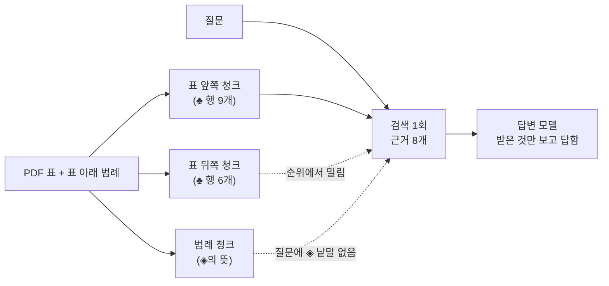

# 표 범례 문제 기록: 증상부터 지금 상태까지 (2026-11-13 ~ 11-16)

> 상태: 기록(2026-11-16). 서비스에는 아직 반영하지 않았다. 숫자의 원문은 7절의 문서들이다.

## 1. 요약

- 문제: 표 아래에 적힌 범례가 표와 다른 청크에 남아, 챗봇이 표 칸 기호의 뜻을 모르고 답한다.
- 알게 된 것: 범례 줄과 그 표의 행 전체가 함께 근거로 가면 모델은 맞게 답한다.
- 지금: 범례 줄을 찾는 방법은 견줘 두었고, 답 품질이 나아지는지 재는 일이 남았다.

처음 나오는 용어:

- 청크(chunk): 문서를 검색하려고 자른 조각이다. 이 서비스는 800자 안팎으로 자르고, 표가 길면 행 묶음으로 나눈다.
- 색인(index): 청크를 검색할 수 있게 저장한 것이다. 청크 모양을 바꾸면 색인을 다시 만들어야 한다.
- 범례(legend): 표 칸에 쓴 기호의 뜻을 적은 줄이다. 예: 「◈표시: 모집인원 제한 없음」.
- 근거: 검색으로 고른 청크 8개다. 답변 모델(A.X 4.0 Light)은 이 8개만 보고 답한다.
- 판정 자료: 표마다 "어느 줄이 이 표의 진짜 범례나 각주인가"를 줄 단위로 정해 둔 정답이다. 방법을 견줄 때 이것과 맞춘다. 이번 판정은 Claude(Opus 5.5)가 한 번 했고 사람 확인은 거치지 않았다.

## 2. 증상

**질문 1. 「전공심화과정(4년제 학사학위과정)이 있는 학과는 어디예요?」** (tq-0001)

- 정답은 2027 모집요강 모집인원 표에서 ♣가 붙은 학과 15개다.
- [실측] 2026-11-14 실험의 26개 설정 가운데 25개에서 「일부」, 1개에서 「맞음」이었다.
- [실측] 기준선 답은 9개 학과만 말했다. 빠진 것은 건축학과, 실내건축학과, 항공운항과, 항공경영학과, 관광경영학과, 경영비서학과다.
- [실측] 이때 프롬프트에는 범례 「♣ 표시 = 4년제 학사학위(전공심화)과정 운영 학과」가 있었다. 그러나 ♣ 행은 표 앞쪽 청크에서 나온 9개 학과뿐이었다(그중 5개는 행 전체 문장). 나머지 6개 학과의 ♣ 행은 뒤쪽 청크에 있어 근거 8개에 들어오지 못했다.
- [실측] 표를 한 청크로 둔 설정(표 하나 최대 2,000자)에서만 15개를 모두 답했다.

**질문 2. 「기계공학과는 전문대졸 전형으로 몇 명 뽑아요?」** (tq-0004)

- 정답은 "모집인원 제한 없음"이다. 표 칸에는 ◈만 있고 뜻은 표 아래 범례에 있다.
- [실측] 정원외 모집인원 표는 청크 8, 9에 있고, 범례 줄은 청크 10, 11에 있다. 기준선 프롬프트에는 ◈가 32번 나오지만 범례 줄은 없었다.
- [실측] 모델은 "'◈'로 표시되어 있지만 정확한 인원수는 문서에 명시되어 있지 않다"고 답했다. 후보를 모두 끈 기준선 네 번이 모두 「모름」이었다.

## 3. 원인

**원인 1. 범례가 표와 다른 청크에 남는다.** 표 주석도 같다. PDF 표를 800자 조각으로 나누면 표 아래 줄은 다음 조각으로 간다. 질문에 범례의 낱말이 없으면 그 조각은 검색에서 밀린다. 묻는 사람은 ◈라는 기호를 모르니 질문에 넣을 수 없다. [실측] 표 질문 오답 35개 가운데 3문항(tq-0004, tq-0031은 ◈ 범례, tq-0007은 표 아래 조건 주석)이 이 경우다. 반대로 질문에 「전공심화과정」이 있으면 범례 줄도 검색된다(질문 1).

**원인 2. 표가 여러 청크로 나뉘어 일부 행만 들어온다.** [실측] 같은 오답 35개 가운데 7문항이다(질문 1 포함). 범례를 받아도 행이 모자라면 받은 행만 답한다.

**두 원인에 공통인 조건.** 챗봇은 검색을 한 번 하고, 받은 근거 8개만 보고 답한다. 모델이 모자란 범례나 행을 스스로 더 찾아오지 못한다.

## 4. 해 본 것과 결과

| 날짜 | 한 일 | 결과 | 배운 것 |
|---|---|---|---|
| 11-13 | 범례나 각주가 문서에서 어디에 적히는지 셈 | [실측] 표본 PDF 61개, 표 540개. 표 주석 94개 중 81개가 표 바로 뒤, 12개가 바로 위, 1개가 다음 쪽 | 규칙을 「표 바로 뒤 주석 묶음에서 그 표 칸의 기호가 든 줄을 표에 붙인다」로 정함 |
| 11-14 | 색인 실험: 범례 줄을 표 청크에 붙임(이슈 #259) | [실측] tq-0004 「모름」 → 「맞음」. tq-0031은 붙여도 「모름」(원인 미확인) | 범례가 근거에 들어가면 모델은 기호를 읽는다 |
| 11-14 | 같은 실험의 전체 점수 | [실측] 후보를 끈 채 다시 색인만 해도 표 질문 맞음 21 → 20, 개발셋 틀림 14 → 16. 청크가 글자까지 같은 두 범례 후보가 23 / 17과 24 / 16으로 갈림 | 전체 점수로는 색인 후보를 가를 수 없다. 흔들림이 차이만큼 크다 |
| 11-14 | 표를 한 청크로(최대 2,000자) | [실측] tq-0001은 맞음. 표 질문 맞음 21 → 23이지만 개발셋 틀림 14 → 17이라 탈락 | 행을 다 주면 목록 질문은 풀리지만, 청크를 통째로 키우는 방식은 다른 문항을 해친다 |
| 11-15 | 범례 줄을 찾는 방법 다섯을 같은 판정 자료로 견줌 | [실측] 아래 표 1 | 지금 규칙보다 진짜를 더 찾는 방법은 잘못도 훨씬 많다 |
| 11-15 | 버린 생각 ①: 같은 쪽에서만 찾기 | [실측] 다시 판정하니 다음 쪽에 범례가 있는 표가 2개 있었다 | 지금 자료에서 0개라는 이유로 일어날 수 있는 경우를 빼면 새 문서에서 깨진다 |
| 11-15 | 버린 생각 ②: 특정 글자 모양(「표시」, 「:」)에 기대는 조건 | [실측] 잘못 붙인 표 0개, 진짜 있는 표 35개 중 5개만 찾음 | 문서 한 종류의 쓰는 법에 맞춘 규칙이다 |
| 11-15 ~ 16 | 대기업 제품과 공개 도구 조사 | [원문] Azure Document Intelligence는 표마다 각주 목록을, AWS Textract는 표 바닥글을 이어 준다. 방법은 공개하지 않았고 범례를 따로 다루지 않는다. [실측] 표와 주석 줄을 잇도록 학습한 공개 모델은 Hugging Face와 GitHub 검색에서 0건 | 학교 문서를 외부로 보내지 않기로 해 클라우드 제품은 재지 않았다. 가져다 쓸 전용 모델은 없다 |
| 11-16 | 모델로 고르기. 기준을 "진짜 줄을 빠짐없이 붙인 표"와 "무관한 줄이 붙은 표"로 바꿔 다시 셈 | [실측] 아래 표 2 | 위치로 범위를 정하고 그 안에서 모델이 고르는 조합이 가장 나았다 |

**표 1. 범례 줄 찾기 방법 (2026-11-15, PDF 표 97개, 진짜 범례나 각주가 있는 표 26개)** [실측]

| 방법 | 진짜 줄이 하나라도 붙은 표 | 잘못 붙인 표 |
|---|---:|---:|
| 지금 규칙(표 바로 뒤 주석 묶음에서 칸 기호가 든 줄) | 20 | 14 |
| 표 바로 뒤 주석 묶음 전체 | 26 | 82 |
| Docling(문서 변환 도구의 각주 연결) | 7 | 16 |
| MinerU(문서 변환 도구의 표 각주) | 17 | 49 |
| A.X 4.0 Light에게 줄 번호를 고르게 함 | 20 | 83 |

판정 자료 전체는 표 156개, 진짜 범례나 각주가 있는 표 35개다. 이 가운데 PDF만 위에 적었다.

**표 2. 모델로 고르기 (2026-11-16, 같은 PDF 표 97개)** [실측]

| 방법 | 진짜 줄을 빠짐없이 붙인 표(26개 중) | 무관한 줄이 붙은 표(97개 중) |
|---|---:|---:|
| 지금 규칙 | 12 | 9 |
| Gemma 4 12B 단독(쪽 그림 + 줄 번호) | 24 | 17 |
| 표 뒤 구간 안에서 Gemma 4가 고른 줄 | 24 | 5 |
| 같은 방식 + 고른 줄을 한 번 더 확인 | 22 | 1 |
| Claude Opus 단독(글만, 상한 확인용) | 23 | 0 |

- 「무관한 줄」은 다음 절 제목, 본문, 다른 표의 주석이다. 표 아래 조건 줄(※ 단서, 단위)은 「딸린 글」로 따로 셌다.
- 「표 뒤 구간」은 표 바로 뒤부터 다음 표 전까지(최대 30줄)다. 위치가 후보 범위를 정하고, 모델이 그 안에서 고른다. HWP 표 37개(글만 줌)에서도 진짜가 있는 9개를 모두 빠짐없이 붙였고, 무관한 줄이 붙은 표는 1개였다.
- 지금 규칙이 12개에 그치는 이유: 기호가 든 줄만 고를 수 있어 여러 줄 범례의 이어지는 줄을 놓친다. 예: 실습실 안전진단 결과보고서의 등급 표 뒤 「※ 1등급 - 안전한 상태 …」와 「4등급 - …」 두 줄을 한 줄도 붙이지 못한다. 표 칸에는 「1등급」 같은 행 이름만 있고 기호가 없다.
- Claude Opus는 서비스에 넣자는 것이 아니다. 과제가 풀 수 있는 정의인지 보려고 쟀다.
- 버린 생각 ①의 표 2개: 2027 정년트랙 전임교원 초빙 안내문은 표가 9쪽에, 「※ 세부기준」과 번호 줄 18줄이 10쪽에 있다. Checklist 2026은 표가 3쪽에, 「*only if …」가 4쪽에 있다. 진짜 범례가 있는 PDF 표 27개 가운데 25개는 같은 쪽, 2개는 다음 쪽이다.

**안 된 것** [실측]

- 서비스의 재순위 모델(bge-reranker-v2-m3): 진짜 있는 표 26개 중 3개만 찾았다. 질문과 문서의 관련도를 배운 모델이라 범례를 가리지 못한다[판단].
- 문서 안에서 자주 쓰인 기호를 글머리표로 보고 빼는 규칙: 진짜 5개 표를 잃었다. 같은 문서 안에서 「*」가 각주로도, 글머리표로도 쓰였다.
- 「표 주석이 몇 번째 줄에서 끝나는가」만 Gemma 4에 묻기: 끝을 너무 뒤로 잡아 59개 표에 무관한 줄을 붙였다.
- 서비스 모델 A.X 4.0 Light에게 줄마다 확인시키기: 657줄 모두에 「예」라고 답해 거르지 못했다.
- 표 뒤 구간 + Gemma 4가 빠짐없이 붙이지 못한 2개: 해외배낭연수 장학생 선발 공고의 제출 서류 표(「*예산서 작성 시 참고사항」 각주, Gemma 4가 빈 답), 모의토익 안내문 표(이어지는 줄이 「7. 유의 사항」 제목 뒤에 있어 놓침).

## 5. 지금 상태 (2026-11-16)

서비스는 바뀐 것이 없다. tq-0001 같은 질문은 여전히 일부만 답한다.

확인된 것:

1. [실측] 범례 줄이 표와 함께 근거로 가면 모델이 읽는다(tq-0004).
2. [실측] 표의 행도 전부 함께 가야 한다(tq-0001).
3. [실측] 범례 줄 찾기는 "위치로 범위를 정하고 모델이 고르는" 조합이 가장 나았다.

한계:

- [판단] 3번은 결과를 본 뒤 만든 조합이고, 같은 판정 자료 안의 값이다. 판정은 Claude가 한 번 했고 사람이 확인하지 않았다.
- 답이 나아지는지는 재지 않았다. 표 2의 숫자는 붙인 줄이 맞는지만 본 것이다.

정해지지 않은 것:

- 표 아래 조건 줄(※)도 범례와 함께 붙일지. [실측] 표 뒤 구간 + Gemma 4는 조건 줄을 60개 표에 함께 붙인다.
- Gemma 4를 색인 때 쓸지. [실측] GPU 9.1GB, 표당 2.3초다. 12GB GPU에서 답변 모델과 동시에 올릴 수 있는지는 재지 않았다.

이 방식이 다루지 못하는 것 [실측]:

- 표 위에 있는 범례(27개 표, 대부분 한 장학재단 공고 양식의 점수 환산 줄)
- 뜻 줄이 문서에 없는 기호(2025 입학전형 시행계획의 ◈ 280칸)
- 표 바로 뒤가 다른 표인 경우(Checklist 2026)

## 6. 다음 할 일

- 표 조각 하나가 검색되면 그 표 전체와 표 주석을 함께 근거로 주고, 근거를 고정한 채 답이 나아지는지 잰다. `표-오답-수정-설계-20261114.md` 7절의 단계 0(근거 고정 재생)과 단계 B(표 단위 조립)다.
- 판정에 쓰지 않은 표를 새로 뽑아, 다른 판정자가 범례 찾기 방식을 다시 잰다.

## 7. 자료 위치

| 무엇 | 위치 | 공개 |
|---|---|---|
| 범례 위치 셈, 처음 정한 규칙 | `docs/rag/research/표-범례-각주-처리-조사-20261113.md` | 저장소 |
| 표 근거 문제 정의 | `docs/rag/m2/표-근거-개선-설계-20261113.md` | 저장소 |
| 표 오답 수정 순서(단계 0, A~E) | `docs/rag/m2/표-오답-수정-설계-20261114.md` | 저장소 |
| 색인 실험 기록 | `docs/rag/m2/표-근거-실험-단계1-20261114.md` (브랜치 `feat/#259-table-experiment`) | 저장소 |
| 표 오답 35개 분류 | `docs/rag/m2/표-질문-오답-분석-20261114.md` (같은 브랜치) | 저장소 |
| 범례 찾기 방법 견줌 | `docs/rag/research/표-범례-판별-기술-조사-20261115.md` 질문 4, 8, 10과 6장 | 저장소 |
| 문항과 실행 결과 | `Assets/eval/table_qset/`, `Assets/eval/runs/20261114-*-tq/` | 로컬 전용 |
| 측정 스크립트와 판정 | `Assets/eval/work/m2/table-legend-methods-20261115/`, `table-legend-census-20261115/` | 로컬 전용 |
| 결과 화면 | `outputs/table-legend-models-20261115/result.html` | 로컬 전용 |

`Assets/`와 `outputs/`는 학교 문서 글이 들어 있어 커밋하지 않는다(`AGENTS.md` 6장).
