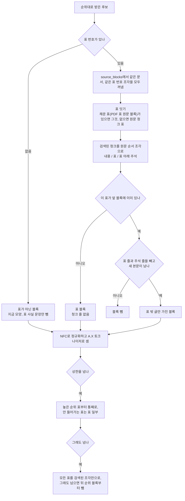

# 표 전체와 표 아래 주석을 한 근거 블록으로 조립 (2026-11-28)

> 상태: 끝남(2026-11-28). 이슈 #274. 새 설정의 기본값(꺼짐)은 그대로다. 실제 색인으로 재는 것은 단계 B에서 한다.
> 날짜와 상위 문서: 2026-11-28, 상위 [M2 README](README.md) 1절, 결정 [ADR-0058](../../adr/0058-표-근거는-표-전체와-주석을-한-블록으로-길이는-A.X-토크나이저로.md)

## 결론

- 표 블록 설정(`AI_TABLE_BLOCK_ENABLED`)을 켜면 AI 서버가 검색된 표 조각의 표 번호(`table_numbers`, #269)로 같은 문서의 조각을 모두 모아 표 전체와 표 아래 주석을 한 근거 블록에 넣는다. 한 조각만 검색돼도 표 전체가 들어간다.
- 같은 표는 가장 높은 순위 블록 하나에만 들어가고, 뒤 순위 블록은 새로 남는 줄이 없거나 제목 줄뿐이면 빠진다.
- 표 사실 문장(「표 검색 정보」)과 그것을 가리키는 지시문 두 줄, 질문 의도 추출 정보의 표 조합 줄을 모델 입력에서 뺐다.
- 프롬프트는 NFC로 정규화해 A.X 4.0 Light 공식 토크나이저로 세고, 상한 11,771토큰을 넘을 때만 표를 줄인다. 줄여도 넘으면 뒤 순위 블록부터 빼서, 결과 프롬프트는 늘 상한 안이다. 토크나이저 파일은 저장소에 넣고 서버가 시작할 때 해시를 확인한다.
- 설정이 꺼지면 프롬프트는 그 전과 글자까지 같다(기존 골든 네 개 그대로 통과).
- 하지 않은 것: 실제 색인으로 재기와 설정 기본값 정하기(단계 B), 학습 데이터와 평가 도구가 이 프롬프트를 그대로 쓰게 하기(#275).

## 배경

표가 든 청크가 검색돼도 표 행이 프롬프트에 빠지는 경우가 둘 있었다.

- 표 사실이나 질문 의도 추출 정보가 있으면 근거 블록에 「질문 관련 발췌」만 들어가, 발췌가 고르지 못한 행이 빠진다.
- 표가 여러 청크로 나뉘어 한 조각만 검색되면 나머지 행과 주석이 입력에 없다.

## 전후 예시

가나대학 합성 표 하나가 청크 3(기계공학과, 항공기계공학과 행)과 청크 4(화학과, 국어국문과 행과 주석)에 나뉘어 있고, 「가나대학 국어국문과 수시1차 모집 인원은 몇 명이야?」에 청크 3만 검색된 경우다.

설정 꺼짐(지금):

```text
[출처 1]
문서: 2027학년도 가나대학 신입생 모집요강.pdf
위치: PDF 2페이지
청크: 문서 내 4번째 청크
섹션: Ⅰ. 2027학년도 모집인원 > 1. 정원내 전형 모집인원
표 검색 정보:
## 1. 정원내 전형 모집인원: 기계공학과 행 정보는 계열=공학; 모집단위=기계공학과; 모집 정원=90; 수시1차=50이다.
## 1. 정원내 전형 모집인원: 항공기계공학과 행 정보는 계열=공학; 모집단위=항공기계공학과; 모집 정원=110; 수시1차=50이다.
질문 의도 추출 정보:
- 수시1차 모집 정원: 90
- 수시1차 모집 정원: 110
- 관련 근거: |계열|모집단위|모집 정원|수시1차|
질문 관련 발췌:
## 1. 정원내 전형 모집인원
|계열|모집단위|모집 정원|수시1차|
|---|---|---|---|
|공학|기계공학과|90|50|
```

국어국문과 행이 없고, 표 조합 줄은 「수시1차 모집 정원: 90」처럼 칸 이름과 값을 섞었다.

설정 켬:

```text
[출처 1]
문서: 2027학년도 가나대학 신입생 모집요강.pdf
위치: PDF 2페이지
섹션: Ⅰ. 2027학년도 모집인원 > 1. 정원내 전형 모집인원
내용:
# Ⅰ. 2027학년도 모집인원
## 1. 정원내 전형 모집인원
표:
|계열|모집단위|모집 정원|수시1차|
|---|---|---|---|
|공학|기계공학과|90|50|
| |항공기계공학과|110|50|
|자연|화학과|40|20|
|인문|국어국문과|30|15|
표 아래 주석:
※ 동일 모집시기 내 1개 전형에만 지원 가능함
```

프롬프트 전문(날짜 줄 켬, 표가 아닌 블록과 뒤 순위 블록 포함)은 `ai-server/tests/golden/full_table_block_on.txt`에 고정했다.

## 조립 흐름



## 규칙

### 블록 본문

- 검색된 청크 글을 원문 순서의 조각으로 나누고 조각마다 이름표를 붙인다. 표 밖 글은 「내용:」, 표 자리는 「표:」(표 전체), 주석은 「표 아래 주석:」이다. 주석 뒤에 주석이 아닌 글이 오면 「내용:」을 다시 단다. 표가 둘 든 청크도 표마다 같은 규칙이다.
- 검색된 청크의 표 밖 글은 발췌하지 않고 전부 넣는다. 표를 채우려고 가져온 조각의 표 밖 글은 넣지 않는다. 다만 그 조각 뒤의 주석(큰 표는 끝 쪽에 한 번 나온다)은 표 바로 아래에 붙인다.
- 표 블록 머리말에는 「청크:」 줄이 없다. 여러 청크를 이은 블록이라 「문서 내 N번째 청크」가 사실이 아니다. 표가 아닌 블록은 지금 그대로다.

### 표 잇기

- 원문 청크 조각은 청크 순서로 잇고, 뒤 조각이 되풀이한 머리(머리 줄과 구분 줄)와 청크 겹침 행은 한 번만 둔다.
- PDF 표 원문 블록은 쪽 순서로 잇고, 뒤 쪽 앞에 되풀이된 머리 행은 한 번만 둔다.
- 표가 둘 이상 든 청크는 색인이 번호 목록만 남기므로 조각과 번호를 다시 짝 짓는다. 같은 문서의 번호가 하나뿐인 청크에서 본 행과 절반 이상 같은 표에 붙이고, 못 붙인 조각은 글 순서대로 남은 번호와, 그래도 남으면 바로 앞 조각의 표와 짝 짓는다. 한 칸짜리 상자(`|내용|`)는 표 조각으로 보지 않는다.

### 주석

- 범위: 표 바로 뒤, 다음 표 조각이나 제목 줄(`#`) 전까지.
- 표시: `※`, `*`, `＊`, `주)`, `(주)`, `주 1)` 모양으로 시작하는 줄. 줄 머리의 `-`, `·`와 공백은 떼고 본다.
- 아닌 것: `1)`, `①`, `1.`, `비고`, `참고`, `단위`, `♣표시: …`처럼 표시 없이 시작하는 줄.

### 뒤 순위 블록

표가 모두 앞 블록에 들어간 블록에서 표 줄과 주석 줄을 빼고 아래 셋 중 하나면 뺀다.

1. 남는 글이 없다.
2. 남은 줄이 모두 그 표의 블록에 이미 든 줄이다(공백을 지운 글자가 똑같은 줄).
3. 새로 남는 줄이 제목 줄(`#`으로 시작하는 줄, 색인이 청크 첫 줄에 붙인 섹션 줄)뿐이다.

본문이 남으면 표 밖 글만 가진 블록으로 제자리에 둔다. 빠진 블록의 후보는 처리 기록의 근거 후보에 `block: null`로 남는다.

### 길이

- 프롬프트를 NFC로 정규화한 뒤 A.X 4.0 Light 공식 토크나이저로 세고, 그 글을 그대로 Ollama에 보낸다. 공식 토크나이저도 llama.cpp도 정규화하지 않아 겉보기에 같은 한글이라도 완성형과 낱자 조합은 다른 토큰이 된다. NFC는 겉보기에 같은 글이 같은 토큰이 되게 하려는 것이다.
- 상한 = 문맥 길이(`OLLAMA_NUM_CTX`) − 답 상한(`OLLAMA_NUM_PREDICT`) − 채팅 틀 토큰 수. 채팅 틀 토큰 수는 모델 설정 파일의 `EXPECTED_PROMPT_TOKENS`(6)에서 「안녕하세요」의 토큰 수(1)를 뺀 5다. 지금 설정으로 11,771.
- 상한을 넘을 때만 줄인다. 모든 표를 줄인 상태에서 높은 순위 표부터 하나씩 통째로 바꿔 보고, 넘으면 그 표는 줄인 채로 둔다. 줄인 표는 「표 일부:」 이름표 아래 머리글과 검색된 조각, 그리고 주석이다. 채운 표 모양이면 검색된 원문 조각과 글이 겹치는 쪽 조각을 고른다.
- 그래도 넘으면 모든 표를 검색된 조각만으로 줄인다. 채운 표 모양이면 검색된 표 원문 블록만, 없으면 검색된 원문 청크의 표 줄을 원문 모양 그대로 넣는다(이름표는 같은 「표 일부:」). 그래도 넘으면 뒤 순위 블록부터 하나씩 빼고, 블록이 하나 남았는데도 넘으면 그 블록의 끝 줄부터 자른다. 블록을 뺀 뒤 남은 표는 높은 순위부터 상한 안에 드는 가장 큰 단계(통째, 표 일부, 검색된 조각만)로 되돌린다.
- 상한 때문에 뺀 블록의 청크는 응답 출처에서도 빠진다. 평가 기록의 `table_block`에 뺀 청크(`limit_dropped_chunk_ids`)와 자른 줄 수(`truncated_lines`)가 남는다.
- 질문과 지시문만으로 넘으면 그대로 보내고 경고 로그와 처리 기록(`over_limit`)에 남긴다.

## 토크나이저 파일

- 위치: `ai-server/tokenizer/ax40light/`에 `tokenizer.json`, `LICENSE`(모델 저장소의 라이선스 원문), `README.md`(출처).
- 확인: 서버가 시작할 때 파일 SHA256을 `deploy/models/ax40light/recipe.env`의 `TOKENIZER_SHA256`과 견준다. 다르거나 파일이 없거나 해시 줄이 없으면 뜨지 않는다. Docker에서는 `docker-compose.yml`이 이 설정 파일을 읽기 전용으로 붙인다. 이미지는 `ai-server/` 전체를 복사하고 `.dockerignore`가 이 폴더를 빼지 않는다.
- `.gitattributes`에서 이 파일을 바이너리로 다룬다. 줄바꿈 변환으로 해시가 바뀌지 않고 PR 크기 셈에서도 빠진다.
- 파일: 모델 저장소 `skt/A.X-4.0-Light` 리비전 `ba21c20`의 공식 `tokenizer.json` 그대로다(git blob `2648cf18…`가 Hugging Face 파일 목록과 같음, SHA256 `e3973ece…`). `normalizer`가 없고 `pre_tokenizer`는 이어진 숫자를 묶는 ByteLevel이라, 운영 생성 모델(llama.cpp)이 입력을 자르는 규칙과 같다. 「2027학년도 모집 정원 110명」은 8토큰이다. 처음에는 학습 어댑터와 함께 저장된 파일(학습 도구가 공식 파일을 읽어 다시 저장한 것, NFC 정규화와 숫자를 한 글자씩 자르는 규칙이 들어감, 같은 글 12토큰)을 넣었다가, 학습을 공식 토크나이저에 맞추기로 해(#280) 공식 파일로 바꿨다.

## 설정

| 환경값 | 기본 | 뜻 |
|---|---|---|
| `AI_TABLE_BLOCK_ENABLED` | false | 표 블록, 표 사실 문장 빼기, NFC와 길이 상한 |
| `AI_TABLE_BLOCK_FILL_ENABLED` | false | 같은 표를 합쳐 줄어든 근거 자리를 다음 순위로 채움(표 블록이 켜졌을 때만) |
| `AI_TABLE_FACT_RETRIEVAL_ENABLED` | true | 검색에 표 사실 청크를 씀(어휘 표 사실 검색, 벡터 검색의 표 사실 결과) |
| `AI_MODEL_RECIPE_PATH` | 저장소의 `deploy/models/ax40light/recipe.env` | 토크나이저 해시와 채팅 틀 토큰 수를 읽는 모델 설정 파일 |

- 세 설정과 프롬프트 상한은 실행 설정 기록(`_model_settings()`)에 실려 평가 실행 기록에 남는다.
- 평가 요청(`include_eval_trace`)의 기록에 `table_block`(블록마다 청크, 표 번호, 표 모양, 통째로/일부, 빠진 청크, 프롬프트 토큰 수, 상한)이 더해진다. 처리 기록에는 프롬프트 토큰 수와 후보마다 몇 번째 블록이 됐는지가 더해진다. 단계 B의 토큰 분포, 블록 수 분포, 길이 규칙이 걸린 질문 수는 이 기록으로 센다.
- 빈자리 채움이 켜지면 블록이 근거 수(8)가 될 때까지 다음 후보를 받는다. 평가 기록의 `final` 단계와 처리 기록의 근거 후보는 조립에 넣은 후보 전부다.
- 응답의 `sources`는 프롬프트의 근거 블록과 1:1, 같은 순서다. N번째 출처가 `[출처 N]` 블록을 만든 청크(그 블록의 가장 높은 순위 청크)이고, 같은 표로 합쳐져 빠진 청크는 없다. 백엔드가 답의 `[출처 N]`을 N번째 출처로 찾아 「참고한 문서」를 만들기 때문이다(ADR-0050). 표 블록이 꺼지면 지금처럼 상위 근거 후보 전부다.

## 표 번호가 없는 색인

표 블록을 켜도 표 번호가 없는 근거는 지금 모양(질문 의도 추출 정보와 발췌, 또는 발췌와 전체 내용, 또는 전체 내용)이다. 달라지는 것은 표 사실 문장과 표 조합 줄, 지시문 두 줄이 빠지는 것뿐이다. 표 번호가 있어도 조각을 꺼내지 못하면 그 근거는 청크 글 그대로 둔다.

## 검증

| 확인 | 결과 |
|---|---|
| 전체 테스트(`OLLAMA_BASE_URL=http://127.0.0.1:9 venv/bin/python -m pytest`) | 262 통과, 1 건너뜀(라이브 Chroma 전용) |
| 한 조각만 검색, 두 조각 모두 검색, 표가 둘 든 청크, 주석 뒤에 글이 이어지는 청크, 제목 줄만 남는 뒤 순위 블록, 이미 든 줄만 남는 뒤 순위 블록, 채운 표 우선, 빈자리 채움, 표 사실 청크 검색 끄기, 제목 줄이 닫는 주석 범위 | `tests/test_table_blocks.py`(메모리 Chroma의 source_blocks에서 표 번호로 꺼냄) |
| 문맥 길이를 넘는 표(조각 40개, 약 1만 5천 토큰), 높은 순위 표를 통째로 먼저 | 같은 파일, 저장소 토크나이저로 셈 |
| 표 원문 블록 하나가 표 전체라 「표 일부」로 안 줄어드는 표, 그 표가 뒤 순위에 있을 때, 검색된 조각 자체가 표 전체일 때, 블록 하나만 남아도 넘을 때, 줄일 수 없는 작은 표 여럿의 합이 넘을 때, 블록을 뺀 뒤 남은 표를 통째로 되돌리기. 모두 프롬프트 토큰 ≤ 상한 | 같은 파일 여섯 테스트 |
| 표 번호 없는 색인에서 블록이 지금 모양과 같음 | `test_index_without_table_numbers_keeps_current_blocks` |
| 토크나이저 해시 불일치, 파일 바뀜, 파일 없음, 해시 줄 없음, 해시가 다르면 main import(서버 시작) 실패, 숫자가 든 글을 공식 규칙으로 셈(가나대학 글 16토큰), NFC 뒤에 낱자 조합이 완성형과 같은 토큰 | `tests/test_prompt_tokens.py` |
| 새 모양 프롬프트 전문 고정, 꺼짐일 때 기존 네 골든 그대로 | `tests/test_prompt_golden.py` |
| 응답 출처의 N번째가 `[출처 N]` 블록과 같은 청크(빈자리 채움 켬과 끔), 평가 기록의 블록 목록과 같은 순서, 꺼짐이면 지금 출처 그대로 | `test_sources_follow_prompt_blocks_one_to_one`, `test_sources_unchanged_when_table_block_off` |

변이 확인(커밋 뒤 하나씩 망가뜨리고 그 파일만 되돌림): 31개 모두 테스트가 잡았다.

| 망가뜨린 것 | 잡은 테스트 |
|---|---|
| 주석 표시에서 `(주)`, `주 1)` 모양 빼기 / 글머리 기호 떼지 않기 | `test_note_marks` |
| 제목 줄이 주석 범위를 닫지 않음 | `test_heading_closes_note_range` |
| 가져온 조각 뒤 주석을 안 붙임 / 같은 표를 뒤 블록에도 넣음 / 표 블록에 청크 줄 / 지시문 두 줄 남김 | 골든 `full_table_block_on` |
| 뒤 순위 블록의 「이미 든 줄」 기준 끄기 / 「제목 줄」 기준 끄기 | `test_later_block_with_only_lines_already_present_is_dropped`, `test_later_block_with_only_new_heading_lines_is_dropped` |
| 두 표 청크에서 행 짝 짓기 끄기 | `test_extra_piece_in_two_table_chunk_follows_known_rows` |
| 채운 표보다 원문 표 먼저 | `test_filled_table_blocks_are_preferred` |
| NFC 하지 않기 | `test_prompt_is_nfc_and_counted`, `test_nfc_makes_same_looking_hangul_the_same_tokens` |
| 토크나이저 파일만 학습 도구가 다시 저장한 옛 파일로 되돌림 | 서버 시작(main import) 실패로 모든 테스트 |
| 옛 파일과 옛 해시를 함께 되돌림 | `test_digits_are_counted_with_official_rule`, `test_nfc_makes_same_looking_hangul_the_same_tokens` |
| 상한을 넘어도 줄이지 않음 / 모든 표를 줄임 | `test_table_over_limit_keeps_retrieved_piece_header_and_notes`, `test_higher_rank_table_whole_first` |
| 빈자리 채움 설정 무시 | `test_fill_uses_next_candidate_only_when_enabled` |
| 표 사실 청크 검색을 꺼도 벡터 결과를 안 거름 | `test_table_fact_retrieval_switch_drops_fact_candidates` |
| 표 사실 문장 남김 / 표 조합 줄 남김 | `test_table_fact_sentences_and_bridge_lines_are_removed` |
| 해시 비교 건너뜀 / 파일 없음 검사 건너뜀 / 채팅 틀 토큰 수 0 | `test_prompt_tokens.py` 세 테스트 |
| 설정이 꺼져도 표 블록 | `test_prepare_query_orders_candidates_by_rank_fusion`(기존) |
| 표 블록이 켜져도 빠진 청크를 출처에 남김 | `test_sources_follow_prompt_blocks_one_to_one` |
| 「검색된 조각만」 단계 없앰 / 그 단계가 표 원문 블록을 겹침으로 고름 | `test_filled_table_whole_in_one_piece_is_reduced_to_retrieved_rows`, `test_later_rank_table_is_reduced_and_earlier_blocks_kept` |
| 뒤 순위 블록 빼기 없앰 | `test_reduced_piece_still_too_big_drops_later_blocks`, `test_first_block_alone_too_big_is_cut_from_the_end`, `test_small_tables_whose_sum_is_over_limit_drop_later_blocks` |
| 끝 줄 자르기 없앰 | `test_first_block_alone_too_big_is_cut_from_the_end` |
| 뺀 블록의 청크를 출처에 남김 | `test_reduced_piece_still_too_big_drops_later_blocks`, `test_small_tables_whose_sum_is_over_limit_drop_later_blocks` |
| 블록을 뺀 뒤 남은 표를 되돌리지 않음 | `test_tables_left_after_dropping_blocks_go_back_to_whole` |

## 단계 B에서 찾은 상한 초과와 고침

단계 B(재순위 끔, 표 사실 검색 켬, 빈자리 채움 켬)에서 1,653개 질문 중 123개(7.4%)가 표를 줄인 뒤에도 상한을 넘었다(최대 11만 토큰).

- 원인: 채운 표 모양의 「표 일부」는 검색된 원문 조각과 글이 겹치는 표 원문 블록을 통째로 고른다. 표 원문 블록 하나가 여러 쪽에 걸친 표 전체이면 「표 일부」가 표 전체와 같아져, 줄일 대상에서 빠지고 「표:」로 남았다(한 질문에서 17만 자). 겹치는 블록이 큰 경우에는 「표 일부」 자체가 수만 자였다. 줄인 뒤에도 넘으면 더 줄이는 단계가 없어 그대로 보냈다.
- 고침: 「검색된 조각만」 단계와 뒤 순위 블록 빼기를 더했다(규칙 절). 그 전 규칙으로 상한 안에 들던 프롬프트는 결과가 같다.
- 다시 조립: 그 측정 기록의 후보와 청크로 123개를 다시 조립했다. 기록에는 표 원문 블록의 메타데이터가 없어 원문 청크 조각만으로 표를 이었다(모든 표가 원문 모양). 이 조건에서 그 전 코드는 1개, 고친 코드는 0개가 넘었다. 공식 토크나이저로 바꾼 뒤 같은 조건으로 1,653개 모두를 다시 조립하면 넘는 프롬프트는 0개, 가장 긴 프롬프트는 11,718토큰, 상한 때문에 블록을 뺀 질문은 1개(블록 2개)다. 그 전 123개는 학습 도구가 다시 저장한 토크나이저로 센 값이다. 채운 표 모양으로 다시 재는 것은 다음 단계 B 측정에서 한다.

## 한계

- 실제 색인으로 돌려 본 적이 없다. 단계 B에서 데스크탑 작업용 색인(표 번호 있음)으로 잰다.
- 주석 표시 없이 기호로 시작하는 범례 줄(`♣표시 : …`)은 주석으로 붙지 않는다. 주석 뒤에 오면 「내용:」으로 같은 블록에 남는다. `* `로 시작하는 마크다운 글머리표와 `**강조**` 줄도 주석으로 본다. 표 위 범례는 다루지 않는다.
- 표가 둘 든 청크에서 번호보다 조각이 많고 다른 청크에서 본 행도 없으면, 남는 조각은 바로 앞 조각의 표로 붙는다. 그 조각이 실제로는 표가 아닌 두 칸 상자면 표 안에 들어간다.
- 줄인 표의 조각이 떨어져 있어도 사이에 표시를 넣지 않는다. 「표 일부:」 이름표만 표가 잘렸음을 알린다.
- 뒤 순위 블록을 빼는 순서는 순위만 본다. 큰 블록이 앞에 있으면 그 뒤의 작은 블록이 먼저 빠진다. 블록 하나를 끝 줄부터 자르면 잘린 표의 뒤 행이 없다는 표시는 없다.
- 질문과 지시문만으로 상한을 넘으면 그대로 보낸다(경고 기록과 `over_limit`). 근거 없는 프롬프트는 450토큰 안팎이라 생기지 않는다.
- 메모리 Chroma(`EphemeralClient`)에서 컬렉션을 지우면 그 배열 메타데이터가 뒤에 만든 컬렉션의 `$contains` 조회에 섞이는 것을 테스트 중에 봤다. 테스트는 컬렉션을 지우지 않는다. 운영 서버는 컬렉션을 지우지 않고 문서 항목만 지운다.

## 학습 포인트

- 색인이 「청크에 든 표 번호 목록」만 남기면 질문 때 조각을 모을 수 있다. 표 전체 글을 따로 저장하지 않아 다시 색인할 때 두 곳을 맞출 일이 없다.
- 길이를 글자 수로 어림하지 않고 생성 모델과 같은 규칙의 토크나이저로 세면, 서버가 센 값이 모델이 받는 값과 같다. 같은 모델의 공식 토크나이저 파일도 학습 도구가 읽어 다시 저장하면 규칙이 다른 파일이 될 수 있어, 해시로 고정하고 출처를 적는다.
- 프롬프트를 바꾸는 기능은 설정으로 켜고 끄고, 꺼짐 상태의 전문 골든을 그대로 두면 기존 동작이 한 글자도 안 바뀌었음을 테스트가 보증한다.
