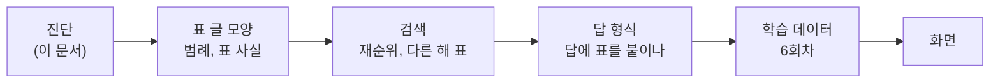

# 표 질문 오답 진단: 어느 단계에서 틀리나

> 상태: 끝(2026-11-18). 이슈 #263. 측정만 했고 코드와 색인은 바꾸지 않았다. 이 결과로 정한 다음 측정은 [표 사실 빼기 측정](표-사실-빼기-측정-20261119.md).

## 1. 결론

- [실측] 표 질문 47문항 중 맞음 21. 맞음이 아닌 26문항은 검색 12, 표 사실의 정보 손실 4, 근거를 받고도 잘못 읽음 10이다.
- [실측] 범례 줄이 프롬프트에 없어서 틀린 문항은 0이다. 가장 많은 것은 근거를 받고도 답을 잘못 읽는 쪽이다(평가셋 밖 새 질문 표본에서도 실제 모델 잘못 8 중 6).
- [판단] 그래서 푸는 순서를 진단 → 표 글 모양 → 검색 → 답 형식 → 학습 데이터 → 화면으로 정했다(2026-11-18).

## 2. 측정 조건

6회차 학습 데이터와 같은 조건이다. 운영 서버의 조건(학습 전 모델, 재순위 끔)과는 다르다.

| 조건 | 값 |
|---|---|
| 답변 모델 | 5회차 `ax40light-r5:q4km`, 온도 0, 문맥 12,288, 출력 512 |
| 검색 | 주석 청크 색인, 순위 융합, 재순위 켬(bge-reranker-v2-m3, 후보 20), 근거 8개 |
| 근거 조립 | 표 번호로 합치기와 기호 주석(R2), 요약 문장 뺌, 학년도 표시 |
| 기준 날짜 | 2026-10-31 |
| 문항 | 표 질문 47문항, 개발셋 205문항 중 본 149문항 |

실패 단계는 세 번에 걸쳐 갈랐다.

1. 규칙 기반 채점에서 애매로 나온 28문항(표 질문 13, 개발셋 15)을 판정했다.
2. 맞음이 아닌 문항마다 정답 근거의 인용문(공백을 뺀 앞 40자, 없으면 20자 조각)이 융합 후보, 재순위 뒤, 최종 8개, 프롬프트 중 어디까지 남았는지 자동으로 찾았다.
3. 근거가 프롬프트까지 간 문항은 프롬프트와 답을 읽고 원인 하나로 갈랐다.

## 3. 표 질문: 26문항이 맞음이 아니다

| 단계 | 실패 | 문항 | 예 |
|---|---|---:|---|
| 검색 | 다른 해 표를 받음(「작년」 질문) | 5 | 맞는 해 표는 융합 23위, 근거 8개에는 다른 해 표 |
| 검색 | 후보 밖이거나 9위 이하 | 5 | 표가 여러 청크로 갈려 일부 행만 후보에 듦 |
| 검색 | 재순위가 8개 밖으로 밀어냄 | 2 | 표 조각이 융합 7위에서 재순위 15위로 |
| 표 사실 | 합친 칸이나 여러 줄 머리글을 잃음 | 4 | 「6~9등급 가산점 없음」이 「6등급=가산점 없음」으로만 남아 7등급을 4점이라 답함 |
| 생성 | 범례나 주석을 받고도 적용 못 함 | 4 | 기호 뜻이 주석에 있는데 「찾지 못했습니다」 |
| 생성 | 여러 행 중 일부만 답함 | 4 | 100명 넘는 동아리 3곳 중 1곳 |
| 생성 | 다른 칸이나 다른 표의 줄을 읽음 | 2 | 조도 대신 평가등급 표의 값을 답함 |

- [실측] 재순위는 정답 근거 청크를 융합 순위 8개 안에서 8개 밖으로 7문항에서 밀어냈고, 4문항에서 반대로 끌어올렸다.
- [실측] 표 사실 4문항은 프롬프트의 「표 검색 정보」 줄에서 확인했다. 합친 칸(6~9등급, 생활비 유형)과 여러 줄 머리글(심사기준 1차, 2차, 3차가 모두 「심사기준=」으로 남음)이 사라졌다.
- [실측] 표 전체가 프롬프트에 있는데도 「표 검색 정보」에 든 두 행에서만 답을 고른 문항이 1개 있다. 한 문항이라 가설로 둔다.

## 4. 개발셋: 본 149문항 중 22문항이 맞음이 아니다

| 실패 | 문항 |
|---|---:|
| 근거가 프롬프트에 있는데 답이 틀림: 표 근거 | 9 |
| 근거가 프롬프트에 있는데 답이 틀림: 글 근거 | 5 |
| 후보 밖이거나 9위 이하 | 3 |
| 최종 8개에는 있는데 「질문 관련 발췌」에서 정답 줄이 빠짐 | 3 |
| 답없음 문항에 지어낸 답 | 2 |

[실측] 재순위는 개발셋에서 1문항을 밀어내고 10문항을 끌어올렸다. 표 질문과 반대 방향이다.

## 5. 평가셋 밖 새 질문: 표본 20개 중 실제 모델 잘못은 8개

표 질문 47문항은 표 합치기를 고를 때 쓴 문항이라 유리하게 나온다. 그래서 평가셋에 없는 학습 몫 문서에서 만든 6회차 새 질문 872개를 같은 조건으로 받아 둔 답으로 다시 확인했다.

- [실측] 답 있는 질문 749개 중 규칙 기반 채점으로 맞음이 아닌 것 331개. 그중 233개(70%)는 핵심 사실이 모두 프롬프트에 있었다. 질문을 만든 청크가 근거 8개에 하나도 없고 핵심 사실도 프롬프트에 없는 것은 44개(13%)다.
- [실측] 233개에서 질문 종류별로 20개를 뽑아(씨앗 20261118) 판정했다.

| 판정 | 원인 | 문항 |
|---|---|---:|
| 모델 잘못 8 | 여러 행이나 항목 중 일부만 | 2 |
| | 여러 근거를 잘못 짝지음 | 1 |
| | 여러 근거를 비교하다 틀림 | 1 |
| | 주석 조건을 적용 못 함 | 1 |
| | 표 사실이 머리글을 잃음 | 1 |
| | 다른 해 문서 | 1 |
| | 근거를 받고도 거절 | 1 |
| 모델 잘못 아님 12 | 「작년」 질문의 기준 날짜 결함 | 3 |
| | 개인정보 동의서 같은 양식 글에서 만든 질문 | 4 |
| | 규칙 기반 채점 오판 | 3 |
| | 질문이 두 가지로 읽힘 | 1 |
| | 정답이 의심스러움 | 1 |

- [실측] 표 사실 문제는 여기서도 나왔다. 열 이름 자리에 값이 들어간 줄(「1652=5027; 여행업실무=중국어회화」)을 받고 최다 과목을 찾지 못했다.
- [판단] 규칙 기반 채점의 「틀림」을 그대로 학습 목표로 쓰면, 표본 기준으로 절반 넘게 모델이 맞은 질문을 틀렸다고 가르친다. 학습 데이터 단계에서 판정과 질문 거르기를 먼저 한다.

## 6. 이 결과로 정한 순서(2026-11-18)

| 순서 | 근거 |
|---|---|
| 표 글 모양이 검색보다 앞 | [판단] 색인 글이 바뀌면 검색 순위도 바뀌어 검색을 다시 재야 한다. 범례와 표 사실 모두 색인을 바꾸므로 한 단계로 묶어 색인을 한 번만 다시 만든다 |
| 범례를 표 사실과 같은 단계에 둠 | [실측] 범례 줄이 없어서 틀린 문항은 0. [판단] 고칠 이유는 오답보다 무관한 줄이 범례로 든 프롬프트가 학습 데이터에 들어가는 위험이다 |
| 학습 데이터가 근거 모양과 답 형식 뒤 | [판단] 근거 모양이 바뀌면 학습 프롬프트를 다시 만들어야 한다. 잘못된 범례나 표 사실이 든 프롬프트로 학습하면 모델이 그것을 믿는 버릇을 익힌다 |
| 화면이 맨 뒤 | [판단] 답에 붙이는 표는 정확도를 바꾸지 않고, 붙일 표를 고르는 일이 검색과 같은 문제다 |

## 7. 한계

- 판정(애매 28문항, 새 질문 표본 20개)과 원인 가르기는 Claude가 한 번 했고 사람 확인은 없다.
- 표 질문 47문항은 표 합치기를 고를 때 쓴 문항이라 유리하다. 새 질문 표본은 20개라 비율이 거칠다.
- 문항마다 원인을 하나만 골랐다. 검색과 생성이 함께 틀린 문항은 먼저 사라진 단계로 셌다.
- 무관한 줄이 범례로 붙어 틀렸는지는 이 47문항에서 따로 가리지 못했다.
- 측정 조건은 운영 서버와 다르다(R2 조립은 아직 서버에 없다).

실행 기록(로컬, 커밋 안 함): 실행 `Assets/eval/runs/20261117-rp-NC5Y-tq`, `20261117-rp-NC5Y-dev`, 진단 `Assets/eval/work/m2/diag-20261118/`(`summary.json`, `trace.jsonl`, 판정 `judgments_diag.jsonl`, 새 질문 표본 `r6_sample_judged.jsonl`), 새 질문 답 `Assets/train/r6-n1s/answers-r5-op-scored.jsonl`.
