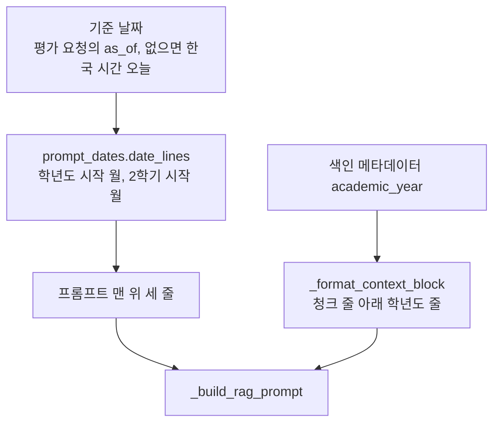

# 프롬프트 날짜 줄 세 줄과 근거 학년도 줄 (2026-11-27)

> 상태: 끝남(2026-11-27). 이슈 #273. 날짜 줄 설정의 기본값(꺼짐)은 그대로다.
> 날짜와 상위 문서: 2026-11-27, 상위 [M2 README](README.md) 1절, 결정 [ADR-0047](../../adr/0047-학습-예시-근거는-질문-재료가-올라온-날의-서비스-모양으로.md) 변경 메모

## 결론

- 날짜 줄 설정(`AI_PROMPT_DATE_LINES_ENABLED`)을 켜면 AI 서버가 프롬프트 맨 위에 날짜 줄 세 줄을 직접 만든다. 지금까지는 서버가 「오늘: 날짜」만 만들고, 학년도와 학기, 아래 두 줄은 평가 도구가 프롬프트에 덧붙였다.
- 근거 블록 머리말에 「학년도:」 줄을 넣는다. 값은 색인 메타데이터 `academic_year`만 쓴다.
- 「답변 직전 확인」에서 지금 프롬프트에 없는 절을 가리키던 두 줄을 뺐다. 날짜 줄 설정이 꺼진 기본 상태에서는 이 두 줄만 달라진다.
- 하지 않은 것: 표 블록 조립과 「표 검색 정보」 정리(#274), 학습 데이터와 평가 도구가 서버 프롬프트를 그대로 쓰게 하기(#275).

## 배경

「작년 입시」, 「올해」 같은 질문은 오늘이 어느 학년도인지와 근거 문서가 어느 학년도 것인지를 알아야 풀 수 있다. 달력의 해를 그대로 학년도로 옮기면 틀린다. 2026년 가을에 치르는 입시는 문서에서 「2027학년도」 입시다.

표 읽기 1차와 2차 학습 데이터는 날짜 줄 세 줄이 든 입력으로 만들었지만, 서버는 설정을 켜도 「오늘: 날짜」 한 줄만 만들었다([운영-학습 파이프라인 차이 점검](운영-학습-파이프라인-차이-점검-20261126.md) 6, 8번). 학습 데이터와 평가 입력을 서버가 만든 프롬프트 그대로 쓰려면 서버가 같은 줄을 만들어야 한다.

## 바뀐 프롬프트



날짜 줄 켬, 기준 날짜 2026-10-31:

```text
오늘: 2026-10-31 (2026학년도 2학기)
지금 모집 중인 입시: 2027학년도
직전 입시(작년에 치른 입시): 2026학년도
너는 인하공업전문대학 문서를 근거로 답변하는 안내 챗봇이다.
…
[출처 1]
문서: 2027학년도 가나대학 수시 모집요강.pdf
게시: 2026-06-02
위치: PDF 3-4페이지
청크: 문서 내 6번째 청크
학년도: 2027
섹션: 모집 일정 > 수시 1차
```

전문은 `ai-server/tests/golden/full_date_lines_on.txt`(켬)와 `full_date_lines_off.txt`(꺼짐)에 고정했다.

## 세 줄의 계산 규칙

설정 둘(학년도 시작 월 S, 2학기 시작 월 T)로 계산한다. 기본은 S=3, T=9.

| 값 | 규칙 |
|---|---|
| 지금 학년도 | 달 ≥ S이면 그 해, 아니면 앞 해 |
| 학기 | S ≤ 달 < T이면 1, 그 밖은 2(1~2월은 앞 학년도 2학기) |
| 지금 모집 중인 입시 | 달 ≥ S이면 그 해 + 1, 아니면 그 해 |
| 직전 입시 | 지금 모집 중인 입시 - 1 |

경계 날짜(기본 설정):

| 기준 날짜 | 학년도와 학기 | 지금 모집 중인 입시 | 직전 입시 |
|---|---|---|---|
| 2026-02-28 | 2025학년도 2학기 | 2026 | 2025 |
| 2026-03-01 | 2026학년도 1학기 | 2027 | 2026 |
| 2026-08-31 | 2026학년도 1학기 | 2027 | 2026 |
| 2026-09-01 | 2026학년도 2학기 | 2027 | 2026 |
| 2026-12-31 | 2026학년도 2학기 | 2027 | 2026 |
| 2027-01-01 | 2026학년도 2학기 | 2027 | 2026 |

계산은 날짜와 두 설정값만 받는 순수 함수로 새 모듈 `ai-server/prompt_dates.py`에 두었다. `main.py`는 설정을 읽고 날짜 줄을 켜고 끄는 일만 한다. 이 규칙은 1차와 2차 학습 데이터를 만든 평가 도구의 계산(괄호 풀이를 뺀 모양)과 같은 값을 낸다.

## 설정

| 환경값 | 기본 | 뜻 |
|---|---|---|
| `AI_PROMPT_DATE_LINES_ENABLED` | false | 날짜 줄 세 줄과 근거의 「게시:」, 「학년도:」 줄을 켠다(기본값 바꾸지 않음) |
| `AI_ACADEMIC_YEAR_START_MONTH` | 3 | 학년도 시작 월 |
| `AI_SECOND_SEMESTER_START_MONTH` | 9 | 2학기 시작 월 |

- 두 월은 1~12 정수여야 하고 학년도 시작 월이 2학기 시작 월보다 작아야 한다. 아니면 AI 서버가 뜰 때 `ValueError`로 멈춘다. 다른 정수 설정처럼 기본값으로 되돌리지 않은 이유는, 틀린 월로 조용히 뜨면 모든 프롬프트의 학년도가 어긋나기 때문이다.
- 두 값은 실행 설정 기록(`_model_settings()`)에도 실려 평가 실행 기록에 남는다.
- 「모집 시작 월」 설정은 두지 않았다. 평가 도구에서 그 값은 옛 모양의 괄호 풀이(「2025년 가을 모집」)에서 계절을 고르는 데만 쓰였고, 괄호를 뺀 지금 모양에서는 어떤 값을 넣어도 세 줄이 같다. 바꿔도 출력이 같은 설정은 운영자를 헷갈리게 한다.

## 「학년도:」 줄

- 자리: 「청크:」 줄 아래, 「섹션:」 줄 위.
- 값: 색인 메타데이터 `academic_year`(업로드 때 문서 대장에서 온 값)가 정수로 읽힐 때만 넣는다. 없거나 「2026학년도」처럼 정수가 아니면 줄이 없다. 문서 이름이나 게시일에서 짐작하지 않는다.
- 「게시:」 줄처럼 날짜 줄 설정이 꺼져 있으면 넣지 않는다.

## 날짜 줄 설정이 꺼졌을 때

세 줄, 「게시:」, 「학년도:」가 모두 없다. develop 코드와 견주면 「답변 직전 확인」의 아래 두 줄이 빠진 것만 다르다(같은 합성 청크로 두 코드의 프롬프트 전문을 견줘 확인).

```text
- [우선 표 근거]가 있으면 표의 행/열/값 판단에 가장 먼저 사용한다.
- [우선 질의 근거]가 있으면 질문 의도에 직접 대응하는 절차와 안내 문구로 우선 사용한다.
```

두 절은 규칙 경로(#169에서 삭제)가 만들던 것이라 지금 입력에는 없다. 지시문이 바뀌면 학습 전 모델의 답도 달라질 수 있어, 새 입력 틀의 기준선은 다음 단계에서 다시 잰다.

## 검증

| 확인 | 결과 |
|---|---|
| 전체 테스트(`OLLAMA_BASE_URL=http://127.0.0.1:9 venv/bin/python -m pytest`) | 206 통과, 1 건너뜀(라이브 Chroma 전용) |
| 경계 여섯 날짜, 설정을 바꿨을 때(학년도 4월 시작, 2학기 8월 시작), 잘못된 설정 거부 | `tests/test_prompt_dates.py` |
| 평가 요청의 `as_of`로 세 줄, 없으면 한국 시간 오늘, 설정 꺼짐이면 날짜 줄 없음 | 같은 파일(검색만 가짜로 바꾸고 `_prepare_query` 실제 경로) |
| 프롬프트 전문 고정(가나대학 합성 청크 셋, 하나는 학년도 없음) | `tests/test_prompt_golden.py`의 `full_*` 두 케이스 |
| 세 곳 기본값 일치(AI 서버, `.env.example`, `docker-compose.yml`) | `tests/test_default_settings_consistency.py` |

변이 확인(커밋 뒤 하나씩 망가뜨리고 되돌림):

| 망가뜨린 것 | 잡은 테스트 |
|---|---|
| 학기 경계 `<`를 `<=`로 | `test_calendar_at_boundaries`(9월 1일), `test_calendar_follows_month_settings` |
| 「학년도:」 줄을 「섹션:」 아래로 | `test_academic_year_line_sits_between_chunk_and_section`, 골든 `full_date_lines_on` |
| 뺀 확인 줄 하나 되살리기 | 골든 네 케이스 모두 |
| 설정 꺼짐에서도 「학년도:」 줄 넣기 | `test_date_lines_off_by_default_drops_all_date_lines`, `test_prepare_query_with_date_lines_off_has_no_date_lines`, 골든 `full_date_lines_off` |

## 한계

- 3~8월에는 실제로 모집이 없는데도 둘째 줄 이름이 「지금 모집 중인 입시」다(값은 다음 입시 학년도로 맞다). 달마다 이름을 바꾸는 모양은 모델로 재 본 적이 없어 넣지 않았다.
- 1~2월은 앞 학년도 2학기로 본다. 사람에 따라 새 학년도로 읽을 수 있는 경계다.
- 날짜 줄을 켠 새 입력 틀로 학습 전 모델을 잰 적은 아직 없다.

## 학습 포인트

- 학습과 운영의 입력이 다르면(학습-서빙 차이) 학습한 능력이 운영에서 나오지 않는다. 입력을 만드는 코드를 한 곳(서버)에 두고 학습 데이터가 그 결과를 그대로 쓰게 하는 것이 가장 싼 방지책이다.
- 프롬프트 같은 긴 문자열은 부분 문자열 검사보다 전문 골든 비교가 안전하다. 한 줄이 바뀌어도 테스트가 알리고, 갱신할 때 diff로 바뀐 줄만 보인다.
- 잘못된 설정은 기본값으로 조용히 되돌리기보다 뜰 때 멈추는 편이 나은 경우가 있다. 모든 응답에 퍼지는 값일수록 그렇다.
